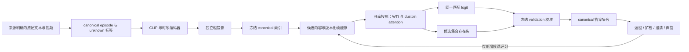

# 新检索系统：接口与数据合同

本页描述 B 阶段代码合同。CPU 回归 324 项通过；正式 ViT-B/32 容量的合成四卡验收首次尝试未通过，修复已完成 CPU 验证，待人工处理归档异常和授权新 run 复验，见[事故报告](../../experiments/contextual-risk-v2/incidents/2026-10-01-rebuilt-q0-first-attempt-review.md)。真实训练/校准/阈值选择必须另有获批 study、四卡 Stage 0 和 Scheme A 预留；现有失败 study 不因代码实现而恢复授权。test 保持 sealed。

研究实验设计见 [官方标签下的候选存在、检索风险与有限扩检计划](../superpowers/specs/2026-10-01-semantic-retrieval-experiment-design.md)。
2026-10-01 按用户指令将主实验修订为官方标签自动构造，人工语义审核改为可选扩展。下文首先描述当前 B 代码；新增标签范围合同见单独的待实现小节。正式协议、适配器与四卡资格尚未完成。

## 端到端链路



监督标签只进入 objective 和评测。在线 `RetrievalService.retrieve(QueryInputs, budget=...)` 接收单个 query，不接收 relevance、存在真值或冲突标志。扩检保留已评分 pair，并重算整个 canonical 集合的存在 logit。预算耗尽不表示全库无答案。

## 显式配置

`SystemConfig` 包含 `runtime/model/train/policy/data/deployment`，JSON 拒绝未知字段。

- `runtime`：Scheme A study/registry/run 路径、run ID、manifest SHA-256、source Git SHA、eval split。
- `model`：`clip` 的全部容量与显式 `fixture` 标志、本地 `clip_weights/clip_sha256`、`dim/num_layers/num_heads/max_frames/coarse_dim`，及默认关闭的 `grouping/alignment`。生产 CLIP 只支持已迁移的 ViT-B/32 容量；小容量仅测试。
- `train`：学习率、weight decay、seed、scheduler 名与步数、trainable prefixes、`checkpoint_interval`，以及 `coarse/match/pair/exist/align/group` 六个显式权重。CLI 的有限训练循环以 `scheduler_steps` 为循环次数，每次消费预留 episode batch；全 unknown 批次不增加 optimizer step。不包含数据挖掘或隐式采样配置。
- `policy`：冻结的 pair/presence 阈值、严格递增 `k_sequence`、`max_budget`。
- `data`：`episode_manifest/episode_sha256/gallery_version/split`。
- `deployment`：训练时为 null；校准/评估显式提供 checkpoint 路径、文件 SHA、训练配置 SHA、gallery manifest 路径/SHA、calibration split SHA，以及 `mode=calibrate/evaluate`。evaluate 必须另提供校准文件路径/SHA；calibrate 的校准输入为 null。
- `resume`：正常启动为 null；断点续训显式提供旧 checkpoint、sidecar 和审核报告身份，字段见下节。仅用于训练，不用于部署或 P1 分支初始化。

`effective_manifest_config` 将这些实际消费的字段映射到 manifest 的 model/loss/optimizer/scheduler/evaluation；额外输入必须列在 input_checkpoints/dataset_splits，不能仅在 JSON 写一个路径。

训练配置 digest 包含 model/train/policy/data/deployment，排除 run runtime identity、恢复来源和保存间隔；这些执行字段仍绑定在 manifest 中。新 checkpoint 保存模型、optimizer、scheduler 与逐 rank RNG，超过 1 MiB 的张量外置到 run-local NPY 引用，读取逐项验 hash 并核对 schema、配置与文件/模型哈希。部署可通过 model-only loader 读取任意训练 world size；训练恢复仍要求 world size 一致。

入口为 `scripts/train_semantic_retrieval.py` 与 `scripts/evaluate_semantic_retrieval.py`，只接受 `--config` 和可核对的 `--run-id/--manifest-sha256/--source-sha`，无任意输出目录。帮助可在 CPU 环境查看；普通调用仍执行完整归档启动保护。

## 训练断点与续训

训练入口已接通定期和最终 checkpoint。`train.checkpoint_interval` 为正整数，默认每 20 次循环保存；不整除总循环次数时仍保存最终断点。文件为 `checkpoints/iteration-XXXXXXXX-step-XXXXXXXX.pt` 及同名 `.json` sidecar，按临时文件写入、fsync、独占发布，sidecar 最后发布；不覆盖已有文件。失败时保留最近的完整断点，不从信号处理器发起可能阻塞的 DDP 保存。

checkpoint v2 增加 `progress.next_iteration` 和最后一批 metrics，与 optimizer step 分开。恢复先校验已绑定的输入/配置/卡数，加载模型及优化器/调度器/各 rank Python、NumPy、Torch、CUDA RNG，再从 next_iteration 执行剩余循环。例如 next_iteration=80、scheduler_steps=240，只再执行160次；全 unknown 批次也不会因为 optimizer step=0 而重复执行。最后一批已完成但报告中断时，可从最终断点只发布新 run 的最终结果，不再做梯度更新。

`resume` 配置字段如下，示意路径/哈希必须替换为实际值；不能直接用该片段启动：

```json
{
  "checkpoint_path": "/absolute/path/to/old-run/checkpoints/iteration-00000080-step-00000080.pt",
  "checkpoint_sha256": "<checkpoint 实际 SHA-256>",
  "metadata_sha256": "<同名 .json 实际 SHA-256>",
  "parent_run_id": "<旧 run ID>",
  "review_report_path": "/absolute/path/to/repository/docs/resume-review.md",
  "review_report_sha256": "<审核报告实际 SHA-256>"
}
```

旧 run 必须先经控制面收束为 failed/cancelled，且 terminal registry 已提交。新 run ID 和目录必须不同，manifest 的 `parent_run_ids` 引用旧 ID；`input_checkpoints` 绑定 `.pt` 和 `.json`，`dataset_splits` 绑定受 Git 跟踪的审核报告。`selection_lineage` 必须有 `kind=training_resume`、`parent_run_id`、`approved=true`、非空 `reason`、仓库相对的 `report_path` 和 `report_sha256`，与 resume 配置一致。程序校验该授权声明与证据，不代替真人审批，不自动创建重试或修改旧运行。

checkpoint v1 仍可由底层训练/model-only loader 加载，但缺少循环位置，CLI 不将其猜成精确续训。当前入口每 rank 消费固定 batch，next_iteration 已覆盖其数据位置；未来 C2 的动态 minibatch/候选调度须扩展相应采样状态，并另做恢复验证。P1→A1–A4 是另设分支的初始化，不能用完整 resume 偷换其优化器/训练阶段。

## Episode JSON

顶层精确字段：`schema_version=1`、`gallery_version`、`preprocessing`、`episodes`。
`preprocessing` 为显式 `max_text_length/max_frames/image_size`。

每个 episode 必填：`query_id/query_text/gallery_version/candidate_ids/canonical_ids/relevance/answer_in_candidates/answer_in_gallery/annotation_provenance/split/video_paths/content_sha256/frame_counts/source_ids/caption_group_id`；可选 `query_conditioned_group_labels`。

candidate 对齐数组等长；video_paths 相对 manifest 解析，内容哈希在加载与 collate 时复核。relevance 用 `positive/negative/unknown`，存在标签用 `yes/no/unknown`；张量 unknown 为 -1。同 canonical 的可靠正负矛盾、不同内容或不同帧数拒绝；known 与 unknown alias 合并保留 known。候选存在必须与 pair 监督一致；从候选中删去 GT 不会自动得到全库 no。

provenance 必须声明非空 `source`、SHA-256 与布尔 `reviewed`，known 标注只接受 reviewed。全库 no 另需 `gallery_audit` 中的正确 gallery_version、scope=complete、reviewed=true 和 source。审核来源字段是数据提供方的声明，loader 不能替代人工审查。

`audit_episode_splits` 分别拒绝 canonical、same-source、caption group 跨 split 泄漏。数据 adapter 必须对联合 split 执行该审核；单文件加载不自动发现其他文件的泄漏。

## 官方标签实验合同修订（待实现）

[C1 计划](../superpowers/plans/2026-10-01-semantic-pilot-c1-data-audit.md)拟新增 Episode v2，明确 `relevance_space=benchmark_annotation` 与官方协议、annotation、关系/ID 映射及来源报告 SHA。官方 caption-video 关系直接提供训练与评价真值，不需逐条人工确认；非配对关系只在该 benchmark 范围下记负例，不代表语义不相关。缺失/异常关系不能转为负例。

候选存在事件为“当前 canonical 候选含至少一个标注正例”。自然查询的标注正例在所属库内；离线受控移除正例只得到候选缺失，不得到真实语义全库无答案。同视频多个 caption 是多个查询，不是跨视频多答案。官方 video ID 排序与 canonical 集合/预算分别评价，alias 不制造额外正例。

v2 不通过填写 `reviewed=true` 兼容 v1；当前 v1 的 known/全库 no 审核要求继续有效。标签空间和协议身份须贯穿配置、checkpoint、校准与指标，不允许 benchmark 状态与未来 `reviewed_semantic` 状态混用。查询来源组件也须纳入跨分区审计。跨库校准还需显式 fit/target gallery 身份，自然/受控候选分布分别绑定。

以上是设计要求，当前 loader、配置和校准代码尚未实现该分支；不能直接将官方标签交给 v1 入口运行。主实验不包含真实语义无答案率或跨视频语义多正例成功声明，相关人工审核另立可选协议。

## Gallery JSON

库由独立原始 manifest 声明，绝不从 episode GT 推导覆盖范围。顶层精确字段：`schema_version=1/gallery_version/preprocessing/videos`。
每行视频精确字段：`canonical_id/alias_id/video_path/content_sha256/frame_count`。alias 去重在 top-K 前完成；内容身份冲突拒绝。空库合法；坏视频不是语义 no-answer。

校准/评测前核对 episode 和 gallery 的重叠 canonical 内容 SHA 及帧数。预处理身份由容量和实际 video/tokenizer/BPE 实现哈希生成，不随无关控制面提交变化。索引/缓存绑定 model SHA、gallery version 与 preprocessing SHA，缓存保存完整逐帧表示、pooled 表示和 mask。数值数组使用 run-local NPY 引用，读取逐项验 hash；训练解冻路径不读取冻结缓存。

## 校准、评测与扩展

温度为正的 temperature+bias sigmoid 只在 `val_calibration` 拟合，unknown 排除，单类拒绝。pair 和 presence 分开校准，不隐式选择动作阈值。校准身份绑定模型、预处理、库、候选 policy 与校准 split SHA。

评测输出 coverage、误接受、误弃答、set precision/recall、初始 miss 扩检找回、abstain/clarify 比例和预算，各率带分子/分母；不完整标签显式计数，无分母时为 null。

语义等价预测消费 query-conditioned pair feature，训练需要独立等价标注 provenance；推理需要冻结的 validation 报告/hash 与阈值。complete-link 不沿非传递链过度合并；等价预测不构成冲突或存在标签。默认 canonical-only，不自动澄清。

OT 使用双侧 dustbin 的平衡增广 log-Sinkhorn，明确 epsilon/dustbin cost/max iterations/tolerance/warm-up；不收敛报错。teacher detach，仅可靠正例做弱对齐，负例由 pair/existence 监督。默认 alignment=null、align/group 权重为 0。两个扩展均未获得真实数据上的效果结论或生产启用授权。
