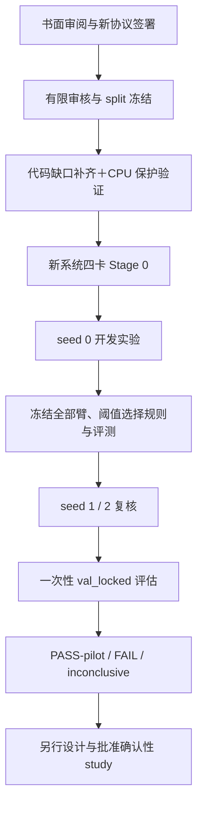

# 重建检索系统实验计划：多答案、候选存在与有限扩检

日期：2026-10-01。状态：**设计已通过用户审阅（含指标、可视化、消融与敏感性补充）；未预注册、未预留 run、未启动实验。**

本轮交付是研究实验设计，不是代码实施计划。用户已授权设置有限人工审核预算，并于本会话批准本设计；下文的审核量、训练量和成功判据已作为设计接受，正式 study 签署前的修订必须说明理由并审阅，看到相应结果后不得追改。实施准备分为 C1 数据/审核、C2 训练/实验臂、C3 校准/分析、C4 四卡资格/运行；首个详细计划见 [C1 实施计划](../plans/2026-10-01-semantic-pilot-c1-data-audit.md)。

## 1. 目的、证据与范围

验证两个假设：H1，内容身份去重与显式多正例训练能稳定处理多个有效答案；H2，候选存在监督与匹配共享连续表征，能在保留答案覆盖的同时减少误接受，并指导漏召回后的扩检。

前置阅读已核对：[研究入口](../../../research/README.md)、[north star](../../../research/00-north-star.md)、[证据账本](../../../research/01-evidence-ledger.md)、[死路](../../../research/02-dead-ends.md)、[常设协议](../../../research/07-protocol-constraints.md)、Contextual Risk 的 study/registry，以及 OQ1 停止结论。旧 north star 是历史未验证命题，本方案不把它升级为结论。

- E-31/E-32：旧 A3 未超过强标量基线。因此 top-score、margin、entropy/energy 必须纳入；不能仅与弱模型比较。
- E-52：旧 SAP 监督曾因冻结成为 NO-OP。因此每项损失必须核对实际梯度、参数更新和部署分数变化。
- E-89b/E-90：低精度并列曾改变分母。因此科学评分采用 FP32、canonical ID 确定并列次序、每查询唯一分母。
- 不重启 SAP、A2-CG 或旧 A3 study；不继承其 checkpoint、冻结检索矩阵或成功阈值。标量/独立头在这里仅作新任务的必要对照。

实现依据为 [系统合同](../../agent/semantic-retrieval-system.md)、[架构设计](2026-10-01-uatvr-audit-cleanup-and-semantic-retrieval-design.md)和 [B 阶段验证报告](../../maintenance/2026-10-01-retrieval-rebuild-b-verification.md)。302 项合成 CPU 测试是软件证据，不是方法效果或四卡资格证据。

首轮只做 MSRVTT 非 sealed 的训练来源、文本到视频、有限声明库。扩散/flow、ANN、视频到文本、自动澄清、CRF 偏移保证和外部方法完整复现均不属于 v1。Holmes 与 GeoFlowVLM 是设计来源，不将不同任务论文表格作为本研究的同条件基线。

## 2. 路线选择与研究层级

| 路线 | 优点 | 限制 | 决定 |
|---|---|---|---|
| 有限声明库，逐查询穷举审核 | 多答案与无答案真值可核验，审核成本可封顶 | 规模小，不能代表大库或开放世界 | **v1 首选** |
| 大库 top-K pooled 审核 | 接近实际检索，容易扩展 | 池外未知，不能证明全库无答案或完整召回 | 后续探索性验证 |
| 外部开放集/PRVR 数据集迁移 | 可检验外部效度 | 新许可、标签合同、划分与预算均需审查 | 后续独立 study |

v1 是有停止条件的先导研究。其结果可支持或削弱机制，但**任何 v1 结果都不解封 test，也不自动授权确认性研究**。若数据或区间不足，结论必须是 inconclusive。

## 3. 数据来源、划分与审核预算

### 3.1 来源与身份

只从经清单确认不属于 MSRVTT/MSVD sealed test 的训练来源抽取。不得打开 test 视频、caption、标签或从 test 派生的候选来构造 episode。不能确认来源身份的文件不使用。

对 canonical 内容、原始来源、同源片段和 caption group 建连通分量，再以 `SHA256("semantic-answerability-pilot-v1:" + component_id)` 排序，按组件数 70%/10%/10%/10% 划分 train、val_development、val_calibration、val_locked；取整余量归 train。组件跨分区零交集。清单冻结在查看新模型结果之前，且记录源文件 SHA、选择算法、排除名单、许可与来源。

各分区从自己的组件中确定一个 **32 个 canonical 视频的声明库 G**；四个库之间内容及来源不重叠。查询可以来自该分区其他来源，查询来源是否在 G 内不决定它在 G 中有没有语义答案。视频覆盖 8 个预先登记的主题，每主题 4 个；主题由人工内容描述确定，不按新模型得分选择。每分区可审查的库候选上限 64 个视频，按哈希次序选取满足主题与可解码要求的前 32 个，不因模型表现换库。

同库条件下进行候选复制、顺序打乱和漏召回干预。所有效应仅解释为对该声明库条件成立，不推广到随机新库。

### 3.2 有限审核配额

| 分区 | 单答案查询 | 多答案查询 | 库无答案查询 | 合计 |
|---|---:|---:|---:|---:|
| train | 48 | 40 | 40 | 128 |
| val_development | 20 | 20 | 24 | 64 |
| val_calibration | 32 | 32 | 32 | 96 |
| val_locked | 96 | 96 | 96 | 288 |
| 合计 | 196 | 188 | 192 | **576** |

每查询对所在 G 的 32 个视频全部审核，理论为 18,432 个 query-video 关系；双人独立审核为 36,864 次判断。预算上限为 **40,000 次关系判断和 192 人时，先到者停止**。库视频观看、查询筛选、仲裁都计入人时；第三人仲裁也计入关系判断。相同判断的追加仲裁不会扩充样本量。

每分区最多筛查目标查询数的 2 倍，候选查询按来源分层、哈希次序提出；禁止按模型错误挑题。每类每来源视频最多 1 个查询，同源 caption 全部保持同一分区。锁定评估要求至少 200 个独立来源组件、各类至少 80 个；达不到配额或组件门槛，在科学训练前停止并记录数据不足，不拿重复 caption 凑数。

查询类别是全库审核后的结果，未满足类别配额的关系记录仍保留，但不得通过改写文本或标签强行补齐。预算不足时交付标签与审核报告，停止 v1，不自动增加审核额度。实际耗时由审核记录得到，本设计不把 192 人时当成保证足够的预测。

### 3.3 标注规范

- relevance 为 positive/negative/unknown；标注依据是查询全部明确语义要求，而非原始 video ID 是否相同。
- 两名审核者独立看完整查询与视频，不看模型得分。分歧由第三人仲裁；未解决保持 unknown。
- 多答案要求至少 2 个不同 canonical 视频为正例；alias 不算第二个答案。
- 声明库无答案要求 32 项全为可靠 negative，完整审核的 source、reviewed、scope=complete、gallery_version 和 SHA 均归档。
- 有 unknown 的查询不能进入需要全库完整真值的主指标；不将 unknown 改为负例。已发生的审核成本仍计入上限。
- 报告原始一致率、positive/negative 混淆表、仲裁率和 unknown 比例；原始一致率低于 85% 时，停止并修订下一版本标注规范，不在本版结果中补救。
- 本版不新增“等价/冲突”关系审核，避免 relevance 被偷换成答案等价。语义分组与 OT 均关闭。

原始 labels、来源证据、完整库清单及每一步审核记录只读归档。审核完成后再推导 answer_in_candidates；在线服务不接收任何真值字段。

## 4. Episode 与候选控制

训练和校准各查询生成 K=4、8、16、32 的前缀候选，共用全部 G 的已审核关系。训练前缀由本地预训练 CLIP 的确定性 pooled cosine 排序生成并冻结；不是由新模型反复重挖。K 采用按步轮转的等频序列，canonical 去重在 top-K 前执行。

基础评估分两轨：

1. **固定集合机制轨**：所有臂消费相同预训练 CLIP 候选前缀，以隔离存在/排序效应。固定 K=32 是主比较，K=4/8/16 和扩检是辅助比较。
2. **完整系统轨**：每臂用最终冻结模型重建自己的粗索引与帧缓存。区别可能来自粗检索，单独报告；不将它归因于存在头。

对有答案查询，从共享排序中移去全部已审核正例再接到尾部，得到受控初始 miss：K=4 内无答案，K=32 内有答案。只在离线构造过程读标签，线上仅读取候选 ID/特征。自然 miss 另报，不能与受控 miss 混算。32 项完整评分是扩检恢复的预算上限对照，不拿更少预算的基线制造优势。

复制压力使用每个候选 1/2/4/8 个 alias，置换使用固定种子 0/1/2/3/4；候选、分数并列顺序由 canonical ID 决定。变换沿用原 query_id 的 lineage，不增加独立统计样本。

## 5. 模型、监督与训练预算

所有臂使用同一经 SHA 验证的本地 CLIP ViT-B/32、224×224 图像、均匀 8 帧、文本长度 32、512 维共享空间、256 维粗投影。首版 `num_layers=0`，即有效帧均值，无可训练时序 Transformer；`num_heads=8` 保持显式合同。CLIP 全程冻结，解冻编码器留给后续 study。

优化器 AdamW，lr=1e-4，weight_decay=0.01，constant scheduler，全局 batch=16 queries，四 rank 各 4 个不同 query。按 train 组件固定种子洗牌，循环取样；每批各 rank 的 query_id 不重叠。初始化 seed 必须在构造新模块前设定，训练采样 RNG 独立存证。

每臂总路径 240 optimizer updates；分支共享 120 步匹配预训练，再各训练 120 步。K 四档等频，候选由原始内容编码；冻结 CLIP 也不使用旧实验缓存。只使用最后一个 checkpoint，不按 val 选 epoch；120 步父 checkpoint 仅用于规定的分支。所有正负/存在损失均屏蔽 unknown。

损失向量顺序为 `(coarse, match, pair, exist, align, group)`：

| 身份 | 训练设计与权重 | 推理/比较用途 |
|---|---|---|
| A0 | 240 步校准 WTI，(1,1,1,0,0,0)；attention/MLP 残差禁用 | 低容量匹配基线 |
| P1 | 120 步完整 PairMatcher，(1,1,1,0,0,0) | 同 seed 的共同父 checkpoint，不独立选优 |
| A1 | 从 P1 继续匹配 120 步，(1,1,1,0,0,0) | 同匹配容量、无存在监督；pair 阈值/标量策略 |
| A2 | 从 P1 训练 120 步，(1,1,1,1,0,0)；存在头输入 h/logit 全部 detach，匹配分支照常训练 | 独立存在监督，隔离存在梯度进入 matcher 的贡献 |
| A3 | 从 P1 联合训练 coarse/matcher/存在头 120 步，(1,1,1,1,0,0) | 主方法；匹配与存在共用未 detach 表征 |
| A4 | 从 P1 训练 120 步，(1,1,1,1,0,0)；score-only MLP 输入 detach，匹配分支照常训练 | 检验 pair 表征是否超出分数几何 |
| P5 | 与 P1 相同初始化，单正例损失视图预训练 120 步，(1,1,1,0,0,0) | A5 父 checkpoint，不作选优候选 |
| A5 | 从 P5 联合训练 120 步，(1,1,1,1,0,0)；沿用单正例损失视图 | 同结构/同预算，隔离多正例监督贡献 |

A2/A3 的存在头复制同一随机初始化，A1/A2/A3/A4 起始匹配权重逐张量一致。A4 输入预先固定为 top1、top2、margin、mean、population std、normalized entropy、logsumexp energy、log(1+K) 八维特征；entropy/energy 的 temperature 固定为 1，熵除以 log K。仅能看当前候选分数。两层隐藏 MLP 宽度均为 2880，Linear 后接 GELU，输出一个 logit；含 bias 的参数量为 8,326,081。512 维模型的 A3 存在头为 8,413,201 参数，差约 1.04%，均计入有效容量与预算。参数量在注册前用实际代码再核对，失配则停止，不能以效果选择宽度。

P5/A5 的单正例损失视图：每查询在当前监督集合的可靠正例中保留 canonical ID 最小者，其余正例只在 coarse/match/pair 的损失视图中置为 unknown，绝不置为 negative。候选内容、原始审核标签、存在真值和评测真值均保持完整；存在头照常接受完整匹配表征。粗检索全局关系与局部关系各自按此确定性规则产生损失视图，记录选择结果。A3/A5 的架构、初始化、步数、存在损失和返回集合规则相同，只有匹配损失的正例监督不同。

A0 是组件基线，不用它单独支撑容量公平的创新结论；A1 是匹配容量对照，A2 是存在头部署容量对照，A4 是分数信息/参数容量对照。240 updates 不是等 FLOPs 的承诺：记录每臂前向、反向、优化时间、可训练参数量与 GPU 小时；A2/A4 不得超过 A3 的总训练预算。

固定 seeds=0/1/2。每 seed 有 A0、P1、A1、A2、A3、A4、P5、A5 共 8 个训练 run，**最多 24 个科学训练 run**。seed 0 只查看 development；只有数据、数值及梯度门通过才执行另两个 seed，不按 seed 0 的收益删选实验臂。任何臂失败保留原记录，不换超参重试。

单 run 最长 2 小时占用四卡，科学训练总上限 192 GPU 小时，Stage 0 上限 8 GPU 小时，校准/推理上限 24 GPU 小时，总上限 **224 GPU 小时**。上限不是预计耗时；不足以完成固定更新则停止、记 cancelled，不以减少训练步数继续同一协议。所有 GPU 操作先经 Stage 0。

## 6. 强基线、校准与阈值冻结

在 A1 最终匹配分数上比较 top-score、top1-top2 margin、负 entropy、energy，以及直接校准 pair 阈值的集合返回。前四种只判断是否接受，返回同一 pair 阈值筛选的集合；另报其 top-1 返回版本。存在头臂同样保留 pair 支持阈值，避免“存在即随便返回”。不重新实现旧 A3 架构。

为了避免校准文件与 policy 身份循环依赖：

1. 在 development 上，以未校准 `sigmoid(logit)` 的 0/0.05/…/1 网格选择 pair 和 presence/标量接受阈值；基线的非 logit 标量使用 development 的同一 21 档分位点。raw 阈值先冻结。
2. 每臂只在 calibration 上拟合 temperature+bias。pair 每个 query-video 使用一次；存在/score-only 臂的 presence 使用每查询四个固定 K 前缀、等权重。A0/A1 的 pair-only 策略不拟合未训练的存在输出。候选来源和四 K 混合分布写入 provenance。
3. 用拟合变换将 raw logit 阈值单调映射为部署概率阈值，使动作与 raw 阈值规则相同；标量阈值保持原单位。绑定最终 policy/model/gallery/preprocessing/split SHA 后发布校准状态，不再调阈值。

temperature 校准只优化 NLL，不是风险保证。每分区使用其独立 gallery_version；针对 locked 库的校准只允许使用 calibration 查询对该库的关系将违反查询/视频分区，本版**禁止这样做**。因此从 calibration 库迁移的温度只能作为显式跨库校准迁移实验；必须由新校准 schema 记录 fit_gallery_version 与 target_gallery_version，不能伪装为同库拟合。跨库概率的 Brier/ECE 单独报告，动作保持冻结 raw 阈值规则。

development 阈值选择约束：有答案 return coverage≥0.50、无答案 false_accept≤0.10、返回集合 micro precision≥0.90，均为 development 点估计。可行候选中最大化有答案 macro set recall，再依次以更少候选评分、更少返回项、更高 pair 阈值、更高接受阈值打破并列。无可行点则该臂标记 development-infeasible，不用全部弃答当成功。

strongest scalar 只在 development 按同一规则选定，其身份在 locked 前冻结；locked 报告所有标量结果，不事后换主比较对象。固定 K=32 的主比较不受 adaptive K 差异影响。不同 coverage 时不宣称“相同覆盖率改善”，完整曲线仅作描述。

## 7. 指标与明确分母

令 S 为实际返回 canonical 集合，R 为 G 中全体审核正例。return 才计为返回；abstain 时 S=空。澄清默认禁用，v1 clarify_rate 应为 0。

| 指标 | 定义/分母 |
|---|---|
| no-answer false accept | R=空的查询中 action=return 的比例 |
| answer return coverage | R 非空查询中 action=return 的比例，不因返回错误而移除该查询 |
| wrong return | 返回非空但 S∩R=空的查询比例；分别报告库有/无答案 |
| false abstain | R 非空查询中 action=abstain 的比例 |
| micro set precision | 正确返回项总数 / 返回项总数；包含无答案查询上的错误返回 |
| macro set recall | 对 R 非空查询平均“返回正例数 / 全库正例数”，弃答计 0 |
| Recall@1/5/10 | R 非空查询中前 K 至少包含一个正例；另报完整正例召回 |
| MRR | R 非空查询的第一个正例 rank 倒数的平均值，rank 从 1 开始 |
| mAP | R 非空查询的 AP 平均值；AP 对全部 32 项排序，正例位置的 Precision@rank 之和除以全库正例数 |
| nDCG@10 | binary relevance 的 DCG/IDCG；discount=1/log2(rank+1)，每查询按完整正例数形成理想排序 |
| macro set F1 | R 非空查询的集合 F1 平均值；弃答记 0，不用 F1 替代 precision/coverage gate |
| expansion recovery | 初始 miss 且 G 有答案的查询中，最终 return 且 S∩R 非空的比例 |
| presence/pair 概率质量 | NLL、Brier、10 个固定等宽 bin 的 ECE、presence AUROC；单类为 null |
| 无答案检测 AP | 固定 K=32 时以库无答案为正类、1-presence probability 为分数计算 average precision；附正类比例，不混用梯形 PR-AUC |
| 成本 | 每查询唯一 pair 评分数、轮数、p50/p95 延迟、缓存/索引建立成本和训练 GPU 小时 |

每项提供 numerator/denominator 或 per-query 汇总引用，零分母为 null。现有 `evaluate_episodes` 的 set recall 是汇总计数口径，不能改名成 macro recall；后续报告同时保留 micro 原指标和新增 macro 指标。每类分别报告，不以平衡构造比例冒充自然部署分布。

### 7.1 排序与选择风险的区别

MRR/mAP/nDCG 使用固定 K=32 机制轨的完整排序，即使策略弃答也保留原排名。这能区分“排序更好了”和“只把难查询拒绝了”。多正例下 R@K 只要求找出任意一个答案，mAP/nDCG 和集合 recall 更能反映多个答案是否都得到支持。32 项库的 R@10 可能较易饱和，所有数字必须同时标明库规模，不直接与 1K-A 论文表比较。

补充 top-1 risk–coverage 曲线及 AURC：错误事件为全排序 top-1 不属于完整 R，无答案查询的 top-1 必然错误。每查询产生潜在 top-1，不先按最终 return 筛掉困难查询。A3 的诊断 confidence 固定为 min(校准后的 top-1 pair probability, candidate presence probability)；A2/A4 对应同规则，pair-only 使用 top-1 pair probability，标量基线使用已冻结方向的标量。存在概率不是 top-1 正确率，不把这个 confidence 称作已校准 failure probability。

相同 confidence 的查询整组接受，以各组新增 coverage 乘该组端点累计错误率求和形成 AURC；coverage=0 的 risk 为 null。报告全部平衡查询与仅有答案查询两套曲线，并固定混合权重。曲线用于描述，不替换 8.1 的主终态判据，不从 locked 曲线上选新 operating point。

### 7.2 固定可视化交付

以下图均由真实归档数据生成，导出 SVG/PDF 与用于作图的哈希引用；未运行前不绘制模拟结果图。误差带基于原始来源组件的 paired bootstrap，seed 点单独显示。

| 图 | 坐标/内容 | 回答的问题 |
|---|---|---|
| 风险—覆盖率 | coverage 对 top-1 error risk，附 AURC；全部/有答案分面 | 低风险是否只是大量拒答造成 |
| 无答案误接受—有答案覆盖率 | 固定 pair 阈值，按 development 冻结的接受阈值网格描点；标出正式工作点 | 减少误接受时保留了多少有答案查询 |
| 返回集合 precision—recall | 按预设 pair 阈值网格，存在阈值固定；单/多答案分面 | 多返回答案是否只是牺牲精度 |
| Reliability diagram | pair/presence 各自 before/after，10 个固定等宽 bin，附样本数/Brier/NLL | 概率与事件频率是否一致，跨库迁移是否失准 |
| 消融效应图 | A0–A5 的主指标与 paired 差值 CI，独立标出 scalar baseline | 哪个监督、信息或梯度路径产生收益 |
| 候选数与预算曲线 | K=4/8/16/32 对 recall、误接受、presence Brier、pair 评分数与延迟 | 方法是否依赖特定 K，扩检收益是否值得成本 |
| 复制与置换压力图 | alias 倍数对 action/答案变更率与最大 logit 差，附置换结果 | canonical 去重和集合聚合是否稳定 |
| 训练/梯度诊断 | 各 loss、实际监督计数、matcher/存在头梯度范数；共享投影上 match 与 exist 梯度 cosine | 是否存在断链、塌缩或梯度冲突 |
| 案例链路 | 查询、32 项中的代表帧、GT、pair/presence、候选前缀与最终动作 | 模型为什么返回、扩检或弃答 |

raw alias 归一化 entropy 可另作离线重复敏感性示例，但它不属于去重后生产基线，不用于制造主比较优势。热力图展示 token-frame cosine/attention/dustbin，不能仅因热力图直观就声称时序定位或因果解释正确。

### 7.3 敏感性与分层分析

| 项目 | 固定取值/分层 | v1 地位 |
|---|---|---|
| 候选 K | 4/8/16/32 | 必做，复用完整评分，不追加训练 |
| 扩检最大预算 | 4/8/16/32 个唯一候选；只允许对应 K 序列前缀 | 必做，与静态同预算评分并列 |
| 接受阈值 | development 已冻结的 21 档网格；pair 固定扫描 presence，presence 固定扫描 pair | 必做；locked 只展示预先登记曲线，不选阈值 |
| alias/候选置换 | alias=1/2/4/8，置换 seed=0/1/2/3/4 | 必做；变换不增加独立样本 |
| 正例数量 | 1、2–3、≥4 | 必做分层，辨别“答案越多越易弃答” |
| 文本长度 | 有效 token 数 1–8、9–16、17–32 | 必做分层，不重新截断或编码文本 |
| episode 难度 | 单/多答案、库无答案、自然 miss、受控 miss，分别报告 | 必做，不混合成一个成功率 |
| seed | 0/1/2，每 seed 及汇总 CI | 必做；区分训练散布与查询抽样误差 |
| 存在损失权重 | 建议后续固定网格 0/0.25/0.5/1/2 | 需追加训练及单独批准预算；v1 只做 0 与 1 的核心消融 |
| 帧数/时序容量/编码器解冻 | 后续可分别研究 4/8/16 帧、0/1/2 层、冻结/部分解冻 | 不在 v1；需合法新配置、缓存身份、校准及训练对照 |
| 库规模/语义分组/OT | 更大或多个独立库、等价监督、对齐辅助项 | 后续独立研究；v1 不能据此声称普适稳定 |

阈值曲线的作图操作也必须提前绑定命令和网格；不能看到 locked 后才决定新增扫描。任何分层独立来源数<30 时仅展示计数和描述，不做可靠子群差异结论。锁定库只有一个，库规模泛化不是把 K 改小就能证明的。

### 7.4 失败案例与机制分析

预设四类案例：多答案被错误拒绝；全负候选被高分错误接受；扩检成功/耗尽仍失败；存在与 pair 支持矛盾。每类按 query_id 哈希次序选前 3 个案例，类别不足则全部展示，不仅挑有利示例。每例附真值审核来源，并区分事实与解释。

共享梯度诊断在每 20 个 optimizer step 采样一次，用同 batch 的各 loss 分别求梯度，不执行额外 optimizer update；A2/A4 存在损失到 matcher 的梯度应为零，A3 应有实际路径。gradient cosine 为负说明局部冲突，不自动说明方法无效；dustbin 权重、logit 分布和 BCE 学习曲线只能诊断，不能代替主指标。

所有作图、分层、梯度记录和固定网格分析纳入原 run/评估 phase 的 manifest 与原 224 GPU 小时总上限，其中推理/作图数值计算仍在 24 GPU 小时评估额度内；不暗中追加训练或 GPU 资格以外的科学运行。数据不足或预算耗尽时记录缺失原因，不能以删图掩盖失败。新增分析代码仍需第 9 节的实施与验证。

## 8. 统计、机制与结论规则

主比较固定 K=32，确认锁定之前不读取 val_locked 模型输出。先完成三个 seed 的开发门、所有模型/阈值/代码冻结，再统一一次性运行 locked。

### 8.1 预设效应与对照

- **H1-pilot**：A3 对 A5 的多答案 macro recall 提高至少 5 个百分点；micro precision 下降不超过 3 个百分点，answer coverage 下降不超过 5 个百分点。A3 对 A1 及同分数 top-1 返回另外报告，以分开存在监督与集合返回收益。这不是语义等价预测有效的证据。
- **H2-pilot**：A3 对 development 选定的 strongest scalar，以及 A1 pair-only 策略，无答案误接受均下降至少 5 个百分点；answer coverage 均下降不超过 5 个百分点。固定 K=32 的候选预算相同。
- **共享机制**：A3 对 A2 的无答案误接受下降至少 3 个百分点，并满足相同 coverage 限制；对 A4 至少报告差值与区间。仅胜过 scalar、未胜过 A2/A4 时，不宣称共享语义表征提供了额外信息。
- **扩检辅助**：受控 miss 的最终找回率比不扩检提高至少 10 个百分点，并与静态 K=32 的相同预算结果并列；自然 miss 分母不足 30 时只描述，不判定。
- canonical alias/置换后答案 ID、action、attempted K 应一致，分数允许 FP32 绝对误差≤1e-6。任何违反都是软件缺陷，不是研究负结果，停止后进入新修复 phase。

以上效应阈值是研究价值标准，不是从现有数字推得的预计收益。

### 8.2 区间与多重比较

每 seed 单独报告，再以三个 seed 的每查询结果平均计算主差值。10,000 次、seed=20261001 的 paired cluster bootstrap，以原始来源连通组件为单位共同重采样所有臂；复制/置换/受控 miss 与原查询同簇。查询采样 CI 与训练 seed 散布分开，不能把三个 seed 当作三份独立测试集。

报告 95% paired CI；两项主假设同时通过时，使用各自 97.5% CI 保守控制联合错误率。H1 要求 recall 差值下界>0 且 precision/coverage 差值下界分别≥-0.03/-0.05；H2 要求误接受差值上界<0 且 coverage 差值下界≥-0.05。点估计还必须达到 8.1 的最小效应。多项辅助比较只报告区间，不作为替代成功路径。

区间条件只适用于固定四个小库下的查询来源抽样；本版无跨库总体置信保证，也不提供 distribution-free/selective-risk 保证。locked 各类仅 96 个查询，**不能承诺有能力检出 3–5 个百分点的小差异**。增加 seed 不解决这个问题。

确认性样本量不能照抄先导配额：作为预算量级示例，配对二元差异的 discordant 比例为 0.20、目标差异 0.05、双侧 alpha=0.025、power=0.80 时，正态近似需要约 760 个独立查询；聚类会进一步增加需求。正式下一版用 train/development 的 discordance 与组件大小模拟功效，至少 80% 才冻结新样本量；不得用 locked 反复加样本直至显著。

### 8.3 三种终态

- `PASS-pilot`：数据、资格、梯度及稳定性门均过，H1/H2 均满足点估计和区间规则。允许提交下一版研究提案；不授权继续 worker 或 test。
- `FAIL`：数据合格且结果区间明确落在不满足实用阈值的一侧，或明显检索/coverage 退化；保留负结果，不换 loss 名称续跑。
- `inconclusive`：预算/审核数量/独立来源不足，或区间不足以满足 8.2 且不能明确判失败，某些强基线无可行 operating point，或模型未稳定训练。不能写“验证了创新”。判定顺序先检查 PASS-pilot，再检查 FAIL，其余 inconclusive，避免部分重叠。

若只 H1 或 H2 通过，逐项记录 supported/not-supported，不用部分通过替代整项 `PASS-pilot`。机制结论要求 A2 对照及分数信息对照一致支持，bootstrap 显著不替代因果消融。

## 9. 软件与资格前置条件

以下是代码核对发现的真实缺口，当前 CLI 不能直接执行本方案：

1. `train_semantic_retrieval.py` 当前加载全部 episode 后重复同一个 batch；需实现固定种子 batch schedule、rank 不交叠分片和 step/K 轮转，绑定其配置及输入哈希。拒绝四 rank 重复 query；验证 epoch/step 的覆盖与可恢复 RNG。
2. A0 的 WTI-only 模式、A2 的存在输入 detach 和 A4 score-only 头未有配置合同；需新增明确模式、严格 schema、容量审计，禁止靠临时 monkeypatch。
   A5 还需完整审核标签与单正例损失视图分离，验证舍弃的正例不变负例、存在真值及在线特征不变。
3. P1 派生分支需要 model-only 初始化与“新 optimizer/new run”合同，区别于同 world-size 的训练恢复；记录父 checkpoint SHA。不能误把新分支当成原 run 续训。
4. 校准身份目前仅一个 gallery_version，不能合法表达分区独立库之间迁移；需独立 fit/target 身份与有效性声明，以及 pair-only/双通道/标量策略合同。保留严格加载，不能直接改 metadata 欺骗验证器。
5. 需新增 scalar-policy adapter、raw 阈值冻结/单调映射、macro recall/wrong return、MRR/mAP/nDCG/集合 F1、risk–coverage/AURC、分层绘图、按 query 来源聚类 CI、受控 miss 与标签完整度报告。固定集合轨需读取预先归档的候选前缀，完整系统轨才用各自索引；候选构造器与线上服务分离，线上接口始终无标签输入。
6. 本地生产 B/32 权重、非 test 输入清单、解码完整性和审核工具需真实检查；当前仅确认代码合同，不保证这些资产已经齐全。
7. 新系统四卡 FP32 Stage 0 要实测 rank 身份、梯度/参数更新、全局已知标签计数、未知 batch、checkpoint/RNG、恢复/取消、hash tamper 拒绝与跨 rank 参数一致性。CPU qualification 和旧研究 Stage 0 均不能替代。

单独反传 coarse/match/pair/exist，核对允许参数有有限梯度、冻结 CLIP 零更新、存在损失确实改变共享 matcher；A2 单独 exist 反传和 step 必须证明匹配张量及相同输入的 logit 不变，但联合损失中的 match/pair/coarse 仍可更新 matcher。A2/A4 不能为了实现 detach 同时关闭匹配训练，否则与 A3 混淆训练预算。测试使用合成数据，不能以检查梯度为由提前访问 sealed 数据。

## 10. Phase、预算与归档交付

| Phase | 输入/工作 | gate 与交付 |
|---|---|---|
| D0 | 书面设计审阅、路径契约裁决 | 签署新 study；仍不开 worker |
| D1 | 有限人工审核、身份与 split 审计 | 配额/来源/一致性通过；标签、库和预算报告 |
| E0 | 补齐第 9 节软件并通过 CPU 验证 | 新实现审阅及精确 source SHA |
| Q0 | 四卡资格，最多 8 GPU 小时 | 完整登记资格报告，通过才可科学训练 |
| P1a | seed 0 的 A0/P1/P5，共 3 个训练 run，仅 development | 父 checkpoint 完成、摘要提交、哈希验证 |
| P1b | seed 0 的五个子臂，共 5 个训练 run，仅 development | 无 NaN/身份/梯度错误；四 K 的存在标签合计至少 20 yes、20 no；无类缺失的校准输入 |
| P2a | seed 1/2 的 A0/P1/P5，共 6 个训练 run | 同冻结配置；父 checkpoint 全部终态、完成摘要 |
| P2b | seed 1/2 的五个子臂，共 10 个训练 run | 精确父 SHA 可绑定后才预留；全部终态、完成摘要 |
| C0 | development 阈值、calibration 温度与最终身份冻结 | 所有 operating point 及 strongest scalar 身份写入 Git；锁定代码和命令 |
| V0 | 三 seed 的一次性 val_locked 与压力评估 | 全部模型同时评估，不中途选优；支持/失败/不确定报告 |

若 P1b 任一臂 development 无可行点，仍保留该臂，并将其记为不可行；全部策略都不可行则停止，不打开 locked。P2a/P2b 不因收益筛臂。父/子必须分 phase，不能预留引用尚不存在 checkpoint SHA 的子 run。无授权的基础设施重试不纳入“24 个”中静默追加。

新研究身份设计为 `semantic-answerability-pilot-v1`，独立 frozen protocol 与 registry。**当前 AGENTS.md 的物理路径只允许 contextual-risk-v2，且旧 study 已停止**：设计审阅通过不替代路径契约落地，不能直接在新数据面写输出，也不能把新训练挂成旧 study 的 Stage 2。D0 还需提交 AGENTS.md/归档契约的路径修订和新控制面。未完成则预留拒绝。本设计没有创建这些目录或修改旧协议。

设计采用 `experiments/semantic-answerability-pilot-v1/` 控制面与 `artifacts/semantic-answerability-pilot-v1/<dataset>/<stage>/<run-id>/` 数据面，实际使用仍以 D0 提交后的路径契约为准。每 phase 先 reserve-phase、整批提交 reserved、verify-run、从干净精确 SHA 启动。worker 不改受跟踪文件；终态后再 finalize 并提交摘要。失败/cancelled 不原地重试；审核后的新尝试在后续 phase 用新 run ID 和受跟踪理由连接 parent_run_ids。

数值数组、逐查询记录和 bootstrap 样本均写 run-local 外置 NPY/NPZ，JSON 仅放统计量和哈希引用；超过 1 MiB 必须外置并验证哈希。审核过程的历史记录 append-only，不覆盖已审核决定，仲裁作为新版本关联原判断。

最终报告至少含四张表：数据/标注预算与完整度；各臂固定集合效果与 CI；共享梯度/容量/成本消融；完整系统扩检及复制稳定性。失败 run 单列，不能只报告完成的 seed。旧 ledger 不写入新效果数字；新事实取得证据后才按其写入规则追加。

## 11. 后续确认性研究的进入条件

本版结束后才可另写新协议，且必须满足：新增大库或多个独立声明库、足够独立 query/来源组件、80% 功效审查、审核规模与训练预算获批、强基线和固定覆盖率比较可行、选定配置与明确停止条件冻结。pilot locked 作为已看过的历史数据，不再充当下一版独立确认集。

语义分组需独立等价/冲突审核；OT 需单独的开关消融；解冻 CLIP 需同预算冻结表示对照。三个扩展分别立项，不在 v1 中临时追加。MSVD/DiDeMo 转移与任何 test 解封需要新的明确研究 gate；本版没有预授权路径。

## 12. 设计自检与审阅边界

- 已明确两假设、八个 run 身份、三 seed、分区和候选生成、审核/GPU 上限、阈值规则、概率迁移边界、每项分母、统计单位与终态规则；A2 用存在输入 detach 而非冻结整个 matcher，以隔离梯度路径。
- 已把当前 CLI、模式、校准身份和指标缺口列作启动前硬条件，没有虚构可运行命令、run ID、文件 SHA 或 GPU 资格。
- 新数据面与 AGENTS.md 的冲突必须在 D0 裁决，不能通过本设计草案默默解除。
- 设计审阅已通过；C1 实施计划另行审阅，协议签署、预留和实验启动尚未完成。
