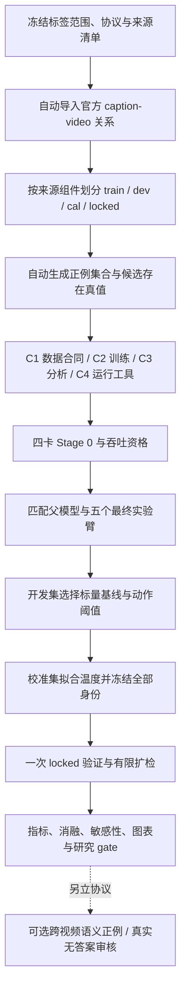

# 重建检索系统实验计划：官方标签下的候选存在、检索风险与有限扩检

状态：2026-10-01 按用户“按这个方向更新设计”修订；仅设计，未建立新 study、预留 run、启动实验或解封 test。

主实验改为官方标签驱动的自动流程。此前获准的有限人工审核移为可选语义扩展，不再是训练、评估或 C1 的入口条件。原 32 视频小库、576 查询语义配额、40,000 次判断/192 人时及 A5 多正例消融不再适用于本版。修订未使用新实验结果；正式协议签署后不得按结果追改。实施分 C1 数据/来源、C2 训练/实验臂、C3 校准/分析、C4 四卡资格/运行，首个详细计划见 [C1 实施计划](../plans/2026-10-01-semantic-pilot-c1-data-audit.md)。

## 1. 目的、证据与结论范围

首轮验证两个限定于 benchmark 标注空间的问题：

- **B-H1：共享存在监督。** 候选存在头与匹配共享连续表征，能否在保留标注正例覆盖的同时，降低候选不含标注正例时的误接受？比较强标量策略、无存在监督、detach 与 score-only 对照。
- **B-H2：检索失败判断。** 能否改善自然检索错误的风险—覆盖率曲线，并在有限预算下指导扩检找回标注正例？风险排序是主检验，扩检是预设辅助检验。

原架构的“跨视频多个语义答案”和“完整语义无答案”仍是待验证假设，本版不检验其完整成立。MSRVTT 同一视频的多条 caption 是多个查询，不是某个文本查询的多个视频正例。标注之外的视频可能语义相关，官方标签实验不能将它们宣称为真实语义负例。

前置阅读：[研究入口](../../../research/README.md)、[north star](../../../research/00-north-star.md)、[证据账本](../../../research/01-evidence-ledger.md)、[死路](../../../research/02-dead-ends.md)、[常设协议](../../../research/07-protocol-constraints.md)，以及 Contextual Risk study/registry 和 OQ1 停止结论。历史命题不升级为结论。

- E-31/E-32：旧 A3 未超过强标量基线；本版保留 top-score、margin、entropy/energy。
- E-52：旧 SAP 监督曾因冻结成为 NO-OP；各 loss 必须核对实际梯度、参数更新和部署分数变化。
- E-89b/E-90：低精度并列曾改变分母；科学评分使用 FP32、确定性并列规则、每查询唯一分母。
- 不重启 SAP、A2-CG 或旧 A3 study，不继承其 checkpoint、检索矩阵或成功结论。

实现依据为 [系统合同](../../agent/semantic-retrieval-system.md)、[架构设计](2026-10-01-uatvr-audit-cleanup-and-semantic-retrieval-design.md)和 [B 阶段验证报告](../../maintenance/2026-10-01-retrieval-rebuild-b-verification.md)。302 项合成 CPU 测试是软件证据，不是方法效果或四卡资格。

首轮只做 MSRVTT train 来源的文本到视频验证。扩散/flow、ANN、视频到文本、自动澄清、分布无关风险保证及外部方法完整复现不属于 v1。Holmes/GeoFlowVLM 是设计来源，其论文表格不能充当同条件基线。

## 2. 端到端流程与自动化边界

输入与协议就绪后，正常 phase 的预留、提交、启动、终态收束及下一 phase 可由 C4 编排，不需要逐视频或逐 seed 人工标注。当前尚未实现该编排，不能声称已可一键运行。来源身份无法证明、资格失败、预算不足、协议变更或 failed/cancelled 重试需要人工处理；不自动调参、补标签或解封 test。

## 3. 数据、标签与划分

### 3.1 标签空间与来源合同

主实验显式声明 `relevance_space=benchmark_annotation`。官方关系定义标注正例集合 `R_b(q)`；非成员仅在该 benchmark 评价约定下记为负例，不称为语义不相关。缺失、格式异常或来源无法证明的关系拒绝导入或保留 unknown，不能直接转 negative。

只使用有可验证 allowlist、来源报告和 SHA 的 MSRVTT **train-only** annotation/video snapshot。身份审计检查来源与文件完整性，不要求逐条确认视频语义。若只能找到含 test 的混合注释文件，先报告缺失训练来源资产，不读取混合文件 caption 后再筛掉 test。本设计不假设真实资产已齐备，也不虚构输入 SHA。

官方 video ID 与 canonical 内容 ID 分开保留。精确内容重复可作为 alias 合并，`R_c(q)` 为 `R_b(q)` 经版本化 ID 映射得到的 canonical 正例集合；不得按语义相似扩充。canonical pair 标签以是否属于 `R_c` 为准，避免同内容 alias 正负矛盾。官方排序指标使用所有官方 video ID 的展开排名，canonical 集合/预算指标使用去重 ID，二者分别标注，不混用。

### 3.2 确定性分区与数量门

用 canonical/source/caption-group 连通组件覆盖全部查询来源与视频，再按 namespace=`semantic-answerability-pilot-v1:` 的组件哈希排序划分。组件不可跨分区，不能只对候选视频查泄漏。

依次向 locked、calibration、development 分配完整组件，直到各自覆盖至少 1,000、500、500 个官方视频 ID；余下组件归 train。held-out 分区按官方 ID 哈希顺序取恰好目标数量组成库，未入库的组件成员仍留在该分区，不回流 train。库成员先于模型输出冻结。组件过大造成数量门不满足时停止，不拆组件或悄悄缩小评估库。

| 分区 | 官方视频库规模 | 首轮查询 | 用途 |
|---|---|---|---|
| train | 剩余完整组件，至少 6,500 个官方 ID | 每视频一条稳定 caption | 优化权重，不选阈值 |
| val_development | 500 个官方 ID | 每视频一条，共 500 条 | 选标量比较对象与动作阈值 |
| val_calibration | 500 个官方 ID | 每视频一条，共 500 条 | 拟合温度/bias |
| val_locked | 1,000 个官方 ID | 每视频一条，共 1,000 条 | 冻结后一次验证 |

caption 取最小稳定官方 caption ID；没有该字段则用预先登记的不可变行 ID，不能按文本或得分挑选。额外 caption 不计入首轮独立样本。每库至少 129 个 canonical ID，以支持 K=128 的 absent 面板；locked 至少 800 个来源组件。输出官方/canonical/query/component 数量、正例数直方图和组件余量。

这是 train 来源的新验证协议，**不是官方 MSRVTT 1K-A test，不能与其 SOTA 表直接比较**。split、库、标签及预处理 hash 必须冻结；test 保持 sealed。

### 3.3 当前 schema 与拟议升级

当前 B 阶段 Episode v1 的 known 标签要求 `reviewed`，全库 no 要求完整语义审核。本版不能把官方非配对关系伪装成人审语义负例，也不能填 `reviewed=true` 绕过该合同。

C1 须新增显式 Episode v2 benchmark 分支，记录标签空间、官方 annotation SHA、关系/ID 映射 SHA、协议身份和查询来源组件。语义审核 v1 合同保持严格。标签空间贯穿配置、训练/部署 checkpoint、校准状态及指标 provenance；不同范围混用须拒绝。benchmark 的 `answer_in_gallery` 只表示库是否含标注正例，本版自然查询均为 yes，不生成“真实语义全库 no”。

## 4. 候选构造与评估轨

GT 仅用于离线构造、loss 和评测。线上 `QueryInputs` 不含 GT、panel 类别或存在真值。canonical 去重在 top-K 前，并列按 canonical ID；展开官方排名后同分按官方 video ID。

### 4.1 自然轨与受控轨

| 轨道 | 自动构造 | 能回答的问题 |
|---|---|---|
| 自然检索 | 固定粗排序的 K 前缀，`y_C=1[R_c∩C≠∅]` | 实际漏召回、错误判断与覆盖 |
| 受控 present | 最靠前 K−1 个非正例，加唯一标注正例；输入按 ID 排序 | 已有标注正例时是否误弃答 |
| 受控 absent | 最靠前 K 个非正例，剔除全部标注正例 | 没有标注正例时是否误接受 |
| 受控 miss 轨迹 | 前 32 项为非正例，正例放第 33 项，后续沿原排序补齐 | 初始 miss 后能否扩检恢复 |

受控轨为同 query 的成对变体，不增加独立查询数，也不代表自然缺失比例。若导入发现多 canonical 正例，先停止并修订单正例构造协议，不暗中只留一个。alias 不增加正例数。present/absent 与自然轨分别报告，不能把 balanced 受控分布的概率当线上先验。

**固定集合机制轨**使用同一 SHA 绑定的预训练 CLIP pooled cosine 排序，固定 K=32 为 B-H1 主比较；扩检/K 敏感性另报。**完整系统轨**为各臂最终模型重建各自粗索引/帧缓存，单独报告；粗检索差异不归因于存在头。

训练 K=4/8/16/32、受控 present/absent 等频；自然轨另评。评估 K=4/8/16/32/64/128；64/128 是训练候选数之外的外推分析。默认扩检 4→8→16→32→64→128，最多 128 个唯一 canonical pair，与静态同预算策略并列；初始 miss、GT 进入候选和最终正确返回分开。

完整库排序用于离线 R@K/MRR 等诊断，全部计算计入评估 GPU 额度。服务最多评分 128 项，延迟/预算按真实动作路径计算，不把离线评分伪装成免费服务结果。复制每项 1/2/4/8 个 alias、置换种子 0/1/2/3/4；变体归原 query/component 的统计簇。

## 5. 实验臂、梯度与训练预算

所有臂使用同一本地 CLIP ViT-B/32 及已验证 SHA，224×224、均匀 8 帧、文本长度 32、共享维度 512、粗投影 256。CLIP 冻结，`num_layers=0` 为有效帧均值，无可训练时序 Transformer；`num_heads=8` 显式记录。grouping/alignment 关闭，align/group 权重为 0，不读旧实验缓存。

AdamW lr=1e-4、weight_decay=0.01、constant scheduler；全局 batch=16 queries，四 rank 各 4 个不同 query。train 按独立固定采样 RNG 洗牌循环取样，不重复 padding。初始化 seed 在模块构造前设置，批次表、K/panel 调度及 RNG 存证。

保留原固定更新数：总路径 240 updates，P1 先 120 步，分支再 120 步；只用最终 checkpoint，不选 epoch。每个 120 步阶段的四 K × 两 panel 类型各出现 15 步。分支批次表相同，P1/A0 同样消费调度。240 步是有限计算 pilot，最多 3,840 次 query 呈现，不等于遍历完整 train；报告唯一查询覆盖、标签计数/loss 曲线，不把未收敛结果当充分训练后的否定。

“只用最终 checkpoint”仅约束评估选择，不禁止中间恢复断点。[训练入口](../../agent/semantic-retrieval-system.md)已接通默认每20次循环保存和显式新 run 续训，恢复完整训练状态及循环位置，不额外重跑总步数。当前固定 batch 入口仍不代表 C2 的候选/minibatch 协议已实现；C2 必须将新采样位置纳入 checkpoint，并验证失败重启与连续训练一致。断点保存不自动授权重试，也不重置阶段累计计算预算。

损失顺序 `(coarse, match, pair, exist, align, group)`；无正例行不强造对角正例，unknown 不计 loss。

| 身份 | 训练路径与损失权重 | 作用 |
|---|---|---|
| A0 | WTI-only 240 步，(1,1,1,0,0,0)，attention/MLP 残差禁用 | 低容量组件基线 |
| P1 | 完整 PairMatcher 120 步，(1,1,1,0,0,0) | 共同父 checkpoint，不独立选优 |
| A1 | P1 后匹配 120 步，(1,1,1,0,0,0) | 无存在监督，同匹配容量 |
| A2 | P1 后 120 步，(1,1,1,1,0,0)，存在输入 h/logit detach | 存在梯度不进 matcher |
| A3 | P1 后 120 步，(1,1,1,1,0,0)，共享表征不 detach | 主方法，共享梯度 |
| A4 | P1 后 120 步，(1,1,1,1,0,0)，score-only 输入 detach | 分数信息与容量对照 |

A1/A2/A3/A4 起始匹配权重逐张量一致，A2/A3 存在头同一随机初始化；A2/A4 匹配分支照常更新。A4 八维输入为 top1、top2、margin、mean、population std、normalized entropy、logsumexp energy、log(1+K)；temperature=1，熵除 log K。两层隐藏宽度 2880、GELU、输出一 logit，8,326,081 参数；A3 存在头 8,413,201 参数，差约 1.04%。注册前核对实际参数量，不按效果调整宽度。

**不运行 P5/A5**：单视频标注正例下，多正例与单正例损失相同，不能作为有信息的消融。系统保留多正例能力，跨视频多正例验证待后续协议。

seeds=0/1/2，每 seed 为 A0/P1/A1/A2/A3/A4 六个 run 身份，最多 **18 个科学训练 run**、五个最终实验臂。seed 0 只看 development；数据/数值/梯度门通过后才跑另两 seed，不按收益删臂。记录参数量、前/反向及优化时间、GPU 小时；固定 updates 不是等 FLOPs 承诺。

每 run 最长 2 小时占四卡，科学训练上限 18×2×4=144 GPU 小时；Stage 0 上限 8，校准/推理/分析上限 24，总上限 **176 GPU 小时**。此为移除 P5/A5 后的新上限，不是耗时预测。吞吐资格须验证预算可行；不足则停止/记录 cancelled，不减少步数继续同协议，失败不静默重试。

## 6. 强基线、校准与阈值冻结

A1 分数上比较 top-score、top1−top2 margin、负 entropy、energy，以及 pair-only 集合返回。标量策略判断是否接受，集合仍由相同 pair 支持阈值筛选；另报 top-1 版本。存在头也保留 pair 支持门，不把存在判断当任意候选正确率。

1. development 固定 K=32 受控 panels 上选阈值。pair/presence 用未校准 sigmoid(logit) 的 0/0.05/…/1 网格；标量用同一 21 档 development 分位点。
2. 可行条件：present return coverage≥0.50、absent false_accept≤0.10、benchmark set micro precision≥0.90。最大化 macro set recall，再以更少评分/返回项、更高 pair/接受阈值打破并列。无可行点记 infeasible，不用全部弃答冒充改善。
3. B-H1 的 strongest scalar 在 development 按该动作规则确定；B-H2 的 strongest scalar 则在自然 K=32 development 按最低 AURC 确定，并列按 top-score、margin、负 entropy、energy 的预设顺序。两者身份分别冻结，可以不同；locked 报所有标量，不换主比较对象。
4. calibration 拟合 pair/presence 的正 temperature+bias；raw 阈值冻结后单调映射，保持动作不变。A0/A1 不校准未训练的存在头。pair 每个唯一 query-canonical 关系只使用一次。

presence 分别拟合**自然前缀**和**balanced 受控 panels**，候选机制、K 混合权重、标签空间、正类比例记 provenance；两种状态不可互用。各轨六档 K 等权，64/128 外推单独报告。缺少任一类时拒绝拟合该状态、报告 unavailable，不补伪样本。

四分区库不交叉；禁止用 calibration 查询对 locked 库评分拟合。校准 schema 须记录 fit_gallery_version、target_gallery_version 及双方 manifest SHA，这是显式跨库迁移，不伪装成同库校准。temperature 只优化 NLL、不保证风险。概率迁移 Brier/ECE 与 controlled 结果分开。model/policy/preprocessing/label/protocol/split 身份冻结后才能发布。

## 7. 指标、图表与敏感性

令 `S` 为实际返回 canonical 集合，abstain 时为空；`C` 为当前候选，`y_C=1[R_c∩C≠∅]`。本版没有已审核语义 no-answer 类；“负例/错误”均带 benchmark_annotation 范围。clarify 禁用，其率应为 0。

| 指标 | 定义与分母 |
|---|---|
| R@1/5/10、MRR | 全库官方 video ID 展开排名，标注正例首次命中；与弃答分开 |
| mAP、nDCG@10、mean/median rank | 官方标注相关性；单正例 AP=RR、mAP=MRR，不当独立证据 |
| candidate-absent false_accept | y_C=0 时实际返回 / 所有 y_C=0 panels |
| present coverage / false_abstain | y_C=1 时返回 / 弃答比例；返回错误另计 |
| wrong_return / overall coverage | 自然轨 S∩R_c 为空的返回 / 所有返回；实际返回 / 所有查询 |
| set precision / recall / macro F1 | S 与 R_c 比较；micro 汇总计数，macro 每 query 等权；空返回 recall/F1=0 |
| presence AUROC/AP、Brier、NLL、ECE | 事件 y_C，AP 以存在为正类；ECE 固定 15 等宽 bins；单类 AUROC=null、附计数 |
| 候选缺失检测 AP | 以 1−presence 检测 y_C=0，附类比例；不称语义无答案 AP |
| RC / AURC | 自然轨假设 top-1 返回的 benchmark 错误随置信度排序；实际策略风险另报 |
| 扩检候选找回 / 正确返回恢复 | 初始 y_C=0 且库含 GT 的查询中，最终 GT 入候选 / S 命中 GT；自然/受控分开 |
| 成本 | 唯一 pair 评分数、K/动作/弃答比例、P50/P95 延迟、训练/评估 GPU 小时 |

micro precision 空分母为 null；没有可靠 R_c 的 query 不进入相关率并报排除数，本版合法自然查询应都有 R_c。不能排除失败样本改善指标。wrong_return 同时给错误返回/全部查询。各率带分子/分母，natural/controlled/fixed/system 不混算。

### 7.1 风险曲线与排序

R@K/MRR 使用未弃答排名，不能因拒绝难查询改善。RC 使用自然轨同一 top-1 错误事件；A3/A2/A4 的排序置信度为 `min(pair_top1_probability, presence_probability)`，A1 比较 pair-only/top-score 和 strongest scalar。min 是选择分数，不宣称校准正确率。缺失自然校准时用冻结 raw sigmoid 分数，相关臂统一 raw 规则，概率指标记 unavailable，不混用 raw/calibrated 选择收益。

exact ties 成组增加覆盖；风险=已覆盖错误/已覆盖查询，AURC=各覆盖增量乘右端风险之和，避免 ID 并列顺序制造收益。完整库 RC 与有限预算服务 RC 分开，B-H2 主检验为固定 CLIP 自然 K=32 机制轨，粗检索漏召回自然计为 top-1 错误。

每臂另报其相同匹配排名上的 pair-only 置信度曲线，分开“匹配排名改变”与“存在分数改善拒绝排序”。若未胜过该臂自身 pair-only 对照，不能把 AURC 收益全部归因于存在判断。

### 7.2 固定图表交付

| 图表 | 内容 |
|---|---|
| RC / AURC | 自然全曲线、冻结 operating point、对照及区间 |
| 误接受—coverage | controlled absent false_accept 对 present coverage，自然另面板 |
| 集合 precision—recall | benchmark 集合返回，附返回率及一正例解释 |
| Reliability | pair/presence，natural/controlled 分开，跨库身份及类比例 |
| 消融效应与 CI | A0/A1/A2/A3/A4、强标量与共享梯度差值 |
| K 与成本 | GT 入候选、错误返回、Brier、延迟及同预算静态对照 |
| alias / 置换 | 分数误差、答案 ID、动作/attempted K 一致性 |
| loss / gradient | loss、已知标签数、更新量、梯度 cosine/范数 |
| 案例链路 | query、帧、官方 GT、pair/presence、扩检路径/动作 |

每图标注 split、轨道、标签空间、库规模、seed、分母、CI 方法、manifest SHA。逐查询数值外置 run-local NPY/NPZ，Markdown 只链接图/摘要。

### 7.3 必做敏感性与分层

- K=4/8/16/32/64/128、最大扩检预算的对应前缀；固定模型，不加训练，与静态同预算比较。
- development 冻结阈值网格只作 locked 描述曲线，不反向选 operating point。
- alias 数 1/2/4/8、五种置换；FP32 分数绝对误差≤1e-6，canonical 答案/动作/attempted K 一致。
- token 数 1–8/9–16/17–32、初始 GT rank 档、自然 present/miss、controlled present/absent、三个 seed 散布。
- 正例数直方图必报；若均为一个 canonical 正例，多答案分层/A5 为 N/A，不能用 caption 数冒充多答案。

loss 权重、帧数、时序层、解冻 CLIP 不在本轮搜索，改变需新预算/协议。每 20 updates 探测匹配/存在梯度范数及 cosine，不加 optimizer step、不污染训练 RNG，计入训练额度。四类案例：已有 GT 被拒绝、无标注 GT 候选被接受、扩检成功/耗尽、pair/presence 矛盾；各类按 query ID 哈希取前三，标签来源明确，不能称其余视频为语义错误。

## 8. 统计与成功判据

三个 seed 的 development 门通过，代码、权重、阈值、校准及分析规则全冻结后才一次读取 locked 模型输出。以下为预设研究价值标准，不是预计效果：

- **B-H1 主检验**：固定 K=32 controlled panels，A3 对 strongest scalar 和 A1 pair-only 的 absent false_accept 均降低≥5 个百分点，present coverage 均下降≤5 个百分点。
- **B-H2 主检验**：固定机制轨自然 K=32，A3 对 strongest scalar 和 A1 pair-only 的 AURC 均降低≥0.01；未弃答同轨 top-1 命中率下降≤1 个百分点。
- **共享机制辅助**：A3 对 A2 的 false_accept 降低≥3 个百分点且 coverage 不劣于 5 个百分点；A4 报差值/区间。未胜过 detach/score-only，不宣称共享局部表征提供额外机制优势。
- **扩检辅助**：受控 miss 正确返回恢复比初始 K=32 不扩检提高≥10 个百分点，同时报告静态 K=64/128 同预算结果。只胜过不扩检不证明适应性扩检优势；自然 miss 独立组件不足 30 时只描述。

paired cluster bootstrap 10,000 次，seed=20261001，原始来源组件共同重采样所有臂；panel/K/alias/置换与原 query 同簇，2,000 panels 不是 2,000 独立查询。每次在各训练 seed 内重算率/RC/AURC，再平均三个 seed 的效应。查询采样 CI 与训练 seed 散布分别报告。

一般 95% CI；两项主假设同时宣称通过时各用 97.5% CI：B-H1 误接受差值上界<0、coverage 下界≥−0.05；B-H2 AURC 差值上界<0、top-1 下界≥−0.01，并达到最小点效应。各主假设对两个冻结比较对象均须满足，辅助比较不替代主失败。

1,000 查询/≥800 组件不保证所有小差异的功效。确认性研究须用 train/dev discordance 和簇结构模拟至少 80% 功效，不看 locked 后追补样本或增 seed 直至显著。区间仅适用于本验证协议，不保证跨数据集/开放世界。

- `PASS-benchmark-pilot`：数据/资格/梯度/稳定性门过，B-H1/B-H2 均过点估计及 CI；只支持官方标注空间的后续研究，不验证完整语义创新，不授权 test。
- `FAIL`：软件/数据合法且稳定训练后，区间明确不满足实用阈值或显示明显退化，保留负结果。
- `inconclusive`：预算、样本、自然两类、可行阈值或训练稳定性不足，或 CI 不能支持以上判定；先 PASS、再 FAIL，其余 inconclusive。

软件不变性/归档身份缺陷是停止条件，不冒充方法负结果。自动数据构造不取消 failed/cancelled 的人工审查与新 ID 规则。

## 9. 实施缺口与资格

1. **C1：** 来源证明、官方关系导入、组件 split、v2 benchmark 合同、自动 truth/报告，不需语义任务平台。
2. **C2：** 逐步 minibatch、四 rank 不重复 query、已知标签/无正例聚合、候选调度、A0–A4/P1 模式与初始化/梯度隔离；当前循环不代表已实现该协议。
3. **C3：** natural/controlled 独立校准、跨库 fit/target 身份、官方展开排名、RC/AURC/cluster CI、图表/敏感性及 null 分母。
4. **C4：** 新控制面/path policy、整批 reservation 提交、资格/预算/依赖门、正常自动 phase 编排，不改旧 study 停止结论。
5. 本地 B/32 权重、train allowlist、帧、GPU 拓扑、完整库评估吞吐需实证；本设计不是资产就绪声明。
6. 新四卡 FP32 Stage 0 实测 rank、梯度/更新、全局标签计数、unknown batch、checkpoint/RNG、取消/恢复、hash tamper、跨 rank 参数一致性；CPU/旧 Stage 0 不替代。

## 10. Phase、归档与交付

| Phase | 工作 | 出口 |
|---|---|---|
| D0 | 提交新路径契约/协议，实现 C1–C4 | 源码/守卫可验证，不启动科学 GPU |
| D1 | CPU 来源审计、官方标签导入/编译 | split/库/标签/映射 SHA、数量报告，无人审配额 |
| E0 | 冻结候选/调度/比较规则 | CPU 身份就绪；GPU 部分在 Q0 后 |
| Q0 | 四卡资格及吞吐 | 新 Stage 0 报告/摘要提交，失败停 |
| P1a | seed 0 A0/P1，2 个训练 run | 父 checkpoint 全部终态、摘要提交 |
| P1b | seed 0 A1/A2/A3/A4，4 个 run，仅 dev | 数据/梯度/数值门，不按收益删臂 |
| P2a | seed 1/2 A0/P1，4 个 run | 同配置，父 checkpoint 终态/hash |
| P2b | seed 1/2 A1/A2/A3/A4，8 个 run | 共 18 个训练 run 完成及摘要 |
| C0 | dev 阈值、cal 校准、冻结统计代码 | model/policy/provenance/分析 identity 冻结 |
| V0 | 一次 locked、固定分析 | 三 seed、强基线、成本及研究终态 |

E0 的 CPU 身份编译可先做，CLIP 编码/科学 GPU 候选生成必须在 Q0 后；输入变动须重新绑定。拟议控制面 `experiments/semantic-answerability-pilot-v1/`、数据面 `artifacts/semantic-answerability-pilot-v1/<dataset>/<stage>/<run-id>/` 先在 D0 修改并提交路径合同才可使用；本次不建目录、不改旧 registry。

每 phase 先 reserve-phase、整批提交 reserved、verify-run，再从干净精确 SHA 启动；worker 不改 tracked 文件，全员终态后 finalize/摘要/提交再前进。重试须人工授权、唯一新 ID、parent_run_ids 与受跟踪 selection_lineage，不原地覆盖。绑定 source/config/input/manifest SHA；数组/逐查询结果 run-local NPY/NPZ 外置并验 hash，JSON 不嵌张量，超过 1 MiB 必须外置。预算为 144+8+24=176 GPU 小时，不借旧研究额度。

## 11. 可选语义扩展与后续研究

主实验结束后可另立协议，在预先声明的有限库审核跨视频多正例、等价/冲突或完整语义无答案，届时再确定样本量、双人/仲裁与有限人时预算。此前允许人审表示用户接受可选研究，不代表必须花完旧配额。

扩展单独使用 `relevance_space=reviewed_semantic`、数据/校准/指标及研究 gate，不用 benchmark 非配对标签充当审核。多正例 A5、分组、OT、编码器解冻、MSVD/DiDeMo 转移、flow/diffusion 各需具体问题、同预算对照和新协议。pilot locked 看过即为历史数据，不作下一版独立确认集。test 解封仍需明确授权，本版无预授权。

## 12. 设计自检

- 官方排序、候选标注正例存在、语义答案已区分；v1 不伪造审核，v2 待实现。
- 查询/视频来源组件一起分区，库/caption 选择、数量门、组件余量与 unknown 可审计。
- 六个 run 身份/seed、五个最终臂、三 seed、240 步、18 个 run、176 GPU 小时一致，无 P5/A5 成功路径。
- natural/controlled、机制/系统、官方展开/canonical、GT 入候选/正确返回、离线评分/服务成本分别报告。
- 保留消融、图表、敏感性及 cluster CI；无真实输入、资格、run 或方法效果声明。
