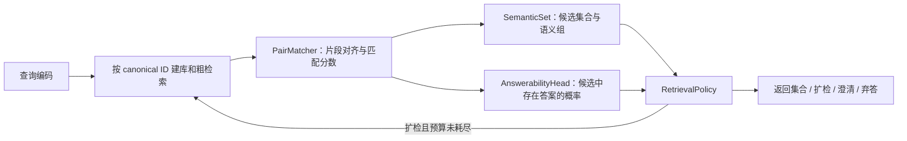

# UATVR 代码审计、死代码清理与语义集合检索设计

日期：2026-10-01。状态：设计待审阅，尚未开始代码清理或功能实现。

## 1. 目标与范围

先证明 UATVR 的数据、排序、指标、损失、梯度和实验启动链路可信，再开发基于 Holmes / GeoFlowVLM 启发的两个方向：

1. 区分有效多答案、重复候选与相互冲突的语义解释，减少候选数量和重复项对不确定性判断的干扰。
2. 区分“当前候选中没有答案”“粗检索漏召回”和“声明的检索库中没有答案”，据此返回答案集合、扩检、澄清或弃答。

本次交付是设计与定向检查证据。实现分成两个可独立验收的阶段：**基础审计与清理先完成，新增检索子系统后开始**。不把旧实现或旧测试通过视为正确性证明。

不在本次执行 GPU 科学实验、访问 sealed test、重启已停止 study、移动或删除历史实验输出。没有证据支撑的论文创新性与性能收益均作为待验证假设。

## 2. 依据与已有约束

- 代码检查基线：`a296cd96f44cad6a7b5052fd406df1bcdc531590`。工作区已有文档修改及两个未跟踪 MSVD 启动脚本；本设计不覆盖、不删除这些内容。
- 研究前置：[研究索引](../../../research/README.md)、[研究命题](../../../research/00-north-star.md)、[证据账本](../../../research/01-evidence-ledger.md)、[已证伪方向](../../../research/02-dead-ends.md)、[常设协议](../../../research/07-protocol-constraints.md)。
- 实验前置：[study](../../../experiments/contextual-risk-v2/study.yaml)、[registry](../../../experiments/contextual-risk-v2/registry.jsonl)、[归档规则](../../agent/experiment-artifacts.md)。本次读到 registry 22 条：11 reserved、3 completed、8 cancelled，对应 11 个已有 run；不预留新 run。
- 旧的 A2、A3、SAP 结论不能包装为新成功结果。冻结检索器上的 A3 MLP 已输给零参数 entropy；SAP 失败监督曾在冻结模式下成为 NO-OP。
- `logs/`、`ckpts/` 及历史数据面只读。旧 schema、manifest、registry、输入和已发布报告不随代码整理改写。
- 新科学实验必须从干净且已提交的源码启动，唯一 run 先批量预留并提交，输出进 Scheme A 数据面；失败记录保留，重试遵守人工审核和新 run ID 规则。
- 新方向需要独立 study，并采用 Scheme A 的归档机制；控制面/数据面及对现有工具的扩展须在该 study 中显式声明。不得借用 contextual-risk-v2 的旧 run 或放宽其冻结配置。
- 在 Stage 0 四卡资格测试通过并记录前，不启动 GPU 科学实验。所有模型选择、K、分组阈值与校准使用 validation，test 保持 sealed。

## 3. 本次定向检查发现

检查覆盖实际入口与关键函数、相关测试和启动约束；没有声称完成整个仓库的逐行审计。以下行号指检查基线，修复后以符号名定位。

| 发现 | 证据与状态 | 设计决定 |
|---|---|---|
| 两套模型不是简单重复 | `main_task_retrieval.py:110` 的 `_import_uatvr` 选择 HEAD / June；`--oq1_arm` 绑定 HEAD，`--use_uatvr_full` 绑定 June；检查点不互换 | 保留两套兼容入口。新增路径明确 `arch_id`，不做全仓模型合并 |
| A3 配置与环境守卫失效 | `main_task_retrieval.py:1901,1978` 两函数在 docstring 后直接 `return`；AST 提取后的原函数接受空参数对象；后续守卫代码不可达 | 属于待恢复的安全契约，不能作为死代码直接删掉 |
| 协议测试存在盲区 | `tests/test_contextual_retrieval_risk_final_fixes.py` 有 10 处相关 skip；fresh epoch allowlist 和 clean-tree 检查仍被移除 | 恢复 PC-7 四处检查并逐项恢复测试；不得用测试总数掩盖 skip |
| 旧检索指标的并列分母错误 | `metrics.py:9` 对每行所有等于 GT 分数的位置计数；2×2 矩阵 `[[1,1],[0,1]]` 得 3 个 rank，R@1=66.67% | 新指标每个查询恰好一个 rank，明确并列规则和版本；历史报告保留原口径 |
| fp32 没有覆盖所有入口 | `_eval_autocast_context` 对 A2/A3/OQ1 禁用 autocast，普通路径仍启用 bf16；计算完再 `.float()` 无法恢复已量化分数 | 新科学评估全程 fp32，并显式管理 TF32；不能只转换最终数组 |
| padding 改变 WTI 分数 | 两套模型的 `weighted_token_wise_intersection` 先将 padding 相似度乘为 0 再 max；CPU 复现：有效 token 分数 −1，加被屏蔽帧后变 −0.5 | 在 max 前排除无效位置；定义全空输入策略；这是排序修复，不能要求修复前后分数完全相同 |
| June 文本概率分支执行但与主要目标断开 | `modeling_mulit.py:1063–1117` 计算 `probabilistic_text`，结果用于 detached 诊断；返回排序/损失来自 WTI 与 sidecar。`mean/embedding` 无下游排序消费。这是静态数据流结论 | 不作为新方法的现成不确定性模块；清理前验证参数梯度、检查点键及随机数副作用 |
| 旧风险路径按设计切断梯度 | `contextual_retrieval_risk.py:77–138,277` detach 表征和分数；配置只训练 sidecar | 保留作为冻结对照；不能把这一链路改名后宣称联合训练 |
| 训练与标签不支持新任务 | June 用 `CrossEn` 对角线目标；数据提供 video ID group，同 ID 多描述不等于跨视频语义多正例；旧风险 objective 拒绝无正例行 | 新任务采用独立 episode schema、三态标签及无答案分支 |
| 有候选孤立代码，但证据不足以直接删除 | `module_mamba.py::VideoMambaEncoder` 在受跟踪 Python / shell 入口搜索中未发现外部调用；`evidential_matrix_loss` 仅见定义；HEAD `forward_eval` 未见仓内调用 | 进入候选清理清单，先排查配置、动态引用、外部公开入口与 checkpoint 依赖 |
| 若仅按绝对 import 搜索，会误删活代码 | `spatial_enhancer.py` 相对导入 `.rala`；`mus_util` 在主入口延迟导入；TQFS 在解码路径延迟导入；CRF 有独立训练调用 | 这些是活动/兼容路径，不删除。孤立 VideoMambaEncoder 不代表可删除 Mamba 依赖 |

### 3.1 本次验证证据及边界

以下为只读 CPU 检查，不是科学实验，也没有访问数据集或加载历史检查点：

- 对 `metrics.compute_metrics` 的最小输入验证了“2 查询产生 3 rank”。
- AST 提取两个原始 guard 函数，在空参数对象上执行，均直接返回；验证没有导入主程序或启动分布式运行。
- AST 提取两套模型的原始 WTI 函数，用零权重线性聚合器和归一化 token 验证 padding 反例；两套均输出 −0.5，移除 padding 则为 −1。
- `tests/test_contextual_retrieval_risk_loss.py` 与 `tests/test_retrieval_risk_metrics.py`：**25 passed，9.81 秒**。前者验证 sidecar 更新且检索输入无梯度，这是旧设计的契约，不是新方法具备联合梯度的证据。

复现所用解释器：`/home/xujie/.conda/envs/tvr/bin/python`；设置 `CUDA_VISIBLE_DEVICES=''`、`PYTHONDONTWRITEBYTECODE=1`、`OMP_NUM_THREADS=1`。pytest 禁用 cacheprovider。未运行全套测试；未证明所有模型配置、解码、DDP 或真实数据链路正确。

## 4. 路线选择

| 路线 | 优点 | 代价 / 风险 |
|---|---|---|
| **定向修复与清理 + 独立新子系统（推荐）** | 先消除已复现缺陷，新任务接口清晰；保留历史实验和检查点复现能力 | 需要显式 adapter 与少量兼容代码 |
| 直接在主入口和 June 模型里继续加分支 | 首次接线较快 | 超长入口、可变返回类型、冻结开关和历史契约容易再次污染新方法 |
| 完全重写 UATVR、同时引入 flow | 新结构整齐 | 重建解码、检查点、DDP、评测和归档，多个变量同时变化，难以归因 |

采用第一条。基础阶段只做必要修复和有证据的清理；新增模块不依赖旧概率分支，不复制整个旧入口，也不先重写所有训练基础设施。

## 5. 阶段 A：基础审计与清理设计

### 5.1 建立可追溯调用与梯度清单

以实际 CLI、shell launcher、测试及延迟/相对 import 为根，记录数据返回结构、模型架构、训练模式、相似度返回结构、损失项、optimizer 参数和评测入口。新增清单按符号记录：引用来源、是否注册参数、checkpoint 键前缀、是否改变随机数状态、处置和验证。

清单不是全仓重构任务。先完成 HEAD / June 的正常检索、CRF 和 A1/A2/A3 路径；与这些入口无关的工具只确认是否仍有独立入口，不扩展审计其算法。

### 5.2 三类处置

| 类别 | 本次识别的对象 | 实现阶段处置 |
|---|---|---|
| 必须保留 | 两套模型、RALA/SpatialEnhancer、CRF、解码/TQFS、Scheme A 工具、历史脚本与受跟踪协议 | 保持接口；必要的修复有独立变更记录，不整目录移走 |
| 需要修复，不是死代码 | guard 后不可达代码、缺失 allowlist/clean-tree 检查、WTI padding、指标并列计数 | 先复现并补回归，再修复。恢复 guard 前核对冻结 study，不能盲目重启旧 study |
| 候选死代码 / 无效计算 | 孤立 VideoMambaEncoder、未调用 evidence loss、未调用 forward_eval、June 文本概率的未消费输出 | 按符号逐个证明后删除、弃用或转为显式诊断；有参数兼容责任的分支不能直接删字段 |

删除条件：支持的入口和配置均无调用；没有动态 import/反射引用；没有公共兼容承诺或 checkpoint 消费；相关窄验证通过。仅“rg 找不到引用”不满足删除条件。不能自动删除未跟踪文件。

对 June 文本概率分支，区分“删不消费的 Gaussian 采样”“删诊断计算”“删模型参数”。前两者可能改变 RNG 序列，后者改变 checkpoint schema。先验证影响：历史复现需要时保留兼容执行；新 adapter 绕开该分支。若最终删除参数，必须显式版本化并提供白名单迁移，禁止泛用 `strict=False`。

### 5.3 指标、mask 与协议合同

- 新指标以显式 relevance mask 为输入，按 score 降序、canonical candidate ID 升序确定并列次序；每个 eligible query 只输出一个 best-positive rank，Recall@K 使用存在至少一个正确答案的定义。
- 无答案查询不放入 Recall 分母；单列计数、误接受和弃答指标。未知标签不能充当负例，未完整审核查询不能声称精确全库 Recall。
- 旧 `positive_ranks` 用严格大于比较，是乐观并列规则；不能直接拿它与新的部署 top-1 判定混用。
- 新指标版本与 mask 修复明确写入 provenance。活动评估迁移到修正口径；需要历史复现时显式调用旧口径，不更改旧文件或追溯覆盖已归档数字。冻结 study 要求另行处理，禁止静默换指标重跑。
- WTI 在取 max 前排除 padding；无有效 text/video token 时拒绝该输入并报告原因，不能产生 NaN 或默认高分。有效项均为负分、不同 padding 长度和不同 chunk 切分均有回归覆盖。
- 恢复 PC-7 四处协议检查及对应测试。新 study 使用自己的 manifest 约束，不能继承旧 A3 的固定 checkpoint/epoch 配置；干净源码、精度、身份绑定和 test 封存是通用前置。

### 5.4 阶段 A 验收门槛

1. 入口、参数和 checkpoint 兼容清单可审阅，候选清理项有逐项结论。
2. 并列分母、padding 反例和无效注册参数的回归测试由失败转为通过；skip 审计逐项记录，不能仅汇报总 passed 数。
3. 受支持模型和 adapter 的 CPU 合同检查通过。GPU 资格与模型科学实验分开，遵守 Stage 0 前置。
4. 除预先声明的 mask、指标和 guard 修复外，旧无并列、无 padding 反例的确定性输入行为保持；比较中单列预期差异，不能要求缺陷结果被保留。
5. 未改变历史数据面；工作区用户修改保留；清理提交与新功能提交分开。

未通过这些条件，阶段 B 不接入旧检索链路。

## 6. 阶段 B：新任务与数据合同

令 `G` 为声明的、固定版本的检索库，`C ⊆ G` 为粗检索候选，`R(q)` 为经过审核的正确答案集合。以下是离线任务真值，不是在线模型可读取的输入：

| episode | 真值条件 | 期望能力 |
|---|---|---|
| 单答案 | `|R(q) ∩ C| = 1` | 返回有效答案 |
| 多答案 | `|R(q) ∩ C| > 1` | 返回正确集合，避免因数量多就拒绝 |
| 粗检索漏召回 | `R(q) ∩ G ≠ ∅` 且 `R(q) ∩ C = ∅` | 触发扩检并衡量找回率 |
| 声明库无答案 | `R(q) ∩ G = ∅`，具有该库范围的审核证据 | 控制误接受；声明的范围不能扩大到开放世界 |

每个 episode 的必要字段：`query_id`、`gallery_version`、`candidate_ids`、`canonical_ids`、`relevance ∈ {positive, negative, unknown}`、`answer_in_candidates ∈ {yes, no, unknown}`、`answer_in_gallery ∈ {yes, no, unknown}`、可选 `query_conditioned_group_labels`、`annotation_provenance`、`split`。标签字段只进入监督/评测，不进入推理特征。

内容相同与语义相同分开：canonical ID 表示确定的内容身份；语义组随查询变化，不能用全局视频聚类替代。未经审核的相似视频保持 unknown。删除原始 GT 只能得到“移除了已知正例”，不能自动标为无答案。

组内 caption、重复视频及同源片段不得跨 train/validation/test 泄漏；库划分和查询划分均记录 lineage。用于阈值选择与校准的 validation 内再划分开发/校准/锁定评估部分，避免同一批标签反复调参后又作为独立验证。不能创建依赖 sealed test 的 episode。

真正无答案的数据规模和审核质量是研究入口条件。标签不足时，先交付 unknown-aware 的加载器、指标和单/多正例能力；不使用伪负例声称完成开放集能力。

## 7. 组件与端到端链路

新增路径显式使用 June adapter 提供已有 CLIP / 时序特征与修正后的 WTI；不默认其优于 HEAD。HEAD 保留为可替换 adapter。首版支持文本到视频，视频到文本的 episode 与标签合同单独扩展，不直接转置不对称任务。

| 组件 | 输入 / 输出合同 | 约束 |
|---|---|---|
| `RetrievalAdapter` | text/frame features、mask、粗检索 embedding；输出固定字段结构 | 显式 arch/checkpoint 版本；不使用 train/eval 下变化的 tuple/dict API；无效 mask 拒绝 |
| `PairMatcher` | query tokens、candidate frames、有效 mask → `match_logit`、局部对齐证据、可选 dustbin mass | 最终排序使用同一个 match logit；Holmes 式局部监督作用到这些表征；不只更新 detached 风险头 |
| `SemanticSet` | 去重候选与 query-conditioned pair features → 组、代表项、支持强度、语义歧义描述 | 第一版严格保证确定内容去重；更宽的语义等价需要独立标注与验证 |
| `AnswerabilityHead` | 每个 canonical 候选的匹配证据与无序集合 → `presence_logit` | 学 `P(R(q)∩C≠∅)`；不是 `P(R(q)∩G≠∅)`，不从候选 softmax 得到 |
| `RetrievalPolicy` | 校准后匹配/存在概率、可用语义冲突信息、扩检历史与预算 → action + reason | 不读取 GT；不输出未经验证的“全库无答案”断言 |

PairMatcher 的首版结构使用共享的 query/frame 投影，构造带 dustbin 的 token→frame attention，以有效 text token 的权重聚合对齐表征，得到 pair 表征 `h(q,v)`。`match_logit = a·WTI(q,v) + b + MLP(h(q,v))`；其中 `a=softplus(a_raw)`，保留基础排序方向。存在头消费同一个 `h` 和 match logit。基础消融关闭 attention/残差，仅保留校准 WTI，防止所有收益都来自额外匹配容量却归因于不确定性。

局部对齐的可选监督由 detached token/frame 相似度生成带 dustbin 的软 OT target，监督上述 attention 的逐 token 分布；padding 不参与 transport。OT 的边际、dustbin 成本、迭代收敛条件和温度必须在实施计划中固定并验证，不直接复制 Holmes 代码中的默认值。最小闭环先令 `λ_align=0`；对齐辅助项在同样任务与预算下单独验收，因此不会把未经验证的 OT 当作基础系统的依赖。

### 7.1 候选去重与语义分组

canonical 去重应在粗检索索引及 top-K 截断前完成，避免重复项挤占候选预算。保留 alias 映射以展示原始来源；同身份使用一致的解码和特征缓存。候选打乱或增加相同 alias 不改变 canonical 集合与输出。

可选语义分组器预测“在当前查询下答案等价”，使用已审核的 pair 标签训练，unknown 对不计 loss。采用确定性的保守 complete-link 合并：只有两组所有跨组 pair 达到 validation 冻结阈值才合并；canonical ID 固定遍历/并列顺序。不把语义相近当作等价，也不声称该分组预测严格不变。

没有等价标注时，仅运行 canonical 分组；不偷偷用评测真值形成在线分组。没有可靠的冲突标签/信号时，不启用自动澄清，返回支持的答案集合或弃答。

匹配概率使用独立 `sigmoid(match_logit)`。语义组支持取组内最高匹配概率，组熵只在达到支持门槛的组之间归一化计算，用于描述“支持哪些解释”；不等同于正确率或存在概率。它是描述性信号，单独列入消融。

### 7.2 存在判断与动作

存在头在 canonical 候选上做置换不变的集合聚合：共享编码 pair features，以 mean/max pooling 汇总，并接空集合标志输出 presence logit；空集合按定义没有候选答案。避免未经独立性论证的 `1−∏(1−p_j)`，也不依赖语义分组预测来决定是否存在答案。

动作优先级固定：

1. 无有效输入：返回输入错误，不伪装为语义无答案。
2. 存在概率低，或没有候选达到匹配接受阈值：若可扩检则扩大候选；耗尽预算则弃答，原因区分候选无支持/预算耗尽。
3. 有支持且存在已验证的冲突解释：澄清；多个可同时成立的答案走集合返回。
4. 其余有支持情况：返回达到阈值的 canonical 答案集合，附 alias 和匹配证据。

阈值全部来自 validation。扩检使用确定的 K 递增序列，已评分候选复用缓存，集合重算存在判断；不因为熵高就宣称库无答案。在线系统最初只判断候选支持情况，全库不存在需要覆盖声明库的额外证据。

### 7.3 训练与梯度

目标由显式开关控制：`L_match + λ_pair L_pair + λ_exist L_exist + λ_align L_align + λ_group L_group`。不预设最终权重或 K；这些属于后续预注册方案中的 validation 选择。

- `L_match`：在具有审核正/负例的查询上，以已知正例的均匀软目标训练多正例对比目标；unknown 从分母及标签中排除。无答案/仅 unknown 行不强行放对角正例。
- `L_pair`：已知 pair 的 sigmoid BCE，和部署时排序共用 match logit；对无答案候选提供负例监督。
- `L_exist`：仅在 candidate-presence 标签可靠时使用 BCE；unknown 集合不计此项。校准目标是 episode 抽样分布中的候选存在事件，需要记录抽样偏差。
- `L_align`：以 Holmes 的局部匹配/dustbin 思路提供辅助监督。无片段标注时明确为弱监督；初期 warm-up 后再使用 stop-gradient 的软对齐目标，不能用 GT 一致性特征做在线 gate。是否改善需要单独消融。
- `L_group`：有标注时训练查询条件下的等价 pair 判别器；不拿视频 ID 充当跨视频语义标签。

梯度必须实测：`L_pair/L_exist/L_align → PairMatcher 的连续表征 → 声明解冻的编码器参数`。先用小 tensor 验证梯度，再检查 optimizer 含这些参数、step 后发生更新及该参数确实参与推理分数。不要把只收到辅助梯度、但输出仍未被排序消费的分支算作成功接线。

top-K 与分组是离散操作，第一版不声称对全库 ANN 选择可微。训练 episode 的候选 ID 可固定，候选内容必须用当前编码器重新计算；trainable 编码器不能消费旧离线特征作为新的训练表征。支持先冻结 CLIP、联合训练匹配/存在头，再显式解冻部分编码器；这两种模式各自记录可训练参数，不能混报“端到端”。

最终粗检索索引、特征缓存与模型 SHA 绑定并重建。训练过程中若更新检索编码器而刷新候选挖掘，刷新时点与模型版本纳入配置/lineage；首版不实现自适应在线挖掘。

## 8. Holmes / GeoFlowVLM 的继承边界与创新假设

来源：[Holmes 精读](../../../related_work/holmes_icml2026/NOTES.md)与[原文 v1](https://arxiv.org/html/2605.06083v1)，[GeoFlowVLM 精读](../../../related_work/geoflowvlm_2026/NOTES.md)与[原文 v2](https://arxiv.org/html/2605.13352v2)。详细版本和作者代码核对见各目录 SOURCE。

- Holmes 提供局部对齐和训练监督的思路；其 GT 一致性不能部署，论文与作者实现的证据公式存在差异，不能直接移植为在线正确率。
- GeoFlowVLM 提供条件匹配分布与边缘支持度分离的思路；gallery 归一化熵会受重复项影响并隐藏绝对支持，Fano 下界不提供部署选择风险上界。
- **假设 H1**：把内容身份、查询条件下的答案等价与候选存在事件分开建模，在保持检索覆盖的同时，更稳定地处理多答案与重复候选。严格内容去重是工程保证；跨视频语义稳定性是待测研究结果。
- **假设 H2**：候选存在监督与局部匹配共用连续表征，比只看归一化分数/熵更能控制无答案误接受，并在粗检索漏召回时有效指导扩检。
- “多正例”“去重”“独立 sigmoid”“存在头”单项都不作为新颖性宣称。潜在贡献应是任务区分、联合训练机制及完整证据；投稿前需补充针对具体形式的近邻文献检索。

第一版不引入 flow/diffusion。只有基础系统通过数据与方法 gate，且条件采样对等计算预算下的强基线有独立收益，才设计可选 flow 模块。密度代理不命名为已证明的 epistemic risk；不宣称 OOD 下的条件风险保证。

## 9. 模块边界与验证设计

以下为拟议职责，尚未创建产品代码。实现计划可以调整文件名，不能混回旧 frozen sidecar objective。

| 拟议文件 | 责任 |
|---|---|
| `docs/maintenance/<date>-code-audit.md` | 调用/梯度/skip/删除证据清单及基础修复影响 |
| `modules/retrieval_adapter.py` | 两套架构的显式特征与评分合同 |
| `dataloaders/retrieval_episodes.py` | 三态标签、canonical 身份、库/候选存在标注与 collate |
| `modules/semantic_set_retrieval.py` | PairMatcher、SemanticSet、AnswerabilityHead |
| `prob_models/semantic_set_objective.py` | 多正例、pair、存在、局部对齐及可选分组 loss |
| `prob_models/retrieval_decision.py` | 冻结阈值、扩检预算和确定性 policy |
| `scripts/evaluate_semantic_set_retrieval.py` | 新任务指标/诊断，接入归档合同 |

首版训练入口通过独立配置装配 adapter 与新 objective，仅复用已验收的解码、优化和归档组件。训练入口的具体拆分留到书面实施计划；不能使用旧 sidecar-only 开关控制新训练模式。带 OT 辅助项和 learned semantic grouping 的扩展各自需要具体合同与验证后再启用，基础闭环不依赖它们。

必要验证按风险展开，避免为简单删除写仅镜像实现的测试：

| 验证 | 能排除的错误 |
|---|---|
| 指标手算、并列、单/多正例及无答案分母 | 同分重复计数、对角线伪 GT、无答案挤入 Recall |
| padding 的负分/全空/不同长度与 chunk | 无效位置参与 max、NaN、分块改变结果 |
| unknown 与无答案 loss | 未标注当负例、无答案强塞正例、空监督 batch 报错不清 |
| 分离 loss 的 backward + optimizer step + 推理字段检查 | detach、漏进 optimizer、有梯度但不影响排序 |
| alias 复制、候选置换、索引去重后 top-K | 重复项改变集合或挤占召回预算 |
| 推理剥离标签后结果一致 | 在线读取 GT、用评测语义组作弊 |
| 架构/检查点/索引版本失配负例 | `strict=False` 静默丢权重、旧特征缓存与新模型混用 |
| 非法配置、脏源码、test sealed 的拒绝 | 配置/归档绕过和提前访问 test |

方法评估必须包含 raw top-score、margin、entropy/energy、校准 pair 阈值、仅 canonical 去重、仅存在头、局部对齐消融、冻结表示对照和联合训练版本。增加参数或计算预算时需给同预算对照。

按 episode 类型报告：多正例 Recall/Precision 和返回集合质量、声明库无答案误接受、存在答案时误弃答、漏召回扩检找回率、重复/置换稳定性，以及延迟/候选预算。报告 abstain/clarify 比例，避免靠全部弃答获得低误接受。局部对齐解释不自动视为可靠解释。

当前不指定科学成功的数值 gate，不挪用旧 A3 数字。后续独立 study 在查看新实验结果前冻结样本量、容忍退化、比较基线、置信区间、计算预算与停止条件；不满足数据审核或强基线条件就停止，不靠新 loss 名称重试旧死路。

## 10. 交付顺序与评审边界

1. 本设计文档审阅。
2. 根据获批设计编写书面实施计划，先细化阶段 A；在该计划中列出具体清理/修复批次、验证命令和提交边界。
3. 阶段 A 实现与验收，产出实际审计报告；发现未预期的架构/兼容问题时更新设计，不直接扩大重写范围。
4. 基础验收后实施阶段 B 数据、指标和最小匹配/存在闭环，再加入有标注支撑的语义分组/局部对齐。
5. 独立 study、Stage 0 和注册 gate 满足后才能开展科学实验；flow 为后续独立决策。

本次完成定向检查与设计，不表示阶段 A 已清理完成，也不表示新方法已实现。采用用户调用的 Superpowers 架构流程：书面 spec 获批后才进入 writing-plans；实施计划获批并选定执行方式后才开始产品代码变更。
