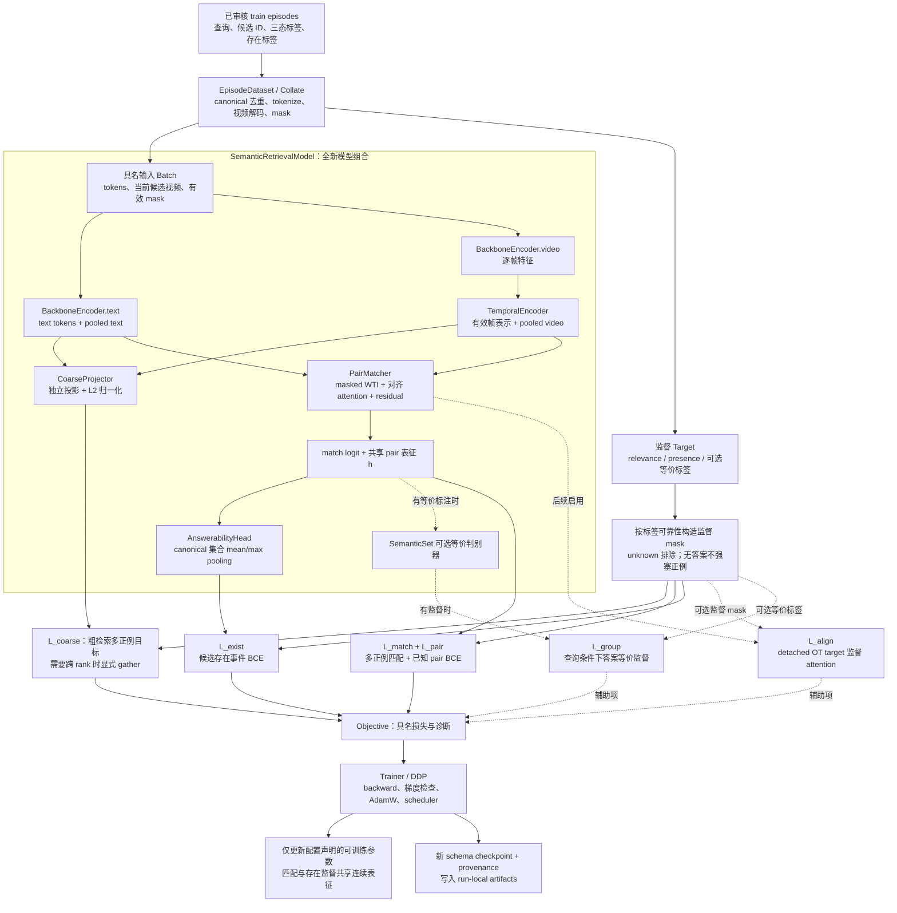
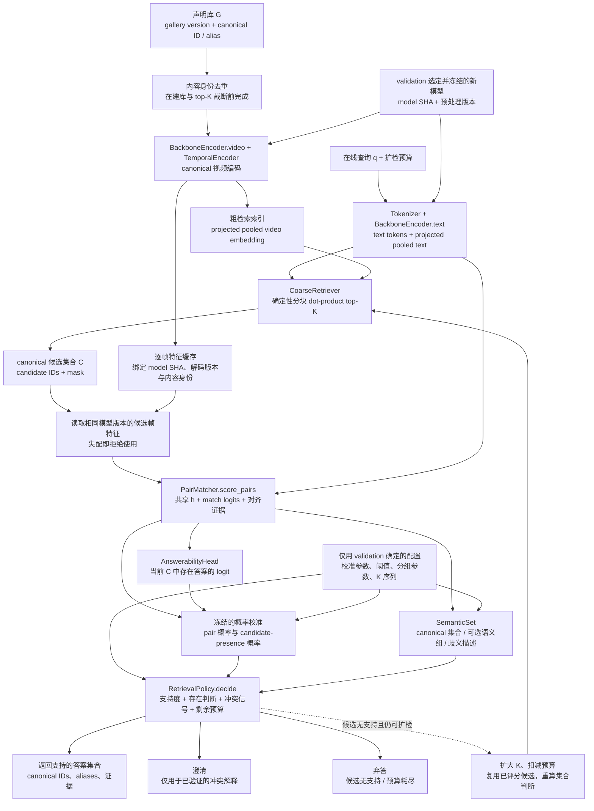
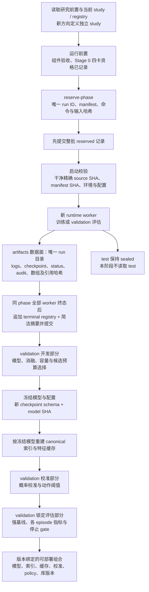

# 语义集合检索系统重建设计：组件审计、迁移与旧 UATVR 清除

日期：2026-10-01。修订：v2，按用户要求改为重建，撤销 v1 的旧架构保留与 adapter 方案。状态：用户已审阅通过（含端到端模块图）；进入书面实施计划阶段，尚未开始代码清理或功能实现。

## 1. 目标与范围

重建一套结构清晰的检索系统。对 UATVR 的检查服务于组件筛选：有用且通过验证的基础代码迁移到新系统，HEAD / June 模型、旧训练入口及无用分支最终全部移除。新系统不继承旧 UATVR 类，不包装旧模型，也不保留旧架构运行选项。开发基于 Holmes / GeoFlowVLM 启发的两个方向：

1. 区分有效多答案、重复候选与相互冲突的语义解释，减少候选数量和重复项对不确定性判断的干扰。
2. 区分“当前候选中没有答案”“粗检索漏召回”和“声明的检索库中没有答案”，据此返回答案集合、扩检、澄清或弃答。

本次交付是修订设计与定向检查证据。实现分成两个可独立验收的阶段：**组件审计、必要迁移与旧架构清除先完成，新检索模型与训练链路后开始**。迁移阶段允许实现必要的基础组件和通用运行合同，但不并行接入研究模型。旧代码只有满足新系统需求并通过对应验证才有资格迁移；现有调用或旧测试通过不是保留理由。

不在本次执行 GPU 科学实验、访问 sealed test、重启已停止 study、移动或删除历史实验输出。没有证据支撑的论文创新性与性能收益均作为待验证假设。

## 2. 依据与已有约束

- 代码检查基线：`a296cd96f44cad6a7b5052fd406df1bcdc531590`；v1 设计提交 `97511a0`。工作区已有文档修改及两个未跟踪 MSVD 启动脚本；当前仅修订设计，不覆盖这些内容。实施时旧脚本纳入逐项清理清单，先核对现有修改，不能用通配符批量删除未识别文件。
- 研究前置：[研究索引](../../../research/README.md)、[研究命题](../../../research/00-north-star.md)、[证据账本](../../../research/01-evidence-ledger.md)、[已证伪方向](../../../research/02-dead-ends.md)、[常设协议](../../../research/07-protocol-constraints.md)。
- 实验前置：[study](../../../experiments/contextual-risk-v2/study.yaml)、[registry](../../../experiments/contextual-risk-v2/registry.jsonl)、[归档规则](../../agent/experiment-artifacts.md)。本次读到 registry 22 条：11 reserved、3 completed、8 cancelled，对应 11 个已有 run；不预留新 run。
- 旧的 A2、A3、SAP 结论不能包装为新成功结果。冻结检索器上的 A3 MLP 已输给零参数 entropy；SAP 失败监督曾在冻结模式下成为 NO-OP。
- `logs/`、`ckpts/` 及历史数据面只读。旧 schema、manifest、registry、输入和已发布报告不随代码整理改写。
- 历史证据保留与旧模型运行兼容分开：源码由 Git 中记录的 source SHA 保存，历史权重文件按归档规则保留；新工作区不需要能运行旧模型。不建立 `legacy_models/`、兼容 adapter 或第二套旧训练入口。需要历史复现时使用对应历史源码与原协议；这不授权恢复已停止 study 或打开 sealed test。
- 新科学实验必须从干净且已提交的源码启动，唯一 run 先批量预留并提交，输出进 Scheme A 数据面；失败记录保留，重试遵守人工审核和新 run ID 规则。
- 新方向需要独立 study，并采用 Scheme A 的归档机制；控制面/数据面及对现有工具的扩展须在该 study 中显式声明。不得借用 contextual-risk-v2 的旧 run 或放宽其冻结配置。
- 在 Stage 0 四卡资格测试通过并记录前，不启动 GPU 科学实验。所有模型选择、K、分组阈值与校准使用 validation，test 保持 sealed。

## 3. 本次定向检查发现

检查覆盖实际入口与关键函数、相关测试和启动约束；没有声称完成整个仓库的逐行审计。以下行号指检查基线，修复后以符号名定位。

| 发现 | 证据与状态 | 设计决定 |
|---|---|---|
| 两套模型不是简单重复 | `main_task_retrieval.py:110` 的 `_import_uatvr` 选择 HEAD / June；`--oq1_arm` 绑定 HEAD，`--use_uatvr_full` 绑定 June；检查点不互换 | 两套架构均退役。检查这些入口用于识别依赖与删除影响，不为旧模型保留新运行入口 |
| A3 配置与环境守卫失效 | `main_task_retrieval.py:1901,1978` 两函数在 docstring 后直接 `return`；AST 提取后的原函数接受空参数对象；后续守卫代码不可达 | 新运行时重新落实 manifest、环境、精度和干净源码合同；旧 A3 函数随入口删除，不能把它们修复后作为新入口依赖 |
| 协议测试存在盲区 | `tests/test_contextual_retrieval_risk_final_fixes.py` 有 10 处相关 skip；fresh epoch allowlist 和 clean-tree 检查仍被移除 | 对应通用拒绝条件迁移为新运行时的有效测试；旧架构测试退役。PC-7 的 A3 复用条件不被绕过：新系统不使用 A3 运行路径 |
| 旧检索指标的并列分母错误 | `metrics.py:9` 对每行所有等于 GT 分数的位置计数；2×2 矩阵 `[[1,1],[0,1]]` 得 3 个 rank，R@1=66.67% | 新指标每个查询恰好一个 rank，明确并列规则和版本；历史报告保留原口径 |
| fp32 没有覆盖所有入口 | `_eval_autocast_context` 对 A2/A3/OQ1 禁用 autocast，普通路径仍启用 bf16；计算完再 `.float()` 无法恢复已量化分数 | 新科学评估全程 fp32，并显式管理 TF32；不能只转换最终数组 |
| padding 改变 WTI 分数 | 两套模型的 `weighted_token_wise_intersection` 先将 padding 相似度乘为 0 再 max；CPU 复现：有效 token 分数 −1，加被屏蔽帧后变 −0.5 | 在 max 前排除无效位置；定义全空输入策略；这是排序修复，不能要求修复前后分数完全相同 |
| June 文本概率分支执行但与主要目标断开 | `modeling_mulit.py:1063–1117` 计算 `probabilistic_text`，结果用于 detached 诊断；返回排序/损失来自 WTI 与 sidecar。`mean/embedding` 无下游排序消费。这是静态数据流结论 | 不迁移该概率分支、未消费的采样及参数；不要求新训练保持旧分支的 RNG 序列或参数布局 |
| 旧风险路径按设计切断梯度 | `contextual_retrieval_risk.py:77–138,277` detach 表征和分数；配置只训练 sidecar | 不迁移旧风险头。保留必要的评分/校准数学工具；新系统中可显式 detach 新表征形成冻结对照 |
| 训练与标签不支持新任务 | June 用 `CrossEn` 对角线目标；数据提供 video ID group，同 ID 多描述不等于跨视频语义多正例；旧风险 objective 拒绝无正例行 | 新任务采用独立 episode schema、三态标签及无答案分支 |
| 有候选孤立代码，但证据不足以仅靠搜索判断 | `module_mamba.py::VideoMambaEncoder` 在受跟踪 Python / shell 入口搜索中未发现外部调用；`evidential_matrix_loss` 仅见定义；HEAD `forward_eval` 未见仓内调用 | 首版新系统不需要，全部纳入清除；删除前排查引用，处理调用者而不是留下兼容壳 |
| 仅按绝对 import 搜索会漏掉依赖 | `spatial_enhancer.py` 相对导入 `.rala`；`mus_util` 在主入口延迟导入；TQFS 在解码路径延迟导入；CRF 有独立训练调用 | 先识别这些活动依赖，再按新任务决定迁移或删除。旧系统中“仍在调用”不等于新系统需要 |

### 3.1 本次验证证据及边界

以下为只读 CPU 检查，不是科学实验，也没有访问数据集或加载历史检查点：

- 对 `metrics.compute_metrics` 的最小输入验证了“2 查询产生 3 rank”。
- AST 提取两个原始 guard 函数，在空参数对象上执行，均直接返回；验证没有导入主程序或启动分布式运行。
- AST 提取两套模型的原始 WTI 函数，用零权重线性聚合器和归一化 token 验证 padding 反例；两套均输出 −0.5，移除 padding 则为 −1。
- `tests/test_contextual_retrieval_risk_loss.py` 与 `tests/test_retrieval_risk_metrics.py`：**25 passed，9.81 秒**。前者验证 sidecar 更新且检索输入无梯度，这是旧设计的契约，不是新方法具备联合梯度的证据。

复现所用解释器：`/home/xujie/.conda/envs/tvr/bin/python`；设置 `CUDA_VISIBLE_DEVICES=''`、`PYTHONDONTWRITEBYTECODE=1`、`OMP_NUM_THREADS=1`。pytest 禁用 cacheprovider。未运行全套测试；未证明所有模型配置、解码、DDP 或真实数据链路正确。

## 4. 路线选择

| 路线 | 优点 | 代价 / 风险 |
|---|---|---|
| **重建新系统，迁移已验证基础组件（采用）** | 独立模型、训练、指标与配置；明确迁移来源；彻底清除旧架构 | 需要覆盖组件和通用运行合同的迁移验证，不承诺旧模型运行兼容 |
| 在旧模型之外增加 adapter | 能继续运行旧检查点 | 保留了用户要求清除的旧架构，撤销该方案 |
| 所有基础代码也从零写起 | 依赖边界容易统一 | 重复实现 tokenizer、解码与归档，增加无必要风险；已有可靠组件应按需迁移 |

采用第一条。重建指新的可执行模型和训练链路，不是“原样复制 UATVR 后改名”。迁移粒度是实际需要的组件或函数；新目录没有用途的代码不能因为“以后可能有用”而保留。重建也不要求同时增加 flow/diffusion。

## 5. 阶段 A：组件审计、迁移与旧架构清除

### 5.1 建立可追溯调用与梯度清单

以旧 CLI、shell launcher、测试及延迟/相对 import 为根，建立依赖清单；以新任务合同决定去留。每项记录来源 commit/符号、新用途、新位置、依赖闭包、验证及旧调用者处置。不得把某个旧模块整文件复制后留下大量未调用函数。

清理覆盖旧架构的依赖闭包及仓库可执行 Python / shell / 配置 / 测试；不扫描权重、数值数组和大日志。已有检查发现归档相关测试和工具也会导入 `main_task_retrieval`，必须先抽取必要运行逻辑再删除旧入口，不能只删两个 model 文件。

### 5.2 迁移与删除矩阵

| 类别 | 本次识别的对象 | 实现阶段处置 |
|---|---|---|
| 删除旧模型和训练壳 | `modules/modeling.py`、`modules/modeling_mulit.py`、`main_task_retrieval.py`、HEAD/June 选择开关、旧架构 launcher / 专用测试 | 必要基础逻辑迁出并验证后删除；不创建代理类、转发文件或 `legacy` 架构目录 |
| 删除旧研究分支 | PIENet / Gaussian 采样与无用不确定性模块、A1/A2/A3 头、OQ1 概率排序、旧 query heads、未调用 evidence loss / Mamba encoder | 逐项确认新系统无需求，清除源文件、参数、CLI、配置、依赖和调用者，不留默认关闭的开关 |
| 按最小需求迁移 | CLIP 编码与 tokenizer、必要视频解码/预处理、受审核 split 校验、WTI 思路、评分基线/校准/置信区间工具 | 组件独立且通过合同验证才迁移；WTI 和指标按新合同重写；不继承旧预训练包装、CrossConfig 或 sidecar 配置 |
| 不纳入首版 | CRF 质量头/训练、RALA/SpatialEnhancer、MUS、Mamba、TQFS、属性扩展及与目标无关的诊断分支 | 旧代码在完成调用者处置后删除。若明确的新需求证明某组件必要，需更新迁移清单并通过验证，不能先将整套旧模块搬过去 |
| 保留治理与证据 | Scheme A 的归档/身份/哈希/恢复能力、历史控制面 schema/manifest/registry/摘要、数据面、研究账本 | 通用工具继续服务新 study；消除其对旧主入口的依赖，保持旧归档数据的只读校验能力 |

删除分两种：旧架构即使有调用也明确退役，先迁移必要能力或删除旧调用者；剩余死代码通过依赖扫描和必要验证清除。旧代码“有调用”或旧 checkpoint 中“有同名键”均不能阻止退役。删除前记录影响，不留损坏的脚本和测试。未跟踪脚本逐项检查，不自动保留旧入口，也不删除未知用途内容。

首版预训练初始化使用固定版本、已校验哈希的 CLIP 权重，不使用旧 UATVR 检查点恢复新模型。旧权重作为证据保留，新训练的随机数和参数布局独立定义。未来确需迁移某个旧权重子集时，仅通过独立、显式的键/shape/哈希映射转换为新格式，不实例化旧模型，也不使用泛用 `strict=False`；首版不实现此转换器。

通用数学或数据组件迁移保留原许可证与来源。`module_clip` 有独立编码实现，是迁移候选，不代表该文件所有下载/加载/扩展代码都可信；新系统只支持声明的本地权重加载合同，未使用的自动下载路径和分支不迁移。tokenizer 的 BPE 词表属于实际依赖，不按“非 Python 文件”误删。

### 5.3 指标、mask 与协议合同

- 新指标以显式 relevance mask 为输入，按 score 降序、canonical candidate ID 升序确定并列次序；每个 eligible query 只输出一个 best-positive rank，Recall@K 使用存在至少一个正确答案的定义。
- 无答案查询不放入 Recall 分母；单列计数、误接受和弃答指标。未知标签不能充当负例，未完整审核查询不能声称精确全库 Recall。
- 旧 `positive_ranks` 用严格大于比较，是乐观并列规则；不能直接拿它与新的部署 top-1 判定混用。
- 新指标版本与 mask 修复明确写入 provenance。新系统只提供修正口径，不保留旧指标运行模式；历史口径由历史 source SHA 解释，不追溯覆盖已归档数字。禁止在新代码下静默重跑冻结 study。
- WTI 在取 max 前排除 padding；无有效 text/video token 时拒绝该输入并报告原因，不能产生 NaN 或默认高分。有效项均为负分、不同 padding 长度和不同 chunk 切分均有回归覆盖。
- 在新的通用运行合同中落实环境、manifest 配置允许范围、干净源码和身份绑定检查。旧 A3 固定 checkpoint/epoch 规则不迁移；PC-7 所指出的协议缺口必须由新合同的拒绝测试覆盖。新系统不启动 A3，若另外重启 A3 则其原恢复约束仍生效。

通用归档必须保留 reserve/verify/status/终态追加、数组引用哈希、信号退出、失败证据与 sealed test 检查能力。现有归档测试中的主入口依赖改为新 `runtime` 合同；旧 run 的只读校验不要求加载旧模型。通用 CLI 的既有归档命令保持或明确迁移，不能因删除架构破坏 registry 管理。

### 5.4 阶段 A 验收门槛

1. 组件迁移清单可审阅，每个保留组件有新用途、来源和有效验证；无用途组件及旧调用者全部清除。
2. HEAD / June 类、旧模型文件和旧主入口不存在；新包及活动脚本/测试无旧架构 import、动态选择、兼容壳或运行开关。历史文档/不可变控制面里的名称不是可执行残留。
3. 并列分母、padding、unknown 等基础合同和通用注册拒绝条件通过新测试；不靠删除断言或增加 skip 获得通过。旧模型专项测试删除，通用保护迁移。
4. tokenizer/解码/基础算子等迁移组件按各自合同验证；不要求新模型与旧 UATVR 同分或同 RNG。DDP 通信原语需要独立梯度验证，不能只依据旧训练曾运行。
5. 归档验证、旧 run 只读校验和必要工具的 CPU 测试通过；历史数据面与冻结研究控制面未改变；用户工作区修改按逐项清单处理。
6. 依赖、配置、脚本和源码中的删除闭包完整，无额外旧包拷贝、生成缓存残留或失效入口。未使用依赖移除，实际词表/输入文件保留。

未通过这些条件，不进入新研究模型实现。旧架构允许仅在迁移进行中的工作分支暂时存在；阶段 A 的最终交付中不保留旧架构。删除、组件迁移和新增研究模型分别记录提交边界。

## 6. 阶段 B：新任务与数据合同

令 `G` 为声明的、固定版本的检索库，`C ⊆ G` 为粗检索候选，`R(q)` 为经过审核的正确答案集合。以下是离线任务真值，不是在线模型可读取的输入：

| episode | 真值条件 | 期望能力 |
|---|---|---|
| 单答案 | `|R(q) ∩ C| = 1` | 返回有效答案 |
| 多答案 | `|R(q) ∩ C| > 1` | 返回正确集合，避免因数量多就拒绝 |
| 粗检索漏召回 | `R(q) ∩ G ≠ ∅` 且 `R(q) ∩ C = ∅` | 触发扩检并衡量找回率 |
| 声明库无答案 | `R(q) ∩ G = ∅`，具有该库范围的审核证据 | 控制误接受；声明的范围不能扩大到开放世界 |

每个 episode 的必要字段：`query_id`、`gallery_version`、`candidate_ids`、`canonical_ids`、`relevance ∈ {positive, negative, unknown}`、`answer_in_candidates ∈ {yes, no, unknown}`、`answer_in_gallery ∈ {yes, no, unknown}`、可选 `query_conditioned_group_labels`、`annotation_provenance`、`split`。标签字段只进入监督/评测，不进入推理特征。

内容相同与语义相同分开：canonical ID 表示确定的内容身份；语义组随查询变化，不能用全局视频聚类替代。未经审核的相似视频保持 unknown。删除原始 GT 只能得到“移除了已知正例”，不能自动标为无答案。

组内 caption、重复视频及同源片段不得跨 train/validation/test 泄漏；库划分和查询划分均记录 lineage。用于阈值选择与校准的 validation 内再划分开发/校准/锁定评估部分，避免同一批标签反复调参后又作为独立验证。不能创建依赖 sealed test 的 episode。

真正无答案的数据规模和审核质量是研究入口条件。标签不足时，先交付 unknown-aware 的加载器、指标和单/多正例能力；不使用伪负例声称完成开放集能力。

## 7. 组件与端到端链路

新模型 `SemanticRetrievalModel` 由组件组合构建，不继承任何 UATVR 类。首版使用经过阶段 A 验收的 CLIP 编码组件、显式视频时序编码和新写的 masked WTI / PairMatcher。首版支持文本到视频，视频到文本的 episode 与标签合同单独扩展，不直接转置不对称任务。

`BackboneEncoder` 输出具名 text tokens / pooled text / frame features / masks；`TemporalEncoder` 使用带 padding mask 的标准时序 Transformer，输出逐帧表示和 masked pooled video。层数等容量在后续预注册配置中固定，关闭时序模块提供基础对照。粗检索使用两侧独立投影并 L2 归一化的 pooled embedding，按 dot-product 排序；小库先使用确定性分块精确检索，大库再引入可验证的 ANN 索引，不继承旧 CrossConfig 或多余 CLS token 分支。

以下三张图描述重建后的预期模块链路，尚未实现。实线表示数据、产物或控制流；虚线表示可选辅助路径或条件触发，具体含义写在边上。图中不包含旧 HEAD / June 模型、adapter 或旧主入口。

**训练链路：数据 → 新模型 → 显式监督 → 参数更新。**

图中的 `Target` 只进入监督，不进入模型输入。候选 ID 可固定，但训练候选表征由当前编码器重新计算；不使用旧离线缓存训练已解冻的编码器。更新后的模型参与下一步前向；粗检索 top-K 和语义分组不属于可微梯度链路。最小闭环关闭 `L_align` 和 learned grouping，冻结 CLIP 与解冻训练分别记录。

**在线链路：声明库建索引 → 粗检索 → 匹配与存在判断 → 动作。**

`SemanticSet` 和 `AnswerabilityHead` 并行消费匹配证据；存在判断不依赖预测语义组。推理链路没有 relevance、GT 或审核组标签输入。输入无效或缓存身份失配时直接报告错误，不解释为无答案。候选存在概率只对应 `C`；扩检耗尽后弃答不构成“整个库 G 无答案”的证明。索引与帧缓存均在最终模型冻结后重建。

**实验与版本链路：受跟踪控制面 → 运行数据面 → validation 选择 → 冻结发布产物。**

选择、校准和锁定评估也是正式实验时，各自通过相同的预留/启动/归档流程；图中省略重复展开。worker 期间只写 run-local 数据面，不修改控制面。大数组外置并校验引用哈希，失败终态不原地重试。最后的组合表示接口与版本完整，不表示性能 gate 自动通过，也不授权 test 访问或实际部署。

| 组件 | 输入 / 输出合同 | 约束 |
|---|---|---|
| `BackboneEncoder` / `TemporalEncoder` | tokens、逐帧表示、mask、粗检索 embedding；输出固定字段结构 | 新模型配置与 checkpoint schema；无旧架构开关；无效 mask 拒绝 |
| `PairMatcher` | query tokens、candidate frames、有效 mask → `match_logit`、局部对齐证据、可选 dustbin mass | 最终排序使用同一个 match logit；Holmes 式局部监督作用到这些表征；不只更新 detached 风险头 |
| `SemanticSet` | 去重候选与 query-conditioned pair features → 组、代表项、支持强度、语义歧义描述 | 第一版严格保证确定内容去重；更宽的语义等价需要独立标注与验证 |
| `AnswerabilityHead` | 每个 canonical 候选的匹配证据与无序集合 → `presence_logit` | 学 `P(R(q)∩C≠∅)`；不是 `P(R(q)∩G≠∅)`，不从候选 softmax 得到 |
| `RetrievalPolicy` | 校准后匹配/存在概率、可用语义冲突信息、扩检历史与预算 → action + reason | 不读取 GT；不输出未经验证的“全库无答案”断言 |

PairMatcher 的首版结构使用共享的 query/frame 投影，构造带 dustbin 的 token→frame attention，以有效 text token 的权重聚合对齐表征，得到 pair 表征 `h(q,v)`。`match_logit = a·WTI(q,v) + b + MLP(h(q,v))`；其中 `a=softplus(a_raw)`。WTI 在新模块实现，含严格 mask 和有限值检查，不调用旧模型的方法。存在头消费同一个 `h` 和 match logit。基础消融关闭 attention/残差，仅保留校准 WTI，防止所有收益都来自额外匹配容量却归因于不确定性。

局部对齐的可选监督由 detached token/frame 相似度生成带 dustbin 的软 OT target，监督上述 attention 的逐 token 分布；padding 不参与 transport。OT 的边际、dustbin 成本、迭代收敛条件和温度必须在实施计划中固定并验证，不直接复制 Holmes 代码中的默认值。最小闭环先令 `λ_align=0`；对齐辅助项在同样任务与预算下单独验收，因此不会把未经验证的 OT 当作基础系统的依赖。

### 7.1 候选去重与语义分组

canonical 去重应在粗检索索引及 top-K 截断前完成，避免重复项挤占候选预算。保留 alias 映射以展示原始来源；同身份使用一致的解码和特征缓存。候选打乱或增加相同 alias 不改变 canonical 集合与输出。

可选语义分组器预测“在当前查询下答案等价”，使用已审核的 pair 标签训练，unknown 对不计 loss。采用确定性的保守 complete-link 合并：只有两组所有跨组 pair 达到 validation 冻结阈值才合并；canonical ID 固定遍历/并列顺序。不把语义相近当作等价，也不声称该分组预测严格不变。

没有等价标注时，仅运行 canonical 分组；不偷偷用评测真值形成在线分组。没有可靠的冲突标签/信号时，不启用自动澄清，返回支持的答案集合或弃答。

匹配概率使用独立 `sigmoid(match_logit)`。语义组支持取组内最高匹配概率，组熵只在达到支持门槛的组之间归一化计算，用于描述“支持哪些解释”；不等同于正确率或存在概率。它是描述性信号，单独列入消融。

### 7.2 存在判断与动作

存在头在 canonical 候选上做置换不变的集合聚合：共享编码 pair features，以 mean/max pooling 汇总，并接空集合标志输出 presence logit；空集合按定义没有候选答案。避免未经独立性论证的 `1−∏(1−p_j)`，也不依赖语义分组预测来决定是否存在答案。

动作优先级固定：

1. 无有效输入：返回输入错误，不伪装为语义无答案。
2. 存在概率低，或没有候选达到匹配接受阈值：若可扩检则扩大候选；耗尽预算则弃答，原因区分候选无支持/预算耗尽。
3. 有支持且存在已验证的冲突解释：澄清；多个可同时成立的答案走集合返回。
4. 其余有支持情况：返回达到阈值的 canonical 答案集合，附 alias 和匹配证据。

阈值全部来自 validation。扩检使用确定的 K 递增序列，已评分候选复用缓存，集合重算存在判断；不因为熵高就宣称库无答案。在线系统最初只判断候选支持情况，全库不存在需要覆盖声明库的额外证据。

### 7.3 训练与梯度

目标由单一新配置控制：`λ_coarse L_coarse + L_match + λ_pair L_pair + λ_exist L_exist + λ_align L_align + λ_group L_group`。`L_coarse` 是粗检索 pooled embedding 上的多正例目标；`L_match` 作用于候选 pair 分数。二者都使用可靠 relevance 标签、排除 unknown，并跳过没有已知正/负监督的行。不预设最终权重或 K；这些属于后续预注册方案中的 validation 选择。

- `L_match`：在具有审核正/负例的查询上，以已知正例的均匀软目标训练多正例对比目标；unknown 从分母及标签中排除。无答案/仅 unknown 行不强行放对角正例。
- `L_pair`：已知 pair 的 sigmoid BCE，和部署时排序共用 match logit；对无答案候选提供负例监督。
- `L_exist`：仅在 candidate-presence 标签可靠时使用 BCE；unknown 集合不计此项。校准目标是 episode 抽样分布中的候选存在事件，需要记录抽样偏差。
- `L_align`：以 Holmes 的局部匹配/dustbin 思路提供辅助监督。无片段标注时明确为弱监督；初期 warm-up 后再使用 stop-gradient 的软对齐目标，不能用 GT 一致性特征做在线 gate。是否改善需要单独消融。
- `L_group`：有标注时训练查询条件下的等价 pair 判别器；不拿视频 ID 充当跨视频语义标签。

梯度必须实测：`L_pair/L_exist/L_align → PairMatcher 的连续表征 → 声明解冻的编码器参数`。先用小 tensor 验证梯度，再检查 optimizer 含这些参数、step 后发生更新及该参数确实参与推理分数。不要把只收到辅助梯度、但输出仍未被排序消费的分支算作成功接线。

top-K 与分组是离散操作，第一版不声称对全库 ANN 选择可微。训练 episode 的候选 ID 可固定，候选内容必须用当前编码器重新计算；trainable 编码器不能消费旧离线特征作为新的训练表征。支持先冻结 CLIP、联合训练匹配/存在头，再显式解冻部分编码器；这两种模式各自记录可训练参数，不能混报“端到端”。

新 Trainer 显式装配 dataloader、模型、objective、optimizer 和 scheduler；首版使用标准 AdamW 与单一记录的学习率计划，不迁移旧 BertAdam 包装。训练调用具名 loss/output，推理调用 `encode` / `score_pairs` / `decide`，不依赖 `model.training` 切换返回类型。DDP 使用标准封装；episode pair/existence loss 先按本地集合计算，只有需要跨 rank 的粗检索对比目标才显式 gather，标签、mask、ID 与梯度语义统一验证。

最终粗检索索引、特征缓存与模型 SHA 绑定并重建。训练过程中若更新检索编码器而刷新候选挖掘，刷新时点与模型版本纳入配置/lineage；首版不实现自适应在线挖掘。

## 8. Holmes / GeoFlowVLM 的继承边界与创新假设

来源：[Holmes 精读](../../../related_work/holmes_icml2026/NOTES.md)与[原文 v1](https://arxiv.org/html/2605.06083v1)，[GeoFlowVLM 精读](../../../related_work/geoflowvlm_2026/NOTES.md)与[原文 v2](https://arxiv.org/html/2605.13352v2)。详细版本和作者代码核对见各目录 SOURCE。

- Holmes 提供局部对齐和训练监督的思路；其 GT 一致性不能部署，论文与作者实现的证据公式存在差异，不能直接移植为在线正确率。
- GeoFlowVLM 提供条件匹配分布与边缘支持度分离的思路；gallery 归一化熵会受重复项影响并隐藏绝对支持，Fano 下界不提供部署选择风险上界。
- **假设 H1**：把内容身份、查询条件下的答案等价与候选存在事件分开建模，在保持检索覆盖的同时，更稳定地处理多答案与重复候选。严格内容去重是工程保证；跨视频语义稳定性是待测研究结果。
- **假设 H2**：候选存在监督与局部匹配共用连续表征，比只看归一化分数/熵更能控制无答案误接受，并在粗检索漏召回时有效指导扩检。
- “多正例”“去重”“独立 sigmoid”“存在头”单项都不作为新颖性宣称。潜在贡献应是任务区分、联合训练机制及完整证据；投稿前需补充针对具体形式的近邻文献检索。

第一版不引入 flow/diffusion。只有基础系统通过数据与方法 gate，且条件采样对等计算预算下的强基线有独立收益，才设计可选 flow 模块。密度代理不命名为已证明的 epistemic risk；不宣称 OOD 下的条件风险保证。

## 9. 模块边界与验证设计

以下为拟议职责，尚未创建产品代码。实现计划可以调整文件名，不能混回旧 frozen sidecar objective。

| 拟议文件 | 责任 |
|---|---|
| `docs/maintenance/<date>-code-audit.md` | 组件来源、用途、迁移验证、删除闭包与协议保护迁移证据 |
| `src/semantic_retrieval/config.py` / `types.py` | 单一类型化配置及具名 batch / feature / score / decision 合同 |
| `src/semantic_retrieval/data/` | tokenizer / 解码必要组件、episode、三态标签、canonical 身份与 collate |
| `src/semantic_retrieval/models/` | CLIP 编码、TemporalEncoder、masked WTI、PairMatcher、SemanticSet、AnswerabilityHead 及模型组合 |
| `src/semantic_retrieval/objectives/` | 粗检索/匹配多正例、pair、存在、局部对齐及可选分组 loss |
| `src/semantic_retrieval/retrieval/` | canonical 索引、缓存身份、粗检索、冻结阈值和扩检 policy |
| `src/semantic_retrieval/evaluation/` | 修正指标、评分基线、校准与诊断 |
| `src/semantic_retrieval/runtime/` | Trainer、标准 DDP、精度合同、通用注册/归档运行桥接 |
| `scripts/train_semantic_retrieval.py` / `evaluate_semantic_retrieval.py` | 薄入口，只负责解析配置并调用新 runtime；无旧 CLI 转发 |

新训练/评测只有一套配置合同与 checkpoint schema，不接收 `--use_uatvr_full`、`--oq1_arm` 或 A1/A2/A3 sidecar-only 参数；旧脚本在最终工作区删除，不转发到新入口。新包依赖方向为 `data/types → models/objectives → retrieval/evaluation → runtime → 薄 CLI`，基础类型和组件不反向导入 Trainer 或主入口。具体文件拆分在书面实施计划固定。带 OT 辅助项和 learned semantic grouping 的扩展各自验证后启用，基础闭环不依赖它们。

必要验证按风险展开，避免为简单删除写仅镜像实现的测试：

| 验证 | 能排除的错误 |
|---|---|
| 指标手算、并列、单/多正例及无答案分母 | 同分重复计数、对角线伪 GT、无答案挤入 Recall |
| padding 的负分/全空/不同长度与 chunk | 无效位置参与 max、NaN、分块改变结果 |
| unknown 与无答案 loss | 未标注当负例、无答案强塞正例、空监督 batch 报错不清 |
| 分离 loss 的 backward + optimizer step + 推理字段检查 | detach、漏进 optimizer、有梯度但不影响排序 |
| alias 复制、候选置换、索引去重后 top-K | 重复项改变集合或挤占召回预算 |
| 推理剥离标签后结果一致 | 在线读取 GT、用评测语义组作弊 |
| 架构/检查点/索引版本失配负例 | `strict=False` 静默丢权重、旧特征缓存与新模型混用 |
| 非法配置、脏源码、test sealed 的拒绝 | 配置/归档绕过和提前访问 test |
| 新包 import / CPU fixture / 旧引用扫描与工具验证 | 旧架构被藏到 adapter、迁移后仍依赖旧入口、删除后归档工具失效 |

方法评估必须包含 raw top-score、margin、entropy/energy、校准 pair 阈值、仅 canonical 去重、仅存在头、局部对齐消融、冻结表示对照和联合训练版本。增加参数或计算预算时需给同预算对照。

按 episode 类型报告：多正例 Recall/Precision 和返回集合质量、声明库无答案误接受、存在答案时误弃答、漏召回扩检找回率、重复/置换稳定性，以及延迟/候选预算。报告 abstain/clarify 比例，避免靠全部弃答获得低误接受。局部对齐解释不自动视为可靠解释。

当前不指定科学成功的数值 gate，不挪用旧 A3 数字。后续独立 study 在查看新实验结果前冻结样本量、容忍退化、比较基线、置信区间、计算预算与停止条件；不满足数据审核或强基线条件就停止，不靠新 loss 名称重试旧死路。

## 10. 交付顺序与评审边界

1. 本设计文档审阅。
2. 根据获批设计编写书面实施计划，先细化阶段 A；列出迁移函数、旧模型/入口/测试/依赖删除清单、通用合同保护和验证命令。
3. 阶段 A 实现与验收，完成必要基础组件迁移、通用运行合同和旧架构清除，产出审计报告；发现新的依赖问题时处理其调用闭包，不默认恢复旧架构。
4. 基础验收后实施阶段 B 的新数据加载、模型组合、训练/推理/评测和最小匹配/存在闭环，再加入有标注支撑的语义分组/局部对齐。旧架构不作为回退运行选项。
5. 独立 study、Stage 0 和注册 gate 满足后才能开展科学实验；flow 为后续独立决策。

本次完成定向检查与设计，不表示阶段 A 已清理完成，也不表示新方法已实现。采用用户调用的 Superpowers 架构流程：书面 spec 获批后才进入 writing-plans；实施计划获批并选定执行方式后才开始产品代码变更。
