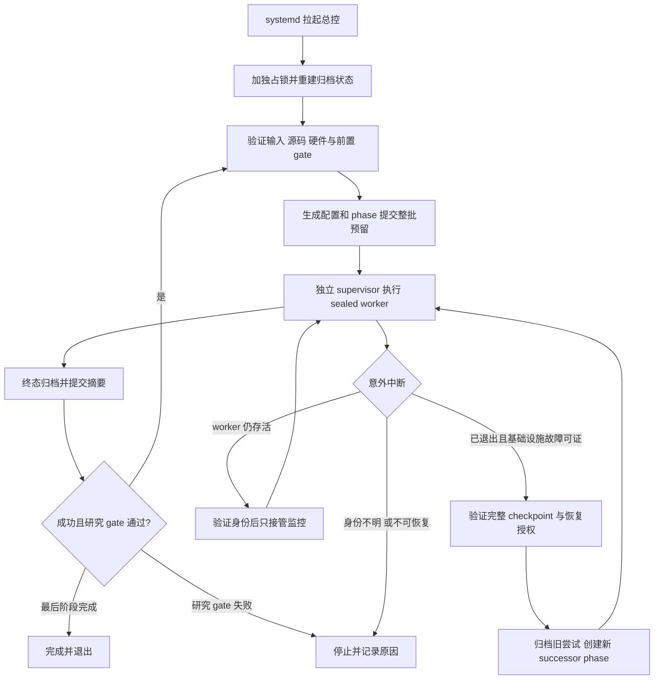

# 无人值守 pilot 编排与中断恢复设计

日期：2026-10-01。状态：按用户反馈修订，待最终设计审阅。用户已授权删除第8条并纳入服务器编排器＋Codex巡检；本文不启动实验或后台服务。

## 目标与范围

用户要求无人值守地跨阶段运行并处理意外中断。新增总控负责已有 semantic-answerability-pilot-v1 的完整生命周期；不复活旧 study，不启动 dual-gpu-preflight 历史失败运行，不解封 MSRVTT/MSVD test。完成意味着正常链路无需人工逐阶段执行，控制器或机器重启后能够核验并接续；不可恢复的故障必须有明确、持久的停止原因，不能承诺所有故障都恢复成功。

现有基础：orchestrate_semantic_pilot.py 有 templates/plan/reserve/run/finalize；train_semantic_retrieval.py 有 ResumeConfig、完整 checkpoint 和默认每20迭代保存。缺口是持久化总控、已运行批次接续、监督退出证据、自动 successor 与资格/证据聚合。

## 方案选择

推荐 Python 持久总控 + 独立 worker supervisor + systemd 用户服务 + Codex 巡检。复用既有配置工厂、归档管理和协议守卫，避免 shell 重跑产生重复实验。服务只重启总控；绝不直接重启训练命令。纯 shell 循环缺少进程身份与事务恢复；引入大型工作流平台增加部署和归档集成成本，本阶段不采用。

## 端到端链路

阶段顺序沿用 D1 → Q0P/Q0 → E0 → P1a → P1b → P2a → P2b → C0S → C0 → V0E → V0S → V0；从已完成、提交且核验通过的 D1/Q0P 起接续。Q0 必须针对最终实现代码重新预留并通过；不使用旧源码 Q0 作为新代码资格。现有 reserved 运行不得改写、覆盖或自动启动不兼容的源码；启动前检测并给出待处理清单。

## 组件与持久状态

1. 新总控 CLI：status、validate、run、stop。启动配置绑定 study、代码 SHA、Python/环境、固定 GPU UUID、输入/预训练权重、预算、阶段序列和恢复策略。run 不接受任意 shell 命令或动态调参。
2. 调度模块根据认证 summary/registry 重建完成进度；本地 journal 为可核验的操作日志，不能替代已提交控制面证据。每项操作有稳定标识，重复调用只能复用完全一致的产物；不同字节立即拒绝。
3. 独立 supervisor 从 sealed argv 启动一次 worker，先写 launch plan，持久保存 PID、启动时间、boot ID、进程组与命令身份，记录实际退出码与预算。总控退出时 supervisor 继续监控；机器重启时根据 boot ID 判定旧进程失效，不能推断 exit 0。
4. 调度锁和源码写入锁避免两个总控同时操作。任何 worker 存活期间不修改受跟踪文件；本阶段运行全部退出后才归档、提交和构建后续阶段。服务的重启退避不能绕过调度锁或工作目录清洁检查。
5. 实时总控状态、journal、supervisor 证据位于 artifacts/semantic-answerability-pilot-v1/_orchestration/<campaign-id>/，此新增目录必须显式加入路径合同。worker 输出仍使用现行 run 路径；控制面仅在无存活 worker 的事务边界更新。

## 恢复与故障分类

| 情况 | 自动动作 |
|---|---|
| GPU 被占用、资源暂时不足，尚未启动 worker | 等待并退避，不产生失败训练或更换 GPU UUID |
| 总控退出，supervisor/worker 仍存活且身份完全一致 | 接管监控，不启动第二份训练 |
| worker 成功，终态或提交步骤中断 | 先 verify-run，修复唯一可证明的待提交 transition；不可证明则停止 |
| 已验证主机重启，或本系统预算内计划抢占/明确服务停止事件 | 保留旧尝试，满足恢复授权和 checkpoint 校验后创建新 successor |
| 无完整 checkpoint 的训练中断 | 默认停止；不得自动从随机初始化重跑 |
| 任意非零退出码、137/143，但无可认证的中断原因 | 停止；退出码不能独自证明基础设施故障 |
| OOM、NaN/Inf、代码异常、DDP错误、数据/哈希/源码不符 | 停止并输出诊断，不改 batch、学习率、精度、拓扑或配置 |
| checkpoint 损坏或恢复配置/模型/rank 数不一致 | 停止，不降级加载或使用损坏文件 |
| 研究 gate 未通过、输入缺失、test 尚未授权 | 持久 blocked 状态，退出自动推进 |

自动恢复策略拟采用最多2个 successor，30秒、120秒退避；累计前驱和新尝试的消耗，不能重置预算。预算耗尽属于停止原因，不属于自动恢复资格。总控重启次数不计入训练重试，但也不能扩大预算。

人工 stop 是持久取消，系统服务重启不会恢复用户主动停止的 campaign。

## 已授权的协议调整

2026-10-01 用户明确要求删除第8条，不再要求逐次人工审核和授权。AGENTS.md、协议汇总和操作文档同步更新。自动恢复由 campaign 策略和编排器校验，不能覆盖历史、扩大预算或绕过 gate。代码错误等故障先停止科学执行，由 Codex 诊断；符合策略的 successor 不因缺少人工审核被拒绝。

旧 failed/cancelled 终态仍不可变。每次 successor 必须在后续唯一 phase 使用新 run ID，parent_run_ids 包含原始科学依赖与失败 predecessor；selection_lineage 引用已提交的恢复策略和本次机器审核报告，标明策略版本、证据、checkpoint、累计成本与重试序号。报告应明确为自动审核，不能冒充人工审核。

checkpoint 仅允许同模型/训练语义/数据/拓扑恢复；绑定模型、AdamW、调度器、Python/NumPy/Torch CPU/CUDA rank RNG、sampler 顺序/游标/K调度与 progress。只挑最新的完整、全部引用哈希可验证的 checkpoint，训练恢复不得覆盖旧产物。中断前进度到最后完整 checkpoint 的工作需要重算。

## 服务器编排器＋Codex 巡检

服务器已安装 codex CLI，用户级 systemd 正在运行；非交互认证、权限、网络、额度和退出登录后的服务存活仍需验收。systemd timer 在服务器调用 codex exec，不依赖桌面应用保持开启，也不把当前聊天视为已部署后台监控。

轻量程序默认每60秒检查 GPU UUID、显存、利用率、进程身份、训练心跳和 checkpoint。Codex 默认每30分钟巡检一次，异常额外触发，5分钟冷却，单次最长10分钟。巡检独占锁防止重入。默认每日最多48次常规巡检、12次事件巡检；campaign 另配置单次和累计 token 上限。达到巡检预算暂停 Codex，不中止健康训练。

Codex 读取结构化状态、必要日志尾部和认证摘要，输出 JSON Schema 约束的 wait/advance/resume/diagnose/stop 建议与证据引用。编排器重新核验 phase/run/manifest、状态、预算及恢复条件，不能把模型输出直接作为 shell 命令执行。GPU 空闲快照不代表独占资源；启动前再次检查冻结 UUID 与显存，并取得协作锁。不杀其他用户进程、不更换冻结拓扑。

Codex 可以分析训练停滞、诊断失败、推进批准阶段、建议 checkpoint 续训和生成报告。不能修改科学超参、选 seed、解封 test 或绕过研究 gate。修代码应在隔离分支完成并验证；运行中的源码不变，修复代码取得新资格后才能用于科学实验。本阶段不自动部署模型生成的代码修复。

认证、网络、额度异常时记录 degraded 状态并退避；确定性编排器与独立 supervisor 继续管理健康训练。Codex 恢复后重新读取持久状态，不依赖会话记忆。凭证不得写入报告或传给训练进程。

持续维护总览：阶段/arm/seed 状态、checkpoint、指标、消融/敏感性图表引用、失败和恢复记录、累计资源消耗、下一步与停止原因。数值必须来自认证产物，未完成结果标为不可用。状态不变保持安静，完成、失败或需要用户介入时生成通知记录；不默认发邮件或外部消息。

官方能力依据：[非交互模式](https://learn.chatgpt.com/docs/non-interactive-mode)支持脚本执行和结构化输出；[桌面定时任务](https://learn.chatgpt.com/docs/automations?surface=app)访问本地项目时需电脑与应用运行，因此采用服务器服务。

## 接入现有协议的必要变更

pilot phase 契约需辨认 logical phase 和唯一 attempt phase：既有固定科学臂/seed/配置保持不变；允许同逻辑阶段的授权 successor，并验证 lineage，不能只改名称绕过 allowlist。

证据聚合按 logical phase 收集唯一完成的 arm/seed，并保留全部失败尝试；不得把失败 batch 当 completed，不遗漏成功 siblings、不重复计算或自动取消仍可执行的 unrelated siblings。原 batch 全部终态并提交后，successor batch 只含需恢复且获得策略授权的成员。所有下游父依赖、C0门检查与训练日志覆盖核验使用认证的聚合摘要。聚合摘要由现有证据校验逻辑扩展支持，而非无校验地伪造旧 summary。

Q0执行源码认证与后续worker源码规则保留；控制面提交不能改变 executable source。D1/E0/C0S/V0S/分析等非训练worker暂不自动重跑已失败尝试；监督与事务接续覆盖所有阶段，训练自动checkpoint续训限定P1/P2。

## 验收

先用CPU短子进程和合成归档验证：正常全阶段推进、重复启动拒绝、总控重启接管、未知退出拒绝、终态提交中断、PID复用/boot变更、部分batch完成、successor身份和证据聚合、预算与重试耗尽、主动stop持久化、gate/test边界。另验证巡检锁、schema及过期建议拒绝、任意命令字段拒绝、认证/网络/额度降级、调用预算/冷却、报告数字溯源与模型无法绕过执行守卫。

故障注入必须证明至少一次实际独立supervisor在总控退出后仍记录真实worker退出码；模拟主机boot变化不能宣称实机掉电测试通过。训练链验证连续与续训模型/AdamW完全一致、sampler/RNG一致；破损checkpoint拒绝且不覆盖历史。

完成源码测试与审阅后再预留新四卡Q0，不自动启动当前 reserved Q0、不启动科学训练。GPU验收执行依然要求合适资源与已提交预留。systemd服务先提供安装/验证命令，不默认启用无限后台实验。

## 交付

设计批准后编写逐项实施计划：总控与状态合同；监督与事务恢复；授权successor与协议聚合；Codex巡检与受限动作接口；系统服务和用户操作文档；故障注入与资格验收。实现后提供一条 campaign 启动命令、查看进度命令、主动停止命令，以及可审核的最终结果和停止原因。
