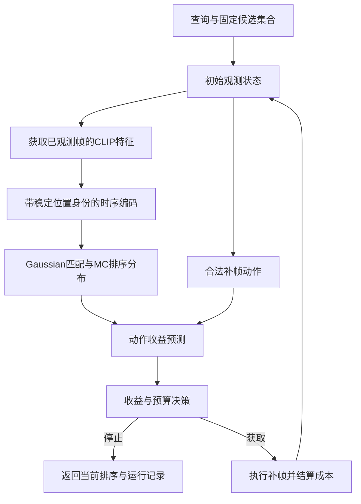

# 查询条件证据补全的概率对比检索：设计方案

日期：2026-10-10。版本：v1。状态：用户于2026-10-10回复“通过”，书面设计已批准，进入实施计划阶段。范围：在现有 semantic_retrieval 组件上新增证据补全子系统；本文件不授权实现、预留run、科学训练或访问test。
代码检查基线：`c6b29a6a06e7c39f00443541a8ebd5584a591fd3`。

## 1. 设计简报

### 1.1 用户目标与已有共识

用户希望基于UATVR发展与课题组“不确定性学习、对比学习”方向相符的研究，已经完成主线查新，并要求将上一轮开发设计整理成书面方案。

本设计承接的主线：给定查询、当前已观测视频帧和竞争候选，学习实际参与训练及排序的预测分布；检验该分布能否为追加视觉证据后的检索纠错提供超过普通置信度与确定性收益预测的信息。

### 1.2 本设计采用的工程选择

采用分阶段方案：冻结CLIP的逐帧编码，先训练概率匹配器，再固定模型编译补帧转移，最后训练动作收益头。第一版只在固定候选集合内追加预定义帧块，以top-1正确性变化定义收益。

这些是实现研究问题的具体选择，不是已获实证支持的结论。用户已批准本书面设计；后续实施计划以本版本为依据，计划仍须审阅并选择执行方式。

### 1.3 完成标准

软件完成意味着：观测隔离、概率匹配、转移监督、收益预测、预算执行和可恢复运行形成可验证闭环。科学成功另需证明概率模型对真实纠错的增量贡献；软件验收通过不能替代该证据。

## 2. 研究定位与范围

### 2.1 查新边界

已有工作分别覆盖本设计的大部分基础模块：

| 前作 | 已有内容 | 本设计需要另行检验的内容 |
|---|---|---|
| [DAB](https://arxiv.org/abs/2607.20984) | 查询条件概率检索、Gaussian分布、KL对比训练 | 当前观测下对追加证据纠错价值的预测 |
| [Query-Conditioned Evidential Keyframe Sampling](https://arxiv.org/abs/2604.01002) | 查询条件证据评分和对比选帧 | 概率匹配的增量信息与观测状态条件的动作收益 |
| [ReQuest](https://arxiv.org/abs/2607.01737) | 不确定性触发追加帧，学习相对空视觉输入的贡献 | 相对已有观测、竞争候选的真实排序纠错 |
| [FOCUS](https://arxiv.org/abs/2510.27280) | 置信区间指导采样，帧效用代理 | 学习的检索预测分布及其独立效用 |
| [UMIVR](https://arxiv.org/abs/2507.15504) | 同任务中的不确定性交互与查询澄清 | 视觉追加观测的纠错预测 |
| [ASC-MQRA](https://arxiv.org/abs/2606.04323) | 不确定性触发重看，讨论可恢复不确定性 | 本设计中概率对比匹配的独立贡献 |

因此不声称首次使用概率表示、查询选帧、不确定性补帧或证据效用。拟检验的差异是：**参与匹配的观测条件预测分布，能否改善对实际补帧纠错的预测及计算分配。**

### 2.2 第一版纳入与排除

纳入：稳定帧身份、嵌套观测、标量Gaussian匹配、MC概率对比、固定参考的分数监督、三分类动作收益、有限预算补帧、分阶段训练、归档和恢复。

第一版固定候选集合C。其生成使用冻结粗检索器和所有方法共同可用的初始帧，不根据相关性标签插入答案。候选漏召回进入总体失败统计。

候选扩容、语言澄清、答案集合分组、强化学习、混合概率族、参数不确定性分解、具体语义事件定位不纳入第一版。本方案不替代既有pilot，不改变其配置、冻结协议或停止判定。

## 3. 路线决策

| 方案 | 优点 | 主要限制 | 决定 |
|---|---|---|---|
| 概率匹配与收益预测分阶段训练 | 预测对象明确；能固定转移标签；便于归因 | 多一次转移编译；匹配器更新后需重新编译 | 采用 |
| 只接方差头并按阈值补帧 | 开发简单 | 方差不保证参与排序，难区分可恢复缺失与语义歧义 | 作为弱基线，不能承担主线 |
| 匹配、选帧、预算策略端到端学习 | 可联合优化 | 目标和动作分布同时变化，调试及归因复杂 | 第一版不采用 |

## 4. 系统架构

训练侧另有两条只用于监督的数据流：

1. 固定参考模型在更丰富观测上的分数 → 少帧Gaussian分数监督。
2. 固定概率匹配器的补帧前后排序 + 独立相关性标签 → 三分类转移监督。

完整视图、收益标签和相关性标签不进入推理接口。

## 5. 数据与身份合同

### 5.1 状态和动作类型

| 类型 | 字段与语义 |
|---|---|
| ObservationState | query_id、gallery_version、candidate_set_sha256、按canonical ID标识的候选、每候选已观测frame_ids/position_ids、解码结果、预算账本、状态版本 |
| EvidenceAction | action_id、state_sha256、candidate_id、下一帧块的原始frame_ids、公开时间位置、可预留资源和估计成本 |
| ActionOutcome | action_id、成功及失败frame_ids、实际操作计数、耗时、输出特征引用、更新后的state_sha256 |
| PairPredictiveScores | 配对身份、loc、scale、交互特征、MC排序log_probability及采样身份；概率仅作派生输出，不含监督 |
| EvidenceTargets | 相关性矩阵及其有效性、rich-score及其有效性、参考模型/观测协议哈希 |
| TransitionTargets | outcome_class、valid_mask、固定匹配器哈希、动作与状态哈希、相关性来源 |

收益类别显式编码：`0=worsened, 1=unchanged, 2=corrected`。unknown由单独bool valid_mask表示。**不得把收益−1直接放进现有unknown=−1的相关性Targets。**

### 5.2 批处理与观测身份

同一个canonical视频可以在不同查询下拥有不同观测。视频观测项的去重键为：
`(canonical_id, observed_frame_ids, preprocessing_sha256, clip_sha256)`。

canonical身份用于候选去重，观测项身份用于编码去重，二者不可混用。当前按canonical ID合并视频的collate逻辑不能直接用于本路径；不得取两个查询观测帧的并集给二者使用。

批内使用Q个查询、N个视频观测项、P个配对：
- text_tokens：[Q,L,D]；frame_tokens：[N,T,D]。
- pair_indices：[P,2]，指向query row和observation row。
- query_offsets：[Q+1]；各查询内canonical候选唯一。
- loc、scale、ranking_log_probability：[P]；监督另行携带。
- 所有mask为bool；非空观测至少有一帧有效，空观测拒绝。

### 5.3 帧池、嵌套观测与稳定位置

从视频长度元数据生成最多F个唯一原始帧索引，按时间排序得到固定帧池。优先顺序采用确定性覆盖规则：先取首尾，再选择距已选位置最近距离最大的帧，并列取时间更早者。不同观测层级取优先顺序的前缀，再按原始时间打包。

软件合成fixture可使用F=16与4→8→16。科学配置必须显式指定F与层级，不能继承fixture值；本设计不冻结科学超参。

position_id始终是该帧在固定时间顺序帧池中的槽位。增加帧不改变旧帧的position_id。TemporalEncoder新增可选position_ids参数；新路径强制提供，旧调用省略时保持原行为。超出容量、重复位置或无效位置拒绝。

首批请求没有任何可解码帧时该episode记录输入失败，不输出默认预测。追加请求的失败帧记为已尝试，第一版不自动重复获取；没有新合法动作时停止。

### 5.4 数据划分与标签范围

按来源组件划分：
- T_match：参考模型与概率匹配训练。
- T_value：动作收益训练；其来源组件不进入T_match的查询或训练候选。
- V_development：模型与策略选择。
- V_calibration：转移概率校准。
- V_locked：最终冻结配置的锁定validation评估。

上述是新路径的逻辑角色，不自动改变现有split。实施时必须绑定显式manifest并核验来源组件不相交。同视频caption、帧视图、近重复来源和同一转移不能跨分区。2026-10-10 用户批准的第一版来源操作定义：以相同原始 YouTube ID 或相同视频 SHA-256 建边取连通分量，同源不重叠片段也合并；保留 trusted-v1 validation 500 个视频，从本 study 训练可用集合排除同源的 254 个视频（剩 8246 个），原 split 不改写。跨不同 URL 的未知视觉重复不声称已排除，作为明确限制；证据见 `experiments/evidence-conditioned-retrieval-v1/reports/source-audit-2026-10-10.md`。第一版不做交叉拟合，用分开的T_match/T_value避免收益头只学习匹配器训练集上的行为。

relevance_space必须显式为benchmark_annotation或reviewed_semantic。前者按官方标注协议报告，不解释为完整语义真值；后者unknown保持unknown。标签不全的episode不能声称精确全库Recall或完整候选漏召回率。

## 6. 特征与缓存

冻结CLIP的text/frame编码；训练时序编码、PairMatcher及概率头。粗检索模型和初始帧索引在匹配训练之外单独固定，保证各方法的候选集合一致。

缓存保存时序混合前的逐帧CLIP特征，键包含视频内容哈希、原始frame_id、预处理及CLIP权重/配置哈希。缓存拒绝requires_grad特征、内容冲突和哈希不一致。

推理读取器只返回state中已获取的帧。完整离线特征库可以用于目标/转移编译，但不能整体传给推理模型。现有FeatureCache中的VideoFeatures不能切片充当少帧观测，因为其中可能混合了未来帧。

每次补帧后，在全部已成功观测帧上重新运行时序编码。第一版不实现增量Transformer缓存，避免在双向时序注意力中错误复用旧上下文。

默认跨查询共享初始索引，但不共享在线新增证据缓存；查询执行顺序不得决定另一查询的免费证据。需要评估共享缓存时，使用独立的warm-cache口径并固定查询顺序。索引构建、反事实编译、在线推理成本分别记录。

## 7. 概率匹配与可观测监督

### 7.1 分布与训练/推理一致性

复用PairMatcher得到配对交互特征h及确定性logit作为loc；scale头同时读取h和可观测帧覆盖描述：

`S_j = μ_j + σ_j ε_j; σ_j = softplus(raw_scale_j) + scale_floor`。

初版假设给定当前特征后，各候选分数条件独立；不是完整联合语义后验。共享查询带来的候选相关性可能影响校准，该限制必须出现在报告中。

对候选集合C采样M次：
`p_j = (1/M) Σ_m softmax(S^(m)/τ)_j`。

推理按log(p_j)降序、canonical ID升序打破并列。p是候选间排序偏好分布，不等于视频相关性的独立边际概率；无正例候选集仍会被softmax分配总概率1。

温度τ在概率模型第一版训练中固定为显式配置值；scale_floor、训练/推理M、采样协议与随机种子均为必填配置。固定方差与学习温度属于独立对照，不能静默替换主路径。

### 7.2 已知标签上的概率对比目标

对查询q，已知候选集合K_q和正例集合P_q从训练Targets获得。仅在同时有已知正例和负例的行计算：

`L_PC(q) = −mean_{j∈P_q} log[ (1/M) Σ_m softmax(S^(m)/τ over K_q)_j ]`。

unknown不进入训练分母；不能因未配对就默认为负例。该目标是已知正例均匀目标规则，区别于“任意一个正例命中”的log-sum正例目标；第一版固定此规则并记录口径。

实现用logsumexp稳定计算log(mean probability)，不能交换log与MC平均。排序直接使用这个log_probability，不对可能浮点下溢为0的派生概率再次取log。推理不读取训练mask，对当前C所有候选归一化；只有已知标签子集时，不能据该训练目标声称全候选概率已经校准。

### 7.3 固定参考分数的Gaussian监督

只靠对比目标，μ/σ可能相互补偿。第一版明确引入可测目标：

- 参考模型D_ref在T_match上训练后固定权重、分数尺度、时间位置协议和rich-view帧池。
- 对每个query/video，T为D_ref在成功解码的更丰富观测上的raw配对logit；目标不依赖正在更新的概率模型。
- 少帧模型拟合T在给定当前观测条件下的Gaussian预测，使用：
  `L_score = log σ + (T−μ)^2/(2σ^2)`。
- rich view与当前观测相同时不纳入“补全”监督计数；目标缺失或解码失败按valid_mask排除。

目标随机性来自数据总体中尚未观测的视觉内容及显式观测协议。MC样本是预测分布的数值积分，不是独立监督样本；同一完整目标的复制不增加统计样本量。

总匹配目标：
`L_matcher = λ_PC L_PC + λ_score L_score`。
两项分别按有效查询数/配对数归一化，再组合；权重显式绑定且仅可在validation选择。

该分布首先预测**固定参考的rich-score**，并同时服务相关性对比匹配。它不自动识别真实语义不确定性；两项目标可能冲突。记录各项对loc与scale的梯度、目标拟合及真实相关性表现，不能只报总loss下降。

### 7.4 随机采样与重放

训练使用独立可恢复的MC生成器，和数据采样器分开保存状态。评估/转移编译以概率模型哈希、query ID、canonical ID、样本序号和固定积分seed派生噪声；不使用Python进程随机hash。

同一候选before/after使用相同标准正态样本，候选重排不改变其噪声；未变化候选的局部分布保持不变，但归一化后的概率可以因竞争候选变化而改变。

转移配置固定M与积分协议。CPU合成测试检验MC精度敏感性及固定积分重放；科学结果报告该数值近似，不把有限MC产生的排序变化解释成额外证据收益。

## 8. 转移数据编译

概率匹配器P_ref训练和选择完成后固定，其模型哈希、完整配置、候选生成、积分协议构成transition_producer identity。

在T_value上按固定脚本策略生成可达状态：包含初始状态及预算允许的随机补帧轨迹。对每个抽样状态枚举所有合法单步动作；不枚举指数规模的全部候选观测组合。记录状态采样策略和动作覆盖范围。

对状态O和合法动作a，用同一P_ref计算前后top-1，按独立相关性标签定义：
`e(O)=1−1[top1(O)相关]`，
`g(a)=e(O)−e(O⊕a)`。

- g=+1映射class 2；g=0映射class 1；g=−1映射class 0。
- before或after top-1相关性unknown时valid_mask=false；不能写成unchanged。
- 同时保存排序、top-1身份与来源，以便复核，但第一版收益仅指top-1风险变化。
- 候选集确无正例而标签完整时，所有动作的纠错收益为0；不能因收益无空间就删除这类总体失败。
- 不按模型预测收益筛选监督动作；对已抽样状态保留全部合法动作。
- 模型、候选、标签或动作协议哈希变化时拒绝混用旧转移。

数值载荷使用外置数组和哈希引用；单条索引只保留身份、位置与引用，不在JSON嵌入逐查询矩阵。编译器的完整视图读取权限不传给收益训练/推理特征生成器。

## 9. 动作收益预测

### 9.1 输入和输出

收益头输入由当前可见状态组成：
- query及候选的交互特征；
- 当前score geometry：margin、排序熵、候选分数概况；
- loc/scale及固定积分下的排序统计；
- 已观测帧覆盖、动作位置描述及估计成本。

第一版动作描述没有未来帧语义内容。系统选择“给哪个候选获取下一个固定帧块”，不能声称已定位缺失事件。

输出三类logits与经softmax得到的r_-、r_0、r_+：
`expected_gain = r_+ − r_-`。

训练使用有效转移的未加类权重categorical NLL。若为应对大量unchanged进行分层采样，必须使用已绑定的采样概率进行importance correction；不能用未校正类权重后把输出称为原动作分布概率。

收益训练冻结CLIP、概率匹配器及其时序/配对模块，只更新value_head。校准是单独的多分类温度拟合，不能直接调用现有二分类校准函数冒充三分类校准。

V_calibration按绑定的脚本状态分布编译转移并拟合温度。报告同时区分该动作总体与实际策略选中动作的校准；动作选择造成的分布变化不能用总体ECE掩盖，本设计不承诺策略选择后的风险保证。unknown转移的覆盖率单列，不能通过过滤未知结果提高宣称的总体准确性。

### 9.2 必需的对照接口

- MeanRegressor：与三分类头接收相同完整输入，直接回归g，比较均值决策是否已足够。
- GeometryValue：保留当前score geometry与观测/动作信息，去掉额外概率描述子，判断概率信息增量。
- DeterministicMatcherValue：确定性匹配器配相同收益学习流程，控制额外监督和选帧的贡献。
- 固定方差、学习温度及标准概率匹配对照。

完整输入MeanRegressor可以读取概率描述子，从而单独比较“输出分布还是只输出均值”；GeometryValue及确定性匹配对照用于检验概率描述子的来源价值。不同问题不能只靠一个所谓确定性baseline解决。

当前策略只使用期望收益，因此即使三分类预测校准更好，也不能自动宣称完整收益分布带来决策提升；必须分别报告proper scoring和实际策略收益。

## 10. 策略、预算与故障

### 10.1 决策规则

动作须满足state_sha256匹配、帧未尝试、候选属于C、资源可预留。按
`expected_gain / estimated_cost`
降序选择，平局按canonical ID和action_id排序。

最大expected_gain不超过validation确定的非负停止阈值、无合法动作或资源不足时停止。停止返回当前排序及原因，不改变候选集，不自动澄清或弃答。

执行动作后仅增加成功观测，失败帧记为已尝试。重新运行时序编码、概率排序和动作收益预测。第一版为单步贪心，不声称全局最优value of information或多步最优预算策略。

### 10.2 成本口径

BudgetLedger跟踪四类可预先界定的硬计数：
1. 请求帧次数，失败解码也计数。
2. 新CLIP帧编码次数。
3. 时序重算处理的token数。
4. MC候选评分/softmax元素数。

动作前预留操作上界，后结算实际计数。无法给出上界的动作拒绝；因解码失败减少成功编码的资源可结算释放，但失败请求不退款。

estimated_cost采用显式绑定的正系数与上述操作量组合；不得为零。它是策略代理成本，不是硬实时延迟保证。实际I/O、编码、时序、MC、收益头及总耗时分别记录。

报告“新增帧预算—准确性”和“真实耗时—准确性”两类结果。帧数相同不等于计算相同；不能省略概率采样和转移编译开销后声称等计算优势。

### 10.3 失败处理

身份/哈希/配置不一致、非有限输出、空初始观测、非法动作和预算矛盾均明确失败，不能用默认概率或新建同名输出目录继续。追加帧部分解码失败按ActionOutcome记录并继续合法流程。

已停止study和terminal run不得原地重启。异常时保留证据、核验恢复身份；按已有campaign策略决定新run，不恢复已删除的逐次人工重试要求。

## 11. 模块、接口与配置

### 11.1 文件边界

以下是拟新增文件，当前尚未实现：

| 文件 | 单一职责 |
|---|---|
| src/semantic_retrieval/evidence/types.py | 状态、动作、预测、监督和预算类型 |
| src/semantic_retrieval/evidence/views.py | 帧池、嵌套观测、position_ids与合法动作 |
| src/semantic_retrieval/evidence/frame_cache.py | 时序混合前逐帧缓存及观测读取权限 |
| src/semantic_retrieval/evidence/matcher.py | 复用PairMatcher的Gaussian匹配与MC归一化 |
| src/semantic_retrieval/evidence/objectives.py | 概率对比、score NLL、value NLL及有效计数 |
| src/semantic_retrieval/evidence/transitions.py | 固定快照转移编译与来源绑定 |
| src/semantic_retrieval/evidence/value.py | 三分类收益头及MeanRegressor/GeometryValue |
| src/semantic_retrieval/evidence/policy.py | 成本排序、停止和动作资源预留 |
| src/semantic_retrieval/evidence/evaluation.py | 排序、分布与动作/预算评价 |
| src/semantic_retrieval/evidence/config.py | 严格的新路径配置与manifest投影 |
| src/semantic_retrieval/evidence/runtime.py | 分阶段训练、执行及归档/恢复接线 |

有针对性的现有修改：TemporalEncoder增加稳定位置接口；必要的通用运行合同增加显式新配置投影支持。保留旧默认调用与严格校验，不把新loss放入旧LOSS_NAMES，不新增旧pilot arm，不复制第二套归档管理器。

### 11.2 核心接口

- `propose_actions(state: ObservationState) -> tuple[EvidenceAction, ...]`
- `encode_observations(state, frame_cache) -> ObservedFeatures`
- `predict_pairs(features, pair_indices, query_offsets, sampling) -> PairPredictiveScores`
- `compile_transitions(states, actions, frozen_matcher, targets) -> TransitionReferences`
- `predict_values(state_features, actions, pair_scores) -> ActionValueDistribution`
- `decide(state, actions, values, budget) -> AcquireDecision | StopDecision`
- `acquire(action, state, frame_source) -> ActionOutcome`

ObservedFeatures含query/video观测张量与身份，不含目标。TransitionReferences为已核验外置数组及索引引用。AcquireDecision只含已预留的一个动作；StopDecision含原因与当前排序身份。接口实现不能通过可选Targets参数给推理暗开监督通路。

### 11.3 配置版本

新增EvidenceSystemConfig，schema_version固定为新路径版本；复用现有RuntimeConfig身份字段和CLIP基础容量合同。配置必须显式绑定：
- stage及各阶段父模型/参考模型哈希；
- 帧池、层级、位置与解码协议；
- Gaussian scale_floor、τ、M_train/M_eval与采样协议；
- 两项匹配损失权重、优化器、scheduler、trainable_prefixes；
- train/value/validation manifest与relevance_space；
- 固定候选索引、C的大小和排序规则；
- 转移状态采样/动作覆盖/生产者身份；
- value校准、停止阈值、硬预算及成本系数；
- checkpoint进度和恢复来源。

拒绝未知字段、缺失字段、未绑定父模型、科学阶段使用合成默认值。温度、scale_floor和成本系数必须有限且大于0，采样数/容量/层级为合法整数，层级严格增加并不超过帧池容量；损失权重非负且至少一项有效。配置规范化结果完整进入manifest的有效配置核验，不能只校验JSON文件哈希却漏掉实际启动参数。

## 12. 训练阶段与数据流

下表是软件阶段，不是已登记campaign phase或运行授权：

| 阶段 | 输入与更新范围 | 产物 |
|---|---|---|
| S0 合同与CPU合成资格 | 合成帧、类型与受控CPUfixture | 信息隔离、梯度、恢复测试证据 |
| S1 固定参考 | T_match，冻结CLIP，训练参考temporal/matcher；粗检索组件单独固定 | D_ref及初始帧索引身份 |
| S2 概率匹配 | T_match，固定D_ref；更新student temporal/matcher/scale | P_ref；rich-score拟合与排序记录 |
| S3 转移编译 | T_value及固定P_ref，全部模型冻结 | 带动作与标签来源的转移引用 |
| S4 收益训练 | T_value转移；仅value_head更新 | value模型与对照 |
| S5 校准与选择 | V_calibration拟合三分类温度，V_development选择停止规则及配置 | 不可变校准/策略身份 |
| S6 锁定验证 | 配置与校准冻结后使用V_locked | 带预算及标签范围的最终validation报告 |

S1/S2选择可以使用V_development，不使用T_value标签调匹配器。S3需要反事实完整帧，是科学计算，不因称为“编译”就免除研究gate。T_value目标与特征来自同一固定P_ref；更换P_ref后S3/S4产物全部失配。

S2与S4不联合回传。未来联合训练需另行设计目标重编译及策略分布合同。

## 13. DDP、精度与恢复

所有新路径训练和受保护运行采用FP32，保留禁用TF32和autocast的合同。参数allowlist按阶段核验，优化器参数集合必须与声明集合一致；参考模型永久无梯度。

对每项loss分别all_reduce有效计数。无有效标签的rank贡献带图零项；全局该项无有效标签时不参与更新。全局所有项均无有效标签时，优化器和scheduler不步进。value分类有importance weight时按权重和而非整数样本数归一化。

CPU多进程分布式测试可以验证计数和恢复；GPU科学/资格运行仍需独立明确gate，不由CPU测试替代。

checkpoint保存并核验：模型、optimizer、scheduler、每rank RNG、MC生成器、数据采样器、epoch/cursor、固定父模型、配置/输入哈希、转移编译进度。策略恢复还保存观测state、尝试帧、预算预留/结算和当前动作。

动作执行采用prepare→execute→commit记录。仅在commit后发布新state；崩溃后发现未决动作时先核验其产物，不能再次无条件扣费或把未获取帧标成已观测。无法证明状态和输出一致时停止恢复。连续运行与恢复运行在同设备/软件合同下应获得相同采样、动作序列和参数；不承诺CPU/GPU之间逐位一致。

严格加载新路径checkpoint，不放宽为strict=False，不实例化历史UATVR架构兼容旧权重。

## 14. 验收矩阵与开发分解

| 交付 | 验收用例 | 通过条件 |
|---|---|---|
| D1 观测/缓存/时间接口 | 不同query对同video不同mask；短视频；未来帧修改；padding；稳定position_id | 观测不合并泄露；未获取帧不影响当前输出；无重复获取 |
| D2 概率匹配 | 人工可算MC例；log与平均顺序；σ干预；unknown和多正例；小σ极限 | 与定义目标一致；loc/scale有限梯度；σ改变预测而非仅日志 |
| D3 分数目标与转移 | 固定teacher；纠错/不变/恶化三例；unknown top1；producer变更 | 参考无梯度；gain与unknown独立；哈希不符拒绝 |
| D4 收益预测与对照 | 相同输入与监督；类概率归一化；类别采样校正 | 有效NLL和均值；不截断负收益；对照身份可核验 |
| D5 策略闭环 | 成本不同动作；无收益；失败解码；无正例候选；未决动作恢复 | 正确选择/停止；不超硬预算；不使用标签或未来特征 |
| D6 运行接线 | DDP不等有效计数；全unknown；参数allowlist；checkpoint恢复；test拒绝 | 全局loss一致；无标签不步进；恢复无重复消费；未授权运行拒绝 |

测试用合成固定数据检验信息流和数值行为，不以toy收益证明科学命题。已有pilot相关测试保持行为不变；新位置接口需要现有TemporalEncoder、model和matching-gradient回归。

该系统跨数据、模型和运行合同，实施计划按D1–D6划分可独立验收任务，不先写一个无法审阅的端到端大patch。

## 15. 评价、贡献判断与失败条件

分开报告四种对象：
1. 固定rich-score预测：Gaussian NLL、区间覆盖与宽度；不是语义相关性概率校准。
2. 动作结果分布：三类NLL/Brier、纠错/恶化概率校准、有效转移覆盖率。
3. 排序与预算：总体top-1、相关性允许的Recall、纠错/恶化、无收益动作、操作成本及真实耗时曲线。
4. 独立贡献：概率描述子对score geometry的增量、分布输出对均值回归的增量、概率匹配对确定性匹配的增量。

校准和阈值只用各自validation角色。按来源组件计算区间，不能把多个caption、动作或MC样本当独立来源。

第一版对照必须支持：固定帧、同预算随机补帧、margin/entropy触发、确定性收益回归、固定方差、学习温度、标准概率匹配。每项匹配候选、观测机会、监督和成本口径；离线teacher与转移成本不能藏起来。

若σ只预测帧数/画质、控制score geometry后无信息、概率参数不影响推理、MeanRegressor达到相同预测/预算效能，或收益只来自额外监督/计算，应据此缩小贡献。不能将概率正则带来的Recall提升自动解释为可靠不确定性。

教师预测分布拟合成功但真实纠错无增量，同样不能支持主线。反之，组件常见但揭示稳定的新失败机制或证据效用关系，可以形成发现型结果；需按实际证据定位。

## 16. 仓库协议与授权边界

遵循[AGENTS.md](../../../AGENTS.md)、[研究索引](../../../research/README.md)、[证据账本](../../../research/01-evidence-ledger.md)、[已证伪方向](../../../research/02-dead-ends.md)、[常设约束](../../../research/07-protocol-constraints.md)及[归档手册](../../agent/experiment-artifacts.md)。既有SAP/CSD/A3失败不是本方案成功证据，不恢复旧study；历史North-star中的宽泛家族解释已有收窄，不当作定理。

本设计未创建study。实施科学路径时另建独立控制面和protocol_version，Scheme A唯一run预留、受跟踪registry与run-local数据面保持不变；新study名称及预算在其协议中明确，不在本设计伪造授权值。

现有contextual-risk-v2的科学Stage 1停止；既有semantic-answerability-pilot-v1的scientific_authorized=false不被本设计改变。双卡合成预检不代替新增链路四卡资格。Stage 0四卡资格与明确科学gate通过并登记前，不启动GPU科学训练、转移编译或策略评估。

源码、命令、配置、父模型、输入和manifest须精确绑定。从干净已提交源码启动，先提交整批reserved；worker不修改受跟踪文件。输出进新study对应的数据面；大于1 MiB数值数组外置引用并逐一校验，不写入遗留logs/ckpts。研究选择、阈值、K与校准仅用validation；MSRVTT/MSVD test保持sealed。

2026-10-01已取消逐次失败后的人工重试审批，不恢复该要求；自动恢复仍须遵守身份、checkpoint、累计预算、生命周期与不可覆盖历史产物的合同。

## 17. 设计审阅与后续阶段

本次交付是可审阅设计，不是实施计划或科学运行许可。已作内部一致性检查：推理不含监督；gain类别与unknown分离；视频身份与观测身份分离；teacher与转移producer固定；预算代理与真实耗时分离；概率校准对象分别定义。

用户审阅本书面设计后，进入Superpowers writing-plans阶段，形成逐任务实现、测试和提交计划；计划审阅与执行方式选择后再开始实现。若更改概率目标、收益定义、候选扩容范围或训练划分，先修订本设计，避免实施过程中静默改变研究命题。
