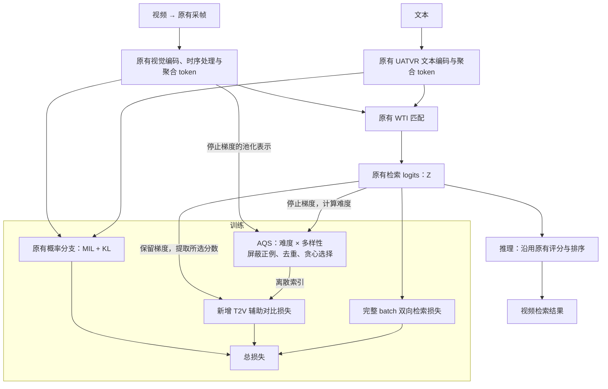

# UATVR + AQS 训练设计：独立于 Laya

日期：2026-10-29。状态：依据用户已讨论方案形成的设计文档，尚未实现或验证效果；不是实验启动授权。

## 1. 目标与范围

在 UATVR 现有视频文本检索训练上，引入受 QueryMatch 启发的 Active Query Selection（AQS）：针对每条文本，从当前全局 batch 的负视频中，贪心选择兼顾检索难度和表示多样性的子集，以辅助对比损失强化学习。

设计问题是：在负样本数量相同时，兼顾难度与多样性的选择是否优于只选择最难负例。这里不声称新颖性、不承诺检索收益，也不将多样性解释为预测不确定性。

范围固定为：

- 保留 UATVR 的文本/视频编码、时序处理、聚合 token、WTI 打分及原有概率辅助训练路径。
- 保留完整 batch 的双向检索损失，新增 T2V 的 AQS 辅助损失。
- 选择单位为整段负视频，不是对象、单帧或局部片段。
- 推理不执行 AQS，不新增视觉检测器、语义 query、局部匹配头或 Laya 评审器。
- 训练允许原有可训练 retriever 参数接收辅助梯度。这是 retriever 训练改动，不属于 frozen-retriever sidecar；不能挂靠旧 sidecar study。

## 2. 代码依据与边界

编写时主仓库 HEAD 为 `43895f270d7c777213a8e7982b9c629376d2de94`，当前分支名为 `codex/laya-validation-v1`。分支名称不代表本方案依赖 Laya。后续实现应从核实过的 UATVR 基线建立独立 `codex/` 分支或 worktree；实际实现基点由 provenance 核对决定，不预先虚构 SHA。

本地 QueryMatch 参考提交为 `83095e072612c96548e0b00abfc05b0e571cde62`。参考仅限其负样本选择思想；不复制整个图像分割框架，不在运行时 import 本地未跟踪的 `QueryMatch/`。

当前代码依据：

| 模块 | 路径 | 已确认行为 |
|---|---|---|
| UATVR 训练及打分 | `src/semantic_retrieval/full_data/upstream_uatvr/modeling.py` | 双向 CrossEn + MIL/KL；检索 logits 为 `exp(logit_scale) * WTI` |
| WTI | 同文件 `weighted_token_wise_intersection` | token 两两匹配、双向最大匹配及可学习权重聚合 |
| AQS 参考 | `QueryMatch/models_querymatch/QueryMatch/head.py` | difficulty 与基于余弦距离的 uniqueness 相乘，贪心选择 |
| Laya 独立链路 | `src/semantic_retrieval/laya_rerank/` | 冻结模型对 UATVR Top-10 进行推理重排序，非本方案依赖 |

原始论文 PDF 尚未成功下载；本设计依据已核对的代码和讨论，不声称逐式复现论文。

## 3. 总体架构

图中不画梯度反向箭头：总损失按既有优化器的参数集合更新模型。AQS 没有可训练参数，离散选择不反传；辅助损失通过原始 logits 回传。

## 4. 输入、身份与候选集合

每个训练样本提供文本、原有视频输入/掩码和稳定的 canonical video ID。ID 只用于正例识别、去重及确定性排序，不作为模型语义输入。

第一版要求一个全局训练 batch 中每个 canonical video ID 只出现一次，每段视频本次采样一条已有描述。这样原有对角正例损失仍然成立，不在本改动中重写为多正例目标。数据层应先确认现有 sampler 是否已满足此条件；若需要调整，AQS 开关两臂必须共享同一 sampler。发现重复 ID 时显式拒绝当前配置，不悄悄将重复项作为负例，也不通过丢行改变 batch。

分布式训练沿用既有特征 all-gather 和全局损失归约方式；新增同步的 ID 顺序必须与 logits 列顺序完全一致。不能额外再次平均或求和一个已经全局归约的损失。

对文本 $t_i$，正视频为 $V_i$，候选负视频集合为

$$
N_i=\{j:\operatorname{id}(V_j)\ne\operatorname{id}(V_i)\}.
$$

本版没有跨 batch 队列、memory bank、额外视频解码或全训练集在线挖掘。不同 ID 仍可能语义相关；本方案不能自动排除这类未知假负例。

## 5. AQS 选择算法

### 5.1 难度

记 $S_{ij}$ 为原有未缩放 WTI 相似度，$Z_{ij}=\exp(\ell)S_{ij}$ 为现有 CrossEn 接收的 logits。难度使用停止梯度的 $S_{ij}$，仅在有效负视频集合内归一化：

$$
h_{ij}=\frac{S_{ij}-\min_{k\in N_i}S_{ik}}
{\max_{k\in N_i}S_{ik}-\min_{k\in N_i}S_{ik}}.
$$

数值规则：分数范围小于等于 $10^{-8}$ 时，令该行所有有效负例的 $h=1$，此时只依赖多样性和确定性 tie-break；空集合不计算 min/max。先验证原分数有限，不能用 NaN 清洗掩盖上游异常。

### 5.2 多样性表示

用时序处理后的原有有效帧 token 做 masked mean，再 L2 归一化得到 $g_j$。只使用真实帧槽位，不混入新增聚合 token；复用既有帧范围和有效帧元数据，不额外调用视觉编码器。

该池化函数须是纯读取，不原地修改 WTI 使用的 token 或 mask；对不安全的既有 helper 使用隔离实现或传入必要副本。Laya 性能测量曾记录文本池化 mask 别名问题，这里仅将其作为回归风险，不导入 Laya 的 monkey-patch 或测量适配器。

表示在选择前 detach，按既有精度策略输出后转 FP32 进行选择计算。零范数、全 padding 或非有限表示视为输入错误，不静默构造正常候选。

### 5.3 贪心选择

初始已选集合 $A_i=\varnothing$，每个候选的 uniqueness 为 1。每轮选择

$$
j^*=\arg\max_{j\in N_i\setminus A_i}h_{ij}u_{ij},
$$

然后更新

$$
u_{ij}=\min\left(u_{ij},\frac{1-\operatorname{clip}(g_j^\top g_{j^*},-1,1)}{2}\right).
$$

第一轮等价于选择最难负视频，后续抑制与已选负视频相似的候选。显式屏蔽已选项，不允许同一视频重复入选。得分相等时按稳定 canonical video ID 顺序选择，不能依赖不稳定的 GPU top-k tie 行为。

每条文本选择 $m_i=\min(M,|N_i|)$ 项。$M$ 是负视频数量，不继承 QueryMatch 的“每张负图选 4 个对象”。本设计不指定科学默认值；$M$ 必须在后续注册配置中明确冻结。配置启用时要求 $M\ge1$；没有有效负例的退化 batch 辅助损失为 0，并记录计数。

多样性相似度矩阵可在全局 batch 内共享，为 $B\times B$；以增量最小距离维护每条文本的 uniqueness。避免构造文本×负视频×帧×帧的高维张量。额外存储主要为 $O(B^2)$，而不是全候选 token 两两矩阵。

## 6. 训练目标与梯度

原有训练损失保持：

$$
L_{\mathrm{base}}=\tfrac12(L_{T2V}+L_{V2T})
+0.01L_{\mathrm{MIL}}+0.0001L_{\mathrm{KL}}.
$$

这里 MIL/KL 系数对应当前核对的 upstream 实现；集成时必须确认包装层没有再次乘权，不能重复缩放。整个 batch 的双向对比分母不被 AQS 替换。

新增损失为

$$
L_{\mathrm{AQS}}=-\frac1B\sum_i
\log\frac{\exp(Z_{ii})}{\exp(Z_{ii})+\sum_{j\in A_i}\exp(Z_{ij})},
\qquad
L=L_{\mathrm{base}}+\lambda L_{\mathrm{AQS}}.
$$

使用稳定的交叉熵/log-sum-exp 实现。直接使用既有缩放 logits $Z$，不再除一次温度；原有可学习 logit scale 沿既有优化器规则接收梯度。$\lambda\ge0$，具体启用值由后续注册配置冻结，不在本设计中当作已验证默认值。

第一版只增加 T2V 辅助项，不做对称负文本选择，不加入局部片段惩罚。固定正例来自视频身份，不采用 QueryMatch 的“本图最高分对象”伪正例。

开关关闭或 $\lambda=0$ 时，完全跳过选择和辅助损失计算，原有前向、随机数消耗及损失返回保持一致。不能先引入有副作用的新计算再乘 0。

## 7. 推理与 Laya 隔离合同

推理继续走既有 UATVR 评分；现有评估配置中的 DSL 等策略显式沿用并记录，不由 AQS 自动改变。推理不需要 video ID 负例集合、AQS 选择器或其辅助损失。训练后的权重和排序可以变化，“推理结构不变”不意味着 R@1 必须不变。

Laya 隔离要求：

1. 新模块、训练入口和评估入口不 import `semantic_retrieval.laya_rerank`，不调用其 judge、缓存、评分或 Top-10 重排。
2. 不加载 Laya 权重/processor；不要求 Laya 环境依赖、外部代码目录或服务可用。
3. 不使用 Laya 的概率、预测、缓存或已有逐查询结果作为负例标签、困难度、筛选规则、伪监督或教师信号。
4. 不向既有 Laya study/registry/数据面写入，不修改、删除或覆盖其代码和历史产物。隔离通过依赖边界与独立入口实现。
5. 不使用 Laya 专属双卡资格或历史科学授权作为新方案的资格。
6. 将 Laya 模块、权重与缓存设为不可访问时，UATVR+AQS 的软件验证应仍然可运行；禁用 AQS 的 UATVR 推理同样不应需要 Laya。

## 8. 建议的实现边界

以下是接口设计，尚未创建这些代码文件：

- 独立包 `src/semantic_retrieval/aqs/`：配置校验、纯池化/表示校验、停止梯度的选择器、有梯度的辅助损失。
- 选择器接收 `scores[B,B]`、`video_repr[B,D]`、`video_ids[B]`、`M`，返回所选列索引、有效长度及诊断计数。
- 损失函数接收原始 `logits[B,B]` 和选择结果，返回标量；不负责模型加载、数据采样或实验生命周期。
- 在独立训练适配层取得原有 logits、帧特征和 ID。优先保持归档的 upstream 源文件不变；若现有 API 不暴露必要信息，先提供显式、可回归核对的训练扩展接口，不能靠 Laya 适配器或运行时替换函数接入。
- checkpoint 保存原有模型状态及明确的 AQS 配置/provenance。选择器无权重；恢复时校验 $M$、$\lambda$、ID/sampler 语义与精度策略，不通过 `strict=False` 掩盖模型不匹配。

## 9. 软件验收要求

验证应覆盖行为差异和真实梯度，而不是仅对实现公式做镜像断言：

- 手工构造候选：第一项最难，后续能避开重复方向；全难度相等、相同表示、tie-break、候选不足及空负集均有确定行为。
- 跨 rank 的同视频重复和 ID/列错位被拒绝；分片/合并顺序变化不影响按身份定义的选择结果。
- 辅助损失对正例和所选负例 logits 有梯度；选择分数和多样性表示无选择路径梯度；确认允许训练的编码参数实际收到辅助梯度，排除 frozen/no-op。
- 禁用或 $\lambda=0$ 时，同输入、权重和精度下，原有损失、logits、随机数状态和梯度与对照一致。
- 启用 AQS 的纯池化不修改 mask/token；包含单样本与多样本场景。无效输入不能静默进入排序。
- 固定 checkpoint、输入与评估设置时，AQS 配置不改变推理 logits/排序；新训练 checkpoint 的结果不要求与旧权重相同。
- 在相同全局候选、精度与归约语义下比较单进程及分布式选择/梯度；浮点容差事先明确，不能失败后放宽。
- 验证 Laya 不可访问时依赖闭包仍成立，且只写新方案自己的产物。
- 新配置、采样器、优化器及随机数状态应支持可核对的断点恢复；不以选择器无参数代替训练恢复验证。

必要诊断包括辅助损失、有效负例数量、所选难度/相似度、多样性、无负例计数及梯度统计。大数组不得嵌入 JSON。

## 10. 风险、研究边界与后续条件

主要风险是语义假负例、反复强化异常难例、池化表示无法代表动作差异，以及 batch 内候选不足。多样性选择只能减少表示重复，不能证明负例可靠。保留完整 batch 损失也不自动保证更优泛化。

判断机制不能仅凭 AQS 对比基线的差值；后续正式研究需区分辅助损失本身、随机选择、只按难度选择与难度×多样性的贡献，并保持候选数量、采样器和其他训练条件可比。本节是判断原则，不规定运行矩阵、GPU 拓扑、预算或启动命令。

本文仅交付设计，不创建 study、预留 run、启动训练或访问 test。任何后续实验规划/执行须先完整读取研究前置文档，以及 `experiments/contextual-risk-v2/study.yaml`、`registry.jsonl` 和实际适用的新 study 控制面，再按仓库现行归档、资格与研究 gate 办理。既有已终止 study 不因本设计复活；其他 study 的双卡或 test 授权不外溢。训练只使用训练集，超参选择及消融使用 validation；test 保持 sealed，除非对应新 study 取得明确授权。

## 11. 自审结论

本版明确了视频级选择单位、唯一视频 batch 契约、难度/多样性公式及边界值、T2V 辅助方向、梯度路径和温度语义；保持完整 batch 与概率辅助损失，并给出 Laya 无依赖边界。$M$、$\lambda$、实现基点和运行资源属于后续注册配置，不作为可执行默认值。当前没有实现、性能或精度成功声明。
