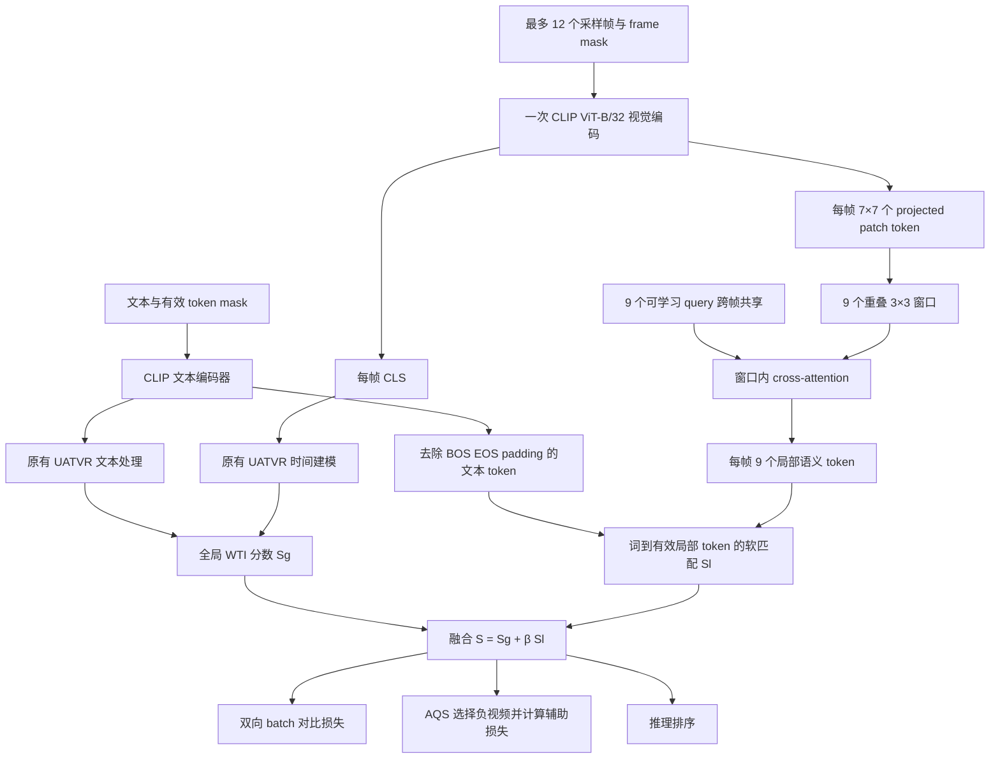

# UATVR + AQS 局部语义 Query 分支设计

日期：2026-10-29
状态：设计稿，尚未实现、验证或训练。
代码基线：`f996782`，分支 `codex/uatvr-aqs-training-v1`。

## 1. 目标与边界

在现有 UATVR + AQS 上增加空间局部证据，让文本中的不同语义成分能够从一段视频的不同局部位置获得支持，缓解单个帧向量混合多个对象、动作与背景的问题。

第一版采用“全局 UATVR 分支 + 每帧 9 个固定窗口的局部 query 分支”。保留全局时间建模、原有损失和负视频选择；新增局部匹配分数。新增的不确定性 KL 融合关闭，已有实现保留，以后是否组合由独立证据决定。

这是结构设计，不是实施文档、实验预留或训练授权。本文不确定新的科学实验超参数，不启动 GPU，不访问 sealed test，不复活已终止的 study。

## 2. 与 QueryMatch 的关系

借鉴的是“先形成较明确的视觉候选，再与文本进行匹配”的思路。QueryMatch 的对象 query 来自预训练视觉模型；本方案使用固定窗口和可学习 query，不继承对象检测或分割监督。

因此，本文中的局部 query 输出称为**局部语义 token**，不能直接称为对象、实例或目标框。窗口给出空间归纳偏置；视频与文本的检索监督驱动其学习有用内容，但不能保证每个 token 对应一个独立对象。

参考：[QueryMatch 官方仓库](https://github.com/TensorThinker/QueryMatch)、[论文](https://openreview.net/pdf?id=eLpaw4H2Nh)。不引入 QueryMatch 的运行时依赖、检测器或分割器，也不接入 Laya。

## 3. 总体结构

全局分支承担视频级语义与原有时间关系。局部分支第一版只提供空间证据，不增加局部时间 Transformer、对象跟踪、额外帧采样或文本条件的视频编码。视频局部 token 可离线缓存，匹配阶段再读取文本。

## 4. 输入与窗口范围

沿用现有数据预处理和最多 12 帧的采样协议。对每个经过 resize/crop 的 224×224 输入帧，ViT-B/32 产生 7×7 个 patch token，另有一个 CLS。

使用零基索引，行列范围均为 `0..6`。窗口中心为：

\[
\mathcal C=\{1,3,5\}\times\{1,3,5\},\qquad
\mathcal W_{a,b}=\{(r,c):|r-a|\leq1,\ |c-b|\leq1\}.
\]

共 9 个窗口，每个含 9 个 patch，步长 2。三种行范围是 `0..2`、`2..4`、`4..6`，列范围相同；所有 49 个 patch 均被覆盖，窗口之间允许重叠。patch 的展平索引为 `7*r+c`，视觉序列中应先去掉 CLS 再使用此索引。

每个窗口的名义覆盖是处理后图像中的 96×96 像素。这个范围不是原始视频坐标中的固定框：裁剪缩放会改变映射，CLIP 高层 patch token 的自注意力也已经融合窗口外的信息。

选择 3×3 是便于检查、成本有限的起点，没有证据表明它最优。第一版不增加可学习窗口大小、动态 mask 或多尺度窗口。

## 5. 视觉特征提取与局部 query

当前 `VisualTransformer.forward` 已计算 `ln_post(x) @ proj` 后的全部 50 个 token，随后用 `x[:, 0, :]` 丢弃 patch。新增显式适配接口，在同一次视觉前向中取得：

- CLS：`[B, F, 512]`，继续送入原有 UATVR 全局分支。
- patch：`[B, F, 49, 512]`，送入新增局部分支。

不得重复运行视觉编码器，也不使用 forward hook 修改运行时行为。不直接编辑 vendor 文件；通过项目内显式适配层暴露双输出，并验证其 CLS 与原实现一致。沿用原 CLIP 参数名称、初始化和冻结策略，不重新初始化骨干。

定义 9 个可学习向量 `q[k] ∈ R^512`，按窗口中心行优先排序。不同窗口拥有不同 query；同一窗口的 query 以及全部 attention 参数在所有帧之间共享。

对帧 f、窗口 k，设其 9 个 patch 为 `P[f,k]`：

\[
u_{f,k}=\operatorname{MHA}(q_k,P_{f,k},P_{f,k}),\qquad
o_{f,k}=\operatorname{normalize}\bigl(\operatorname{LN}(q_k+u_{f,k})\bigr).
\]

第一版使用一层、8 个头、维度 512 的 cross-attention，带输出投影、残差和 LayerNorm，dropout 为 0，不增加 FFN。每次只提供该窗口的 9 个 key/value，从接口上保证窗口限制。保留 patch 已有的位置语义，不新增一套空间位置编码。

有效帧最多产生 108 个局部 token。padding 帧的 token 不参与匹配；其输入变化不能影响任何有效视频分数。同一个 k 表示同一网格位置，不表示跨帧同一对象，不应建立跟踪正例。

## 6. 文本与局部匹配

局部分支复用 `encode_text` 返回的 CLIP 上下文文本 token，位于全局 UATVR 额外文本处理之前，不增加第二个文本编码器。全局分支仍使用原有处理，两个分支的表示来源须在接口中明确区分。

局部 mask 排除 BOS、EOS、padding，以及 UATVR 后续增加的聚合 token。这里的“词”实际是 CLIP 子词 token，不假定一个 token 就是一个完整单词或语义短语。

第一版对有效文本 token 使用均匀权重，避免额外引入一个未验证的词权重模块。设有效文本索引集合为 A_i，视频 j 的有效帧窗口集合为 U_j；全部特征先做带 epsilon 的 L2 归一化：

\[
c_{ia,jfk}=t_{ia}^{\top}o_{jfk},\qquad
p_{ia,jfk}=\frac{\exp(c_{ia,jfk}/\tau_l)}
{\sum_{(f',k')\in U_j}\exp(c_{ia,jf'k'}/\tau_l)},
\]

\[
S_l(i,j)=\frac{1}{|A_i|}\sum_{a\in A_i}
\sum_{(f,k)\in U_j}p_{ia,jfk}\,c_{ia,jfk}.
\]

`τ_l > 0` 是显式固定配置，训练和推理一致，不在本文指定经验值。先按词搜索整段视频的局部证据，再聚合各词；不先将所有局部 token 平均成一个视频向量。该分数有方向性，但对称检索损失直接使用同一分数矩阵及其转置，不另造一个 V2T 局部评分器。

没有有效词或没有有效帧的输入在 local-enabled 模式下显式拒绝；不得对全 mask 执行 softmax 或默默产生 NaN。仅含 BOS/EOS 的旧输入仍可走关闭局部模块的原路径。

这种聚合允许多个词共享同一局部证据，也允许一个词读取多个窗口，不强制一对一对齐。空间位置重叠、帧重复以及采样密度会影响 softmax 权重，因此固定原帧采样，完整记录有效 token 数，不把 attention 权重解释成定位真值。

## 7. 分数融合、训练目标与负样本

令 `S_g` 为当前全局 WTI 输出中尚未乘 CLIP logit scale 的分数，定义：

\[
S(i,j)=S_g(i,j)+\beta S_l(i,j),\qquad \beta\geq0.
\]

β 是显式固定配置，不使用可学习门控或不确定性自动调权。先融合原始分数，再按原有逻辑乘一次 logit scale。训练、AQS 选样和推理必须共用评分接口，防止局部分支只参与训练或重复缩放。

\[
\mathcal L=\mathcal L_{\mathrm{batch}}(S)
+\lambda\mathcal L_{\mathrm{AQS}}(S)
+\mathcal L_{\mathrm{legacy}}.
\]

`L_batch` 为现有双向 batch 对比目标；`L_legacy` 代表原有 UATVR MIL、legacy VIB 等辅助目标及其原系数，不增加针对局部 token 的新 KL 或伪标签损失。保留旧目标并不意味着新局部 query 自身有概率分布。

AQS 仍在跨 rank 汇集后的候选中按**视频身份**排除正例及同身份视频，选择 M 个困难负视频。hardness 从融合分数的 detached 副本计算；损失读取保留梯度的融合分数。沿用现有合法候选数检查、排序及分布式契约。

正视频是一组局部候选组成的正 bag，不要求其每个窗口都与文本匹配，也不把其中未选中的窗口标成负样本。不照搬 QueryMatch 的对象伪正例或对象负样本策略。已有 M=16、λ=0.2 只是历史 AQS 起始配置，不构成该新结构的最优参数结论。

## 8. 新增 KL 与 Laya 隔离

第一版运行配方须同时满足 `fusion.enabled=false`、`eta=0`。局部功能开启时，若请求启用新增 Gaussian/KL 分数融合，配置解析直接拒绝；不能只在文档中约定关闭。

现有 `fusion_*` 实现和测试保留，不删除、不重写。本文新增的 β 是局部分数系数，与旧 η 完全不同。原 UATVR 的 legacy VIB 保留原行为，不因“关闭新增 KL”而被移除。

新模型不导入 Laya，不读取其缓存、checkpoint、分数或配置，不调用其训练或重排流程。

## 9. 工程接口与兼容性

使用独立架构标识 `uatvr-aqs-local-query-v1` 和独立模型适配层，复用现有 AQS 选择与损失逻辑。新增配置至少记录局部开关、固定窗口规范版本、query 数、维度、head 数、β、τ_l、文本 mask 和聚合方式。

关闭局部功能或 β=0 时，模型工厂在创建新参数之前直接选择旧 AQS 路径；不得多消耗初始化随机数、改变旧 checkpoint 结构或执行额外 patch 提取。用于配对比较的骨干初始化必须相同。

局部开启后的模型包含新增参数，旧 checkpoint 只能通过显式、可追踪的 parent initialization 初始化公共部分，并初始化局部模块；不能称为精确续训。精确恢复必须校验新架构、全部参数、优化器、随机状态与配置。不得把旧 KL checkpoint 的恢复绑定当作新架构的恢复协议。

训练时局部 token 的跨 rank 汇集必须保留梯度，frame mask、文本 mask 与身份元数据必须使用相同顺序。视频缓存仅存与文本无关的 token，绑定源码、checkpoint、预处理、窗口与特征规范；不得只缓存某条文本条件下的 attention 结果。

局部匹配的工作量随文本数、视频数、文本长度和有效局部 token 数共同增长。不得物化整个数据集的 `[Q,V,L,F,9]` 张量；训练和评估使用文本/视频分块，确保分块前后分数、损失和梯度一致。训练分块的 autograd 存储也需计入内存，必要时使用重计算；不能仅凭 token 数宣称显存开销很小。

## 10. 验收要求

实施文档应把以下条件落实为可验证的检查，不在此启动训练：

1. 窗口索引精确覆盖 49 个 patch，每窗 9 个，无 CLS、越界或跨帧索引；窗口输入扰动验证 query 无法直接读取窗外 token。
2. 双输出适配器的 CLS 与原视觉前向一致，视觉编码器每批只执行一次，公共参数加载与冻结策略一致。
3. BOS/EOS/padding 不参与局部分数；padding 帧输入扰动不改变有效分数；全 mask 输入明确拒绝。
4. 局部分数在分块与非分块、小规模手算参考之间一致；训练和推理使用相同公式。
5. 单独从局部检索损失反传时 query、attention 投影及允许训练的编码器参数获得有限梯度；负视频选择本身不反传。
6. β=0 或关闭局部功能时，与旧 AQS 的分数、损失、初始化随机状态及恢复行为一致。
7. 跨 rank 候选、重复身份过滤及视频 mask 对齐正确；新架构恢复拒绝不兼容配置。
8. 新 KL 配置冲突被拒绝，Laya 不在依赖链中，旧模型测试继续通过。

后续若获准比较，应先判断局部分支相对相同协议的 AQS 基线是否提供增益，再讨论窗口范围或 KL 组合。不能从新增模块存在、attention 可视化或单次 Recall 波动推断对象对齐已经成立。

## 11. 能力限制与研究约束

该设计无法保证短语级组合、对象身份、跨帧连续性或动作先后关系。局部输出仍受 CLIP 全局上下文影响；均匀词权重也可能放大功能词噪声。全局分支用于保留整句语义和原有时序能力，局部分支的独立贡献仍需验证。

相邻采样帧不等于连续视频帧，也不对应固定秒数，因此第一版不采用 `t±1` 局部时间范围。将来若加入时间窗口，必须单独定义真实时间跨度和对象漂移处理。

任何后续实验均先遵守 [research 入口](../../../research/README.md) 与 [归档规则](../../agent/experiment-artifacts.md)，读取对应 study 和 registry，确认研究 gate、干净源码、预留与资格要求；本文不继承其他 study 的双卡豁免，不授权 test。

## 12. 实施定位

- 视觉 token 丢弃位置：`src/semantic_retrieval/full_data/upstream_uatvr/nn_components/module_clip.py` 中 `VisualTransformer.forward`。
- 当前模型编码接口：`src/semantic_retrieval/full_data/models.py` 中 `encode_text`、`encode_video`。
- 全局 WTI 与原有时间/文本处理：`src/semantic_retrieval/aqs/core.py`。
- AQS 设计：[现有设计](2026-10-29-uatvr-aqs-design.md)。本文扩展其“无局部分支”的初版范围，旧配置行为仍需保留。
- 新增不确定性实现：[KL 设计](2026-10-29-uatvr-aqs-uncertainty-kl-design.md)，保留但不在本版启用。

下一阶段为根据本设计撰写实施文档，再进行代码开发；本稿没有修改模型、数据、训练入口或实验配置。
